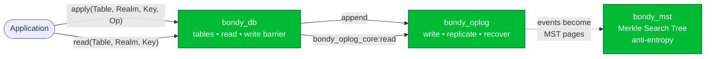
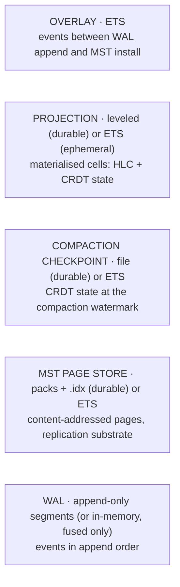
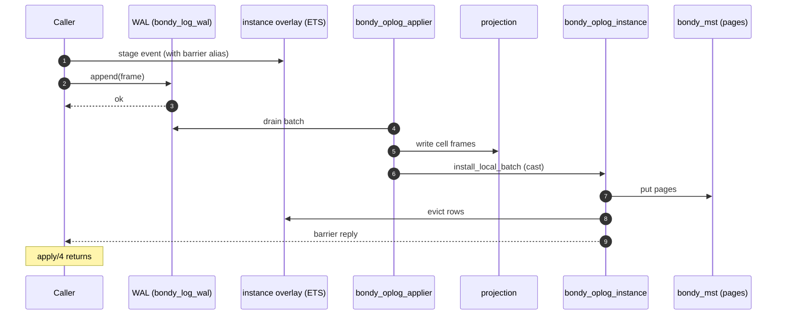
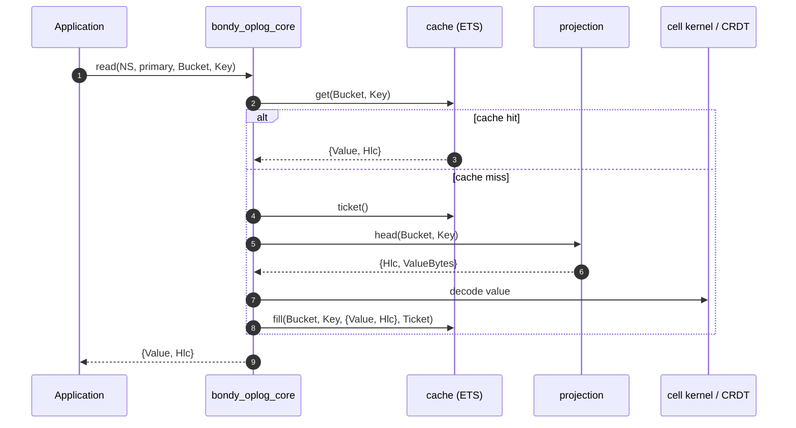
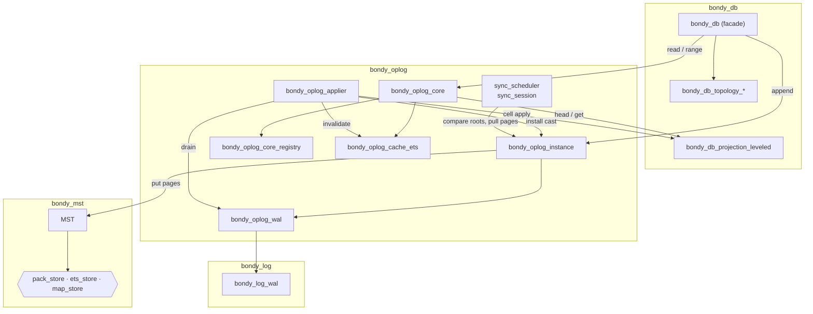

# The storage packages

> Audience: anyone who wants the mental model before reading any code.
> Time to read: ~10 min.

Bondy's storage is a small stack of packages behind one facade. Each has a
distinct job and a narrow interface:

- **`bondy_oplog`** is the **write side**. It appends events durably,
  replicates them to peers, and recovers them after a crash. Its WAL is a
  writer from **`bondy_log`**, the segmented log core.
- **`bondy_mst`** is the **replication structure**: a Merkle Search Tree that
  lets two peers find the events one of them lacks without sending
  everything they hold.
- **`bondy_db`** is the **facade**. Applications open tables, write and read
  through it. Its reads use the read primitives in `bondy_oplog_core`, which
  is part of the `bondy_oplog` application.

The applier, the projection, the cache and the CRDT catalogue connect these
packages.

The packages are **layered**, and their dependencies run one way:
`bondy_db` → `bondy_oplog` → `bondy_log` → `bondy_mst`. Each layer also has its
own leaf dependencies: leveled under `bondy_db`, and `bondy_cluster` and
Partisan under `bondy_oplog`. `scripts/check_layering.escript` checks the
static call graph of `bondy_db`, `bondy_oplog` and `bondy_mst` and fails on
any call from a lower layer to a higher one. The higher layer wires itself
into the lower one by dependency injection: `bondy_db` passes its leveled
projection adapter as an option, so `bondy_oplog` calls it with no static
edge. A layer configures the one below through that layer's public API:
`bondy_db:open/2` passes per-instance options to
`bondy_oplog:start_instance/2`, and those options select the `bondy_mst`
store backend. One environment key crosses a layer: at start, `bondy_db` sets
`bondy_oplog`'s `latency_probe` to `{bondy_db, probe_write}`.

## The 30-second picture

Three things to note before going further:

1. **Applications read through `bondy_db`.** A read goes to the cache and
   the projection, not to the log of events.
2. **The MST is not a key/value store.** It is the structure that peers use
   to agree on a set of events. The materialised key/value cells live in the
   projection (leveled on disk, or ETS for an ephemeral table).
3. **There is no leader.** A node writes locally and converges by pulling
   the MST pages it lacks from its peers.

## Layered storage

Each oplog instance owns one shard and stacks these layers:

The WAL is not an unbounded history. Compaction folds the events that every
peer holds into the checkpoint and truncates them from the MST. Once the
checkpoint is durable, the instance advances the WAL's snapshot watermark,
and the WAL deletes the segments below it
(`bondy_oplog_compaction_durable_test:compaction_advances_wal_watermark_and_sweeps`).
[Chapter 06](06_compaction_and_bootstrap.md) covers the cycle.

## Following a write end-to-end

A client calls `bondy_db:apply(Table, Realm, Key, Op)`. The facade picks the
shard and calls `bondy_oplog:append_applied/4` on that shard's instance. This
is the happy path:

Notes on what the diagram leaves out:

- When the instance publishes a fast path, the caller's own process signs
  the event, stages the overlay row and then appends to the WAL. The row is
  staged first because the applier can read the frame as soon as it is
  durable. Without a fast path the append goes through the instance
  gen_server.
- The WAL writes one frame per append. Through the oplog adapter, one event
  becomes one `term_to_binary([Event], _)` body.
- The applier writes the projection *before* it casts the install to the
  instance. The instance evicts the overlay row after the MST install and
  then replies to the waiting caller. `apply/4` therefore returns after the
  projection holds the write.
- Replication is pull-only. The responder of a peer serves only read
  requests (roots, frontiers, pages, catalogue snapshots), and a sync session
  pulls the pages its own MST lacks. Whether two nodes hold the *same data* is
  a separate question, answered by the per-instance **applied frontier**,
  because compaction empties the MST and an empty MST's root says nothing
  about its contents
  (see [chapter 06](06_compaction_and_bootstrap.md#the-applied-frontier-the-convergence-oracle)).
- **An ephemeral table can be fused.** The applier collapses into the
  instance, which runs drain, verify, apply and install itself. A fused
  instance can also use the in-memory WAL (`wal_backend => mem`), so the
  write path does no disk I/O. Peers hold the data through anti-entropy.
  See [chapter 01](01_bondy_oplog.md).

## Following a read end-to-end

`bondy_db:read(Table, Realm, Key)` computes the shard and calls
`bondy_oplog_core:read(NS, primary, Bucket, Key, #{shard => Shard})`:

A read touches two storage tiers: the cache and the projection. The
**CRDT module** of the table ([chapter 05](05_crdt_model.md)) decides what a
cell's state means. `bondy_oplog_core` can also merge a per-shard read overlay
of pending events into a read. `bondy_db` registers every shard with
`overlay = disabled`, so Bondy reads never take that path.
[Chapter 03](03_bondy_db.md#read-your-writes-and-the-write-barrier) explains
why.

## How the packages talk to each other

The arrows worth flagging:

- **`bondy_db` names the projection adapter, `bondy_oplog` calls it.** The
  applier and `bondy_oplog_core` reach `bondy_db_projection_leveled` only
  through the adapter module stored in the registry entry of the shard.
- **The applier writes primary cells on a non-fused instance.** A fused
  instance writes them itself. After each projection write the writer deletes
  the cache entry for that cell. Readers share the same projection handle
  through `bondy_oplog_core_registry`.
- **The pack store** is one of three `bondy_mst_store` implementations.
  A durable instance uses it. An instance opened with `backend => ets` uses
  the ETS store.

## Why this shape?

A handful of architectural commitments explain the chapters that follow:

1. **Durable state is the WAL above the snapshot watermark, the MST, the
   projection and the compaction checkpoint.** The WAL gives each write its
   durability point. Compaction bounds the WAL and the MST together.
2. **Per-cell HLC.** Each projection cell carries the HLC of its latest
   applied event. Reads return `{Value, Hlc}`, so causality is exposed, not
   hidden.
3. **Per-table CRDT, pure operation-based.** The substrate is CRDT-agnostic:
   it replicates *operations* (opaque terms) and causal metadata. What a write
   means for a table is defined by a module that implements the
   `bondy_oplog_crdt` behaviour. Types such as counters and LWW registers
   declare `tier_0` and order by the HLC alone. Types that detect concurrency
   (multi-value register, add-wins and remove-wins maps and sets, the flags)
   declare `tier_2` and carry a per-cell causal context. See
   [chapter 05](05_crdt_model.md).
4. **One facade.** Applications write and read through `bondy_db`.
5. **No consensus.** Convergence is by anti-entropy over the MST (carried
   over Partisan in a Bondy deployment). A wall-clock **freshness fence**
   serves namespaces that need bounded staleness, such as the security
   tables. A completed sync round that reaches a peer stamps the shards of
   the instance as in contact with its peers, so an idle security shard stays
   fresh.
6. **The MST is bounded.** Once the cluster confirms it holds an event,
   compaction removes the event from the MST and folds it into the
   compaction checkpoint of the instance. New replicas bootstrap from a
   catalogue snapshot, not from the full history
   ([chapter 06](06_compaction_and_bootstrap.md)).
7. **Convergence is judged by the applied frontier, not the MST root.**
   Because the MST empties, root equality cannot answer "do two nodes hold
   the same data?". Two converged peers in different compaction states show
   different roots, and two fully compacted peers both show `undefined`. Each
   instance keeps an **applied frontier**, a per-origin version vector
   `#{Origin => max Seq}` of applied events, and peers compare frontiers
   ([chapter 06](06_compaction_and_bootstrap.md#the-applied-frontier-the-convergence-oracle)).
8. **Changes are observable.** A table opened with `publish => true` publishes
   a node-local event for each applied write. A write that arrives from a
   *peer* through anti-entropy publishes a distinct *merge* event, which a
   node-local reactor uses to act on what another node did
   ([chapter 03](03_bondy_db.md#change-notification)).
9. **A node's main job is routing, and storage work yields to it.**
   Anti-entropy runs under a node-wide concurrency cap and a fixed page
   budget per round. A per-shard throttle quiets converged shards, and an
   opt-in load-reactive yield defers reconciliation while the node is busy.
   Instances that back the freshness fence are exempt from the cap, the
   throttle and the yield
   ([chapter 06](06_compaction_and_bootstrap.md#keeping-anti-entropy-subordinate-to-routing)).
   The durable MST seals packs off the install path by default
   (`pack_seal_mode`, default `async`; chapter 02 in the bondy_mst library
   docs). A per-instance heap monitor reclaims transient garbage
   ([chapter 01](01_bondy_oplog.md#the-instance-heap-monitor)).

## Where next?

Read the chapters in order. The write side teaches what an event is. The MST
chapter teaches how peers find their disagreements. Then come the read side
and the applier that connects them.

If you have time for one more chapter only, read 02 — bondy_mst (in the
bondy_mst library docs). The MST is the idea the rest of the stack is built
around.

## Pointers

- These chapters are the architecture reference. The module docs carry the
  implementation-level contracts (wire formats, options, invariants).
- Modules to skim before reading further: `bondy_db.erl`, `bondy_oplog.erl`,
  `bondy_oplog_core.erl`, `bondy_mst.erl`.
