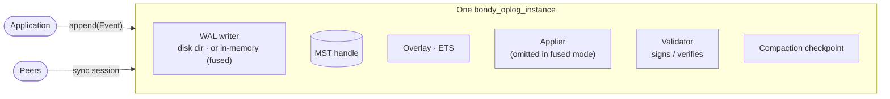
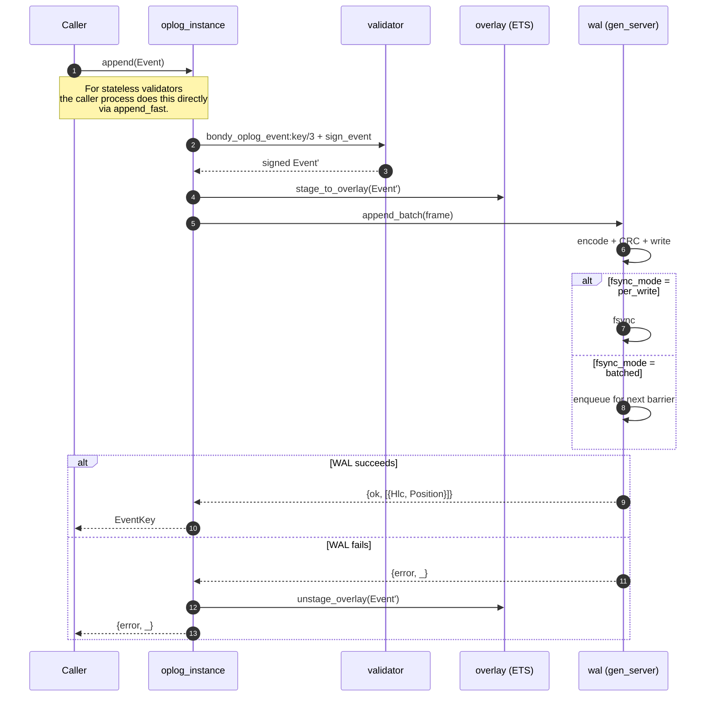
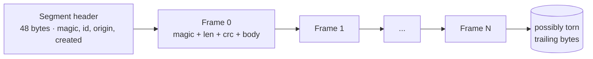
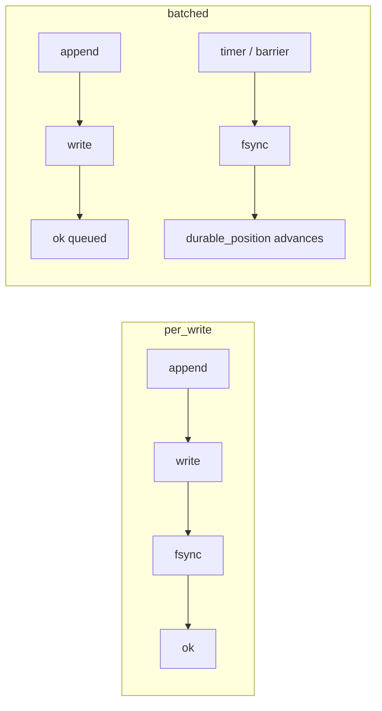
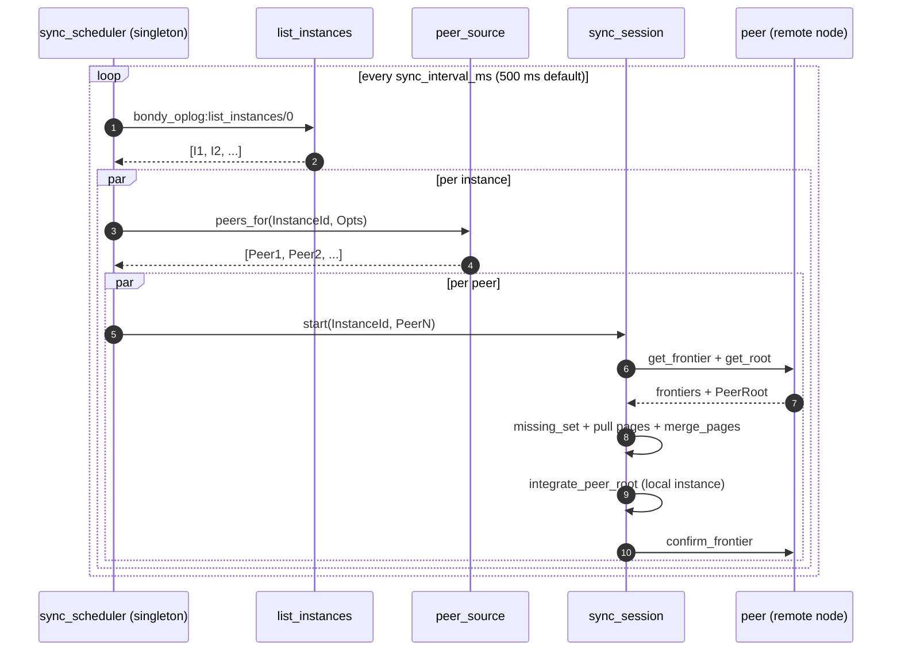
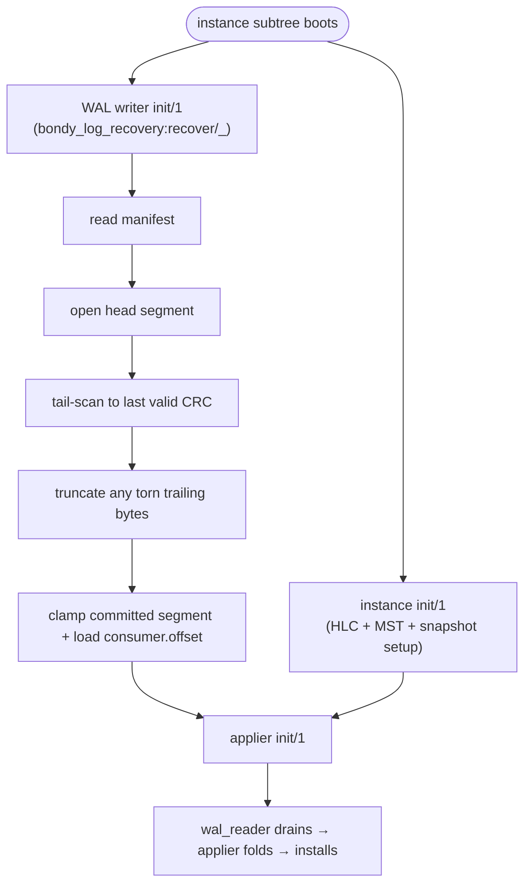
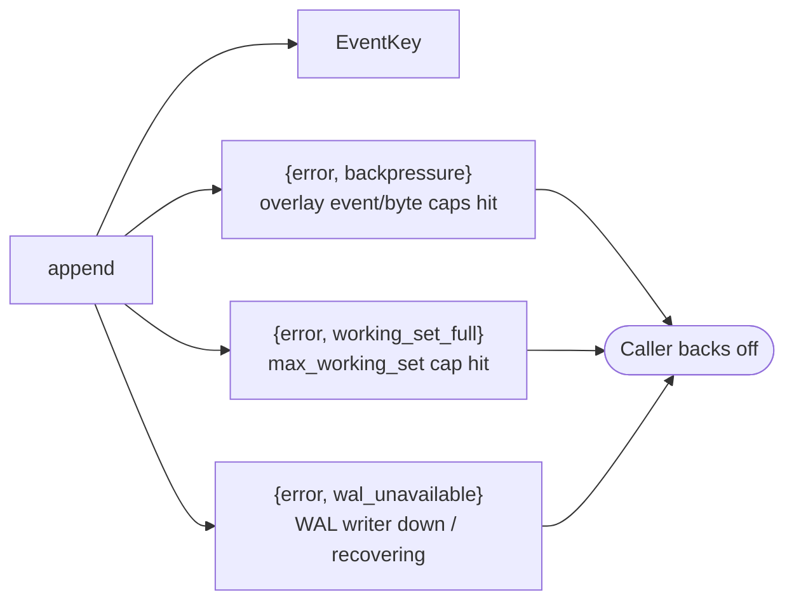
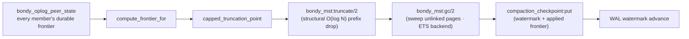

# bondy_oplog: the write side

This chapter explains what happens between `bondy_oplog:append/2` and the
point where an event survives a power cut, reaches every peer, and finally
leaves the log. It is written for a reader who knows the overview in
[chapter 00](00_overview.md) and wants the mental model of the write side
before reading its code.

The oplog has four jobs:

1. **Frame** each event into a known shape: an `{HLC, Origin, Seq}` key, an
   operation, optional metadata and a signature.
2. **Persist** each event in the write-ahead log (WAL) of its instance.
3. **Replicate** events to peers without a leader, through the MST.
4. **Recover** events from the WAL after a crash.

A fifth job follows from the first four: the oplog truncates itself, so the
log does not grow without bound.

## The instance

A `bondy_oplog_instance` is the smallest replicated unit. One instance owns
one MST, one WAL, one overlay, one validator and one compaction checkpoint.
A durable instance also has an applier, the process that materialises
events into the projection ([chapter 04](04_applier.md)). Several instances
run side by side on one node, and they share no state.



The instance is a gen_server, but two paths do not go through it. A read by
instance id (`bondy_oplog_instance:get/2`) looks up the overlay and the MST
handle in the registry. When the validator is stateless, `append_fast`
builds, signs and appends the event in the caller's process. The gen_server
serialises the rest:

- appends that need a stateful validator (`append`, `append_many`);
- single peer-event installs (`install_remote`);
- MST page exchange (`get_pages`, `merge_pages`, `missing_set`,
  `integrate_peer_root`);
- compaction (`compact`, `truncate_prefix`);
- applier barriers (`drain_install_queue`, `await_overlay_drained`). In
  fused mode the instance services these itself between drain slices.

## Events and their keys

Every event carries an **event key**:

```
{HLC, Origin, Seq}
```

- **HLC** is a 64-bit Hybrid Logical Clock value. Each instance keeps its
  own clock, and the clock never runs backwards. When a sync merges events
  with a higher HLC, the instance advances its clock past them.
- **Origin** is an opaque binary that identifies the replica that created
  the event. The default origin is a random 128-bit value
  (`bondy_oplog_origin:default/0`). Two replicas never share an origin
  unless an operator configures the same `origin` for both.
- **Seq** is a per-origin counter. It increases with every event of that
  origin and is never reused. A failed append returns its sequence numbers,
  so the sequence of an origin has no gaps.

The event key is the sort key of the MST. Keys sort by HLC first, then by
origin, then by sequence. Peers agree on the order of events without
consensus, because the order is part of the data.

The event also carries an **operation**. The oplog never interprets it; its
meaning lives in the CRDT module of the table
([chapter 05](05_crdt_model.md)). The optional `meta` field carries the
causal metadata of the tier, and the validator adds a signature.

## The append path



Two properties of this path matter to everything downstream:

- **The instance stages the overlay row before the WAL append.** The applier
  reads an event from the WAL as soon as the WAL commits it. If the overlay
  row came later, the applier could evict a row that does not exist yet, and
  the late row would stay as an orphan. When the WAL refuses the batch,
  `unstage_overlay/2` removes the rows again.
- **The caller returns before the applier runs.** A returned key means that
  the WAL accepted the frame and the overlay serves the event. Under
  `per_write` the frame is also on disk. It does not mean that the event is
  materialised in the projection.

## The WAL on disk

The WAL keeps one directory per instance. Each segment has a 9-digit id:

```
{wal_dir}/{instance_id}/
    manifest
    consumer.offset
    snapshot.watermark
    000000000.qdata
    000000000.qidx
    000000001.qdata
    000000001.qidx
    ...
```

When `wal_dir` is not set, the supervisor derives the directory from
`storage_path` through `bondy_oplog_path`. Each segment file looks like this:



Each frame has this layout (`bondy_log_frame`):

```
Magic | FrameLen | CRC32 | FrameVersion | Flags | Body (list of events, ETF)
```

The frame is the unit of atomicity: a batch of events becomes one frame.
When a crash leaves a partial frame at the tail of the head segment,
recovery truncates the segment back to the last frame with a valid CRC.

The `.qidx` file next to each segment is a sparse key index
(`bondy_log_idx`). It maps the key range of a frame to its byte offset, so a
reader can seek to a target key without a full scan. The index only
accelerates seeks: when it is missing or stale, the reader scans the
segment, and recovery rebuilds the file.

### Two fsync modes

The `fsync_mode` option of an instance selects its durability policy. The
durable main database reads it from the `wal_fsync_mode` setting, whose
default is `per_write`.

| Mode | When `append` returns | Trade-off |
|---|---|---|
| `per_write` | After the fsync. | Every acknowledged event is on disk. Throughput is bounded by the fsync rate of the device. |
| `batched` | After the write, before the fsync. `await_durable/3` waits for the fsync. | Higher throughput. An acknowledged event can be lost until the next fsync. |



Both modes are pure Erlang. The PropEr properties in
`bondy_oplog_wal_proper_test` cover torn writes, failed fsyncs in both
modes and truncation safety.

## Fused mode

A table can put its instances in **fused mode**
(`oplog_instance_opts => #{fused => true}`). Only an ephemeral table can do
this. In fused mode the instance gen_server has no separate applier: it
drains its own WAL and runs the whole pipeline inline:

```
drain → verify → cell-apply → MST install → publish → overlay evict
```

`fused_apply_batch/2` in `bondy_oplog_instance.erl` reuses the stages of the
applier that hold no state, and it emits the telemetry events of the
applier. Dashboards therefore see one write path. The supervisor omits the
applier child. It also omits the scrubber child when the WAL is in memory.

**The fused drain yields.** After a bounded number of batches, the instance
re-queues its drain message and returns to its mailbox. Compaction calls,
`integrate_peer_root` and write barriers therefore run between drain
slices. Without the yield, a sustained load would starve them behind an
unbounded drain.

### The in-memory WAL

A fused instance can also select `wal_backend => mem`. The disk WAL is then
replaced by `bondy_oplog_wal_mem`, an ETS `ordered_set` keyed by a dense
monotonic sequence. The acknowledgement path has no fsync and no disk I/O.
Appends run in the caller's process (`append_local/2`): each caller reserves
a sequence range from an atomic and inserts its rows directly. The fused
drain reads the table through an `ets:next/2` cursor
(`bondy_oplog_wal_mem_reader`) and stops at the first gap. The WAL deletes
each prefix once the drain commits it. The `max_live_events` cap returns
`{error, wal_full}`, the same backpressure shape as the disk WAL.

The rest of the instance sees the same gen_server protocol as
`bondy_oplog_wal`: `append_batch`, `await_durable` and
`set_committed_segment`.

The cluster provides the durability of an in-memory WAL. The projection and
MST of an ephemeral table already live in memory, so node death loses them
whatever the WAL backend. Anti-entropy then restores the data from peers.
Dropping the local fsync widens the loss window by one case: a BEAM crash
on a node whose disk survives. Anti-entropy covers that case the same way.
Durable tables never use the in-memory WAL: the supervisor honours
`wal_backend => mem` only for fused instances, and otherwise it logs a
warning and uses the disk WAL.

## Replication by anti-entropy

`bondy_oplog` replicates without a leader, and anti-entropy over the MST is
its only replication path. A local append stages the overlay row and writes
the local WAL. A peer learns about the event when one of its sync sessions
compares MST roots with this node and pulls the pages it lacks.

Two mechanisms make this work:

1. The **MST** is a content-addressed tree. A sync session compares the
   root of the peer with its own. When they differ, the session walks the
   tree of the peer and requests only the pages that the local store lacks
   (`missing_set`), a bounded batch per round. The MST chapter in the
   bondy_mst library docs (`02_bondy_mst.md`) explains the structure.
2. One node-wide **`bondy_oplog_sync_scheduler`** ticks every
   `sync_interval_ms` (default 500 ms). On each tick it walks the running
   instances. For each instance it asks the configured peer source for a
   set of peers, and it starts one `bondy_oplog_sync_session` per peer
   (`bondy_oplog_sync_session:start/3` by default).



The session is short-lived and asynchronous. It does not block writes, and
the next tick retries a failed session.

### How peer events enter an instance

Peer events do not pass through the local WAL or the overlay. When every
page reachable from the root of the peer is in the local store, the session
calls `integrate_peer_root` on the local instance. The instance merges that
tree into its own MST and then delivers the new events to the projection. A
fused instance folds them inline. A durable instance asks its applier to
fold them. `bondy_oplog:append_remote/2` installs a single peer event
through the same delivery point, but no Bondy component calls it, so the
sync cadence sets the floor on cross-node visibility.

### Which frontiers a round exchanges

Root comparison tells a session which pages to pull. It does not show that
two nodes hold the same data: compaction empties the MST, so the root of a
converged instance is `undefined`. The **applied frontier** answers that
question instead. It is a per-instance `#{Origin => max Seq}` version vector
over the applied events, and compaction does not change it. The
`get_frontier` request returns the applied frontier and the **durable
frontier** of the peer. The session compares the applied frontiers. When the
peer has no pages left to serve and its applied frontier is ahead, the
scheduler flags a **catalogue re-bootstrap**. At the end of a complete
round the session records the durable frontier of the peer in
`bondy_oplog_peer_state`, and `confirm_frontier` hands the peer its own.
Compaction reads those recorded durable frontiers as its witnesses. The
construction and recovery of the applied frontier are in
[chapter 06](06_compaction_and_bootstrap.md#the-applied-frontier-the-convergence-oracle).

### Cadence and freshness

A converged instance has nothing to pull, so the **live-sync throttle** (on
by default) backs off its poll window while its MST root stays quiescent, up
to `live_sync_max_ms` (default 5 s). An instance that backs the read-side
freshness fence is never throttled. The rules are in
[chapter 06](06_compaction_and_bootstrap.md#the-live-sync-adaptive-throttle).

A complete round also advances the freshness signal of each shard the
instance backs. `bump_ae_on_sync/2` stamps the `ae_atomics` timestamp of
each `(NS, primary, Shard)` with the current monotonic time, even when the
round pulled nothing. That heartbeat lets a low-churn shard show that it is
still in contact with its peers. An **isolation policy** (`refuse`,
`proceed` or `quorum`; default `refuse`) decides whether a round may certify
freshness. Under `refuse`, a node that reaches no peer does not certify its
own data. The policy lives on the side that produces freshness, so the read
path stays a single atomic read. [Chapter 03](03_bondy_db.md#the-freshness-fence)
explains the fence that reads the signal.

### Transports

The transport is a behaviour (`bondy_oplog_transport`) with three
implementations:

- `bondy_oplog_transport_partisan` carries sync traffic over the Partisan
  overlay that Bondy uses for cluster membership and messaging. A Bondy
  node uses this transport.
- `bondy_oplog_transport_disterl` uses Distributed Erlang.
- `bondy_oplog_transport_inline` calls the peer in the same VM, for tests.

## Recovery on boot



- Recovery runs in the `init/1` of the WAL writer, not in the `init/1` of
  the instance.
- The manifest is small and the writer replaces it atomically.
- The tail scan reads at most the head segment, whose size
  `max_segment_bytes` bounds (default 64 MiB).
- After the tail is clean, the applier chooses its resume position from the
  **durability** of the MST backend, never from MST state. A durable
  backend resumes at the committed consumer offset of the WAL
  (`start_pos_from_consumer_offset/1`). A volatile backend (`ets` or
  `map`) replays from `beginning` to rebuild its lost MST.
  [Chapter 04](04_applier.md#crash-recovery) explains why MST state is not
  a safe resume source.
- The committed segment also bounds WAL retention: the retention sweep
  deletes only the segments below it.
- The applier re-applies any event past the resume position. CRDT
  idempotency makes the replay safe ([chapter 05](05_crdt_model.md)).
- **The origin survives restarts.** When `storage_path` is set and no
  explicit `origin` is configured, the supervisor loads the origin of the
  instance from disk, or persists a new one on first boot
  (`bondy_oplog_origin:load_or_create/1`). Recovery therefore never rejects
  the WAL segments of the node as foreign. When neither `wal_dir` nor
  `storage_path` is set, the WAL falls back to a temporary path keyed by the
  OS pid, which a restart abandons. The supervisor then logs a warning,
  unless the instance declares `durability => ephemeral`.

## Backpressure

The instance admits or refuses each append. There is no soft hint: an
append returns its key, one of three admission errors, or the failure of
the WAL writer (`bondy_oplog_instance.erl`).



- `{error, backpressure}` means that the overlay has reached
  `max_overlay_events` or `max_overlay_bytes`. The instance reads both
  counters from atomics, so the check takes no lock.
- `{error, working_set_full}` means that the events visible to readers, MST
  plus overlay, have reached `max_working_set`.
- `{error, wal_unavailable}` means that the WAL writer is down or
  restarting.

A full disk WAL returns `{error, wal_full}`. Full disks, degraded partitions
and slow peers therefore show up as errors that the caller handles.

## The instance heap monitor

An instance is a long-lived gen_server. Applying a high-volume event stream
creates many short-lived terms: the apply and drain folds, the
anti-entropy page merges and the CRDT interpretation. The generational
collector of the BEAM keeps that garbage until the next major collection.
The heap of a busy instance therefore climbs above its live working set,
although the process reclaims the memory under pressure. The peak is most
visible during a solo import, with no peers. The hibernate that
anti-entropy drives never fires then, because no peer round runs.

`bondy_oplog_heap_monitor` caps that peak. It is passive state that the
instance drives from `handle_info(gc_tick, …)`. Every
`instance_gc_interval_ms` (default `2000`; `0` disables the monitor), the
tick compares the heap with a post-GC baseline. The pure function
`bondy_oplog_heap_monitor:gc_decision/3` decides:

- When the heap has grown by at least `instance_gc_heap_delta_bytes`
  (default 16 MiB), the instance does a full sweep and hibernates.
- When the heap is below the baseline, the monitor lowers the baseline.
- Otherwise the monitor keeps the baseline, so slow steady growth still
  reaches the delta.

Two properties let the monitor run always on:

- **It keys on growth over the live baseline, not on absolute heap size.**
  An ephemeral backend keeps the whole MST on the heap, and the monitor
  never thrashes such an instance. It fires about once per delta of
  garbage, so the peak stays near `live + delta`.
- **It runs off the hot path.** It has its own timer, so it reclaims memory
  during a solo import. The append and drain paths never call it, so it
  adds nothing to write latency.

## The oplog truncates itself

The event log does not grow without bound. An event can leave the MST once
every **member** of the cluster holds its effect durably. Each member's
**durable frontier** records what it has checkpointed, and compaction reads
those frontiers as **witnesses**. On the `ets` and `map` backends the
witness of a member is its live applied frontier.

`bondy_oplog_gc_scheduler` ticks every second by default. It fires the
least-recently-fired instances first, so its `gc_max_concurrency` cap
rotates across all instances instead of starving those behind the first
few. For each instance it calls `bondy_oplog_compaction:compact/1`, which
runs one cycle in the instance gen_server:

1. The instance writes a checkpoint when its applied frontier has moved.
   Then `compute_frontier_for/2` computes the **stability frontier**: the
   largest key such that every witness confirms every key up to it. Every
   member counts, however long it has been silent
   ([chapter 06](06_compaction_and_bootstrap.md#what-does-stable-mean-here)).
2. `capped_truncation_point/2` caps the truncation point strictly below the
   first key that the applied frontier does not cover. `compact/1` drains
   nothing first, because of this cap.
3. `bondy_mst:truncate/2` drops the prefix. It walks only the left spine and
   rewrites O(log N) pages, and its root equals the root of the equivalent
   per-key deletes
   (`bondy_mst_truncate_test:truncate_matches_delete_and_fresh_test_/0`).
   On the ETS backend, `bondy_mst:gc/2` then sweeps the dropped pages,
   because truncation only unlinks them. No step re-folds events: the
   projection, maintained on write, is the materialised state.
4. The instance makes the truncated root durable and writes the
   **compaction checkpoint** (`bondy_oplog_compaction_checkpoint`), which
   holds the watermark and the applied frontier. The checkpoint is a file
   when `storage_path` is set and an ETS table otherwise.
5. Only then does the instance advance the WAL **watermark**.

When the walk in `compute_frontier_for/2` meets a page that the store lacks,
the result is `unservable` and the cycle confirms nothing from the walk
(`proofs/tla/ConfirmedCompaction_3R_Lost.cfg` holds `NoStrand`;
`ConfirmedCompaction_3R_Lost_SkipWalk.cfg`, whose walk skips the page,
violates it). Only `rebuild_frontier/2` can then truncate, on an instance
whose witnesses all cover its applied frontier
(`ConfirmedCompaction_3R_Lost_Ungated.cfg` drops that condition and
violates `NoStrand`;
`bondy_oplog_compaction_fused_test:unservable_own_root_self_heals_when_right_edge_lost/0`).



When the cluster is quiescent and every witness has caught up, the live MST
is empty. A new replica then joins through the catalogue bootstrap
(`bondy_oplog_sync_session:bootstrap_catalogue/3`) instead of replaying
history. [Chapter 06](06_compaction_and_bootstrap.md) covers the whole
lifecycle.

## Things to keep in mind

- **The disk WAL has one writer process.** The in-memory WAL takes
  concurrent inserts from callers, and its reader stops at the first gap.
- **Events are signed.** The validator signs local appends, and the applier
  verifies events before it materialises them ([chapter 04](04_applier.md)).
- **The WAL is not the replication log.** Each instance has its own WAL,
  and peers never replay each other's WALs. The MST is the replication
  structure.
- **The overlay gives read-your-writes.** Without it, a read would have to
  wait for the applier.
- **The live MST is a window, not a log.** Compaction deletes stable events
  ([chapter 06](06_compaction_and_bootstrap.md)).

## Pointers

Implementation:

- `bondy_oplog.erl`: the facade.
- `bondy_oplog_instance.erl`: the gen_server; the lock-free paths, the
  stateful-validator paths, `integrate_peer_root`, overlay staging,
  `fused_apply_batch/2` and the yielding fused drain.
- `bondy_oplog_heap_monitor.erl`: the instance heap monitor (`new/0`,
  `arm/1`, `handle_tick/1` and the pure `gc_decision/3`).
- `bondy_oplog_wal.erl`: the WAL of the oplog. It opens a `bondy_log_wal`
  writer with `bondy_oplog_log_adapter` and delegates `append_batch/2`,
  `await_durable/3` and `set_committed_segment/2` to it.
  `bondy_log_state:write_consumer_offset/2` persists the consumer offset.
- `bondy_oplog_wal_mem.erl` and `bondy_oplog_wal_mem_reader.erl`: the
  in-memory WAL for fused ephemeral instances.
- `bondy_oplog_origin.erl`: origin persistence under `storage_path`
  (`load_or_create/1`).
- `bondy_oplog_path.erl`: the per-instance directory layout (`flat` or
  `sharded`, selected by the `path_layout` option).
- `bondy_oplog_compaction_checkpoint.erl` (with `_ets` and `_file`): the
  compaction checkpoint behaviour and its backends.
- `bondy_log_wal.erl`, `bondy_log_recovery.erl`, `bondy_log_reader.erl`,
  `bondy_log_segment.erl`, `_idx.erl`, `_manifest.erl`, `_state.erl` and
  `_scrubber.erl`: the log core in the `bondy_log` library app, shared with
  Bondy Streams. It holds the writer (group-commit fsync, rotation,
  retention, backpressure), the boot-time tail scan and manifest
  reconciliation, the drain cursor and the on-disk layout. The frame
  envelope (`bondy_log_frame`), the body codec (`bondy_log_codec`), the
  key-registry behaviour and the atomic-write helpers (`bondy_log_io`)
  live there too. `bondy_oplog_wal.hrl` re-exports the constants under the
  `BONDY_OPLOG_WAL_*` names. The core does not depend on the oplog: three
  behaviours define what a record is (`bondy_log_record`), what the
  identity fields of the segment header hold (`bondy_log_identity`) and
  where the writer pid is published (`bondy_log_directory`).
  `bondy_oplog_log_adapter.erl` implements all three for the oplog.
- `bondy_oplog_sync_scheduler.erl`: the node-wide scheduler (`run_tick/1`,
  `dispatch_for/2`).
- `bondy_oplog_sync_session.erl`: `run/3`, `bootstrap_catalogue/3` and
  `pull_until_complete`; `bump_ae_on_sync/2` and
  `maybe_bump_ae_isolated/1`, the per-round freshness heartbeat; and
  `should_certify_freshness/1`, the isolation policy.
- `bondy_oplog_transport.erl` (with `_partisan.erl`, `_disterl.erl` and
  `_inline.erl`): the transport behaviour and its three implementations.
- `bondy_oplog_registry.erl`: the per-instance applied frontier and its
  max-merge (`merge_applied/2`). `bondy_oplog_cell_apply.erl` turns applied
  events into a frontier claim, and `bondy_oplog_responder.erl` serves the
  `get_frontier` request
  ([chapter 06](06_compaction_and_bootstrap.md#the-applied-frontier-the-convergence-oracle)).
- `bondy_oplog_config.erl`: the configuration surface of the layer. It has
  one accessor per setting, holds each default once and reads the
  application environment on every call, so a runtime `set_env` takes
  effect on the next read. It covers the scheduler cadence; the
  anti-entropy regulators (`aae_max_concurrency`,
  `aae_max_pages_in_flight`, the live-sync throttle bounds and the
  `aae_load_adaptive` yield); the durable-seal mode and threshold
  (`pack_seal_mode`, `pack_auto_seal_bytes`); the instance heap monitor
  (`instance_gc_interval_ms`, `instance_gc_heap_delta_bytes`); the fence
  isolation policy; and the GC concurrency.
- `bondy_oplog_validator.erl` (with `_crypto.erl` and `_trust.erl`).
