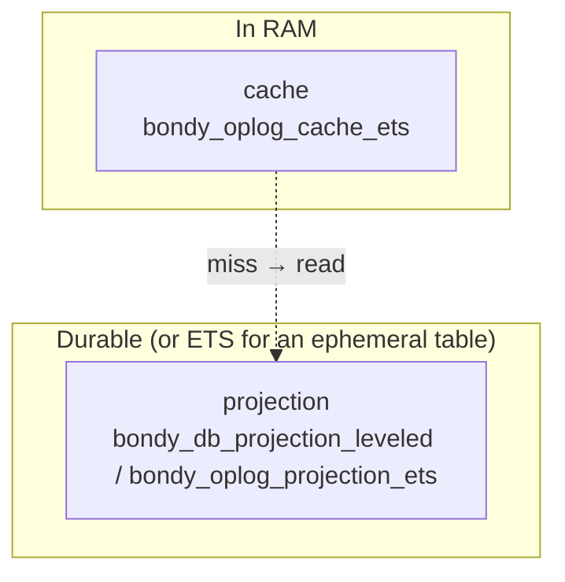
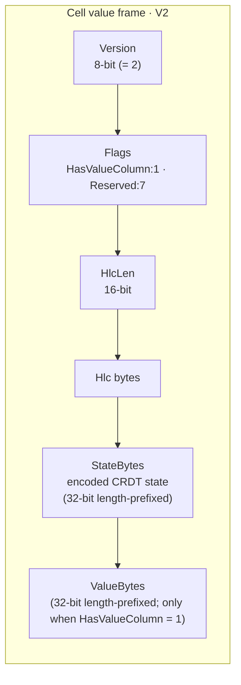
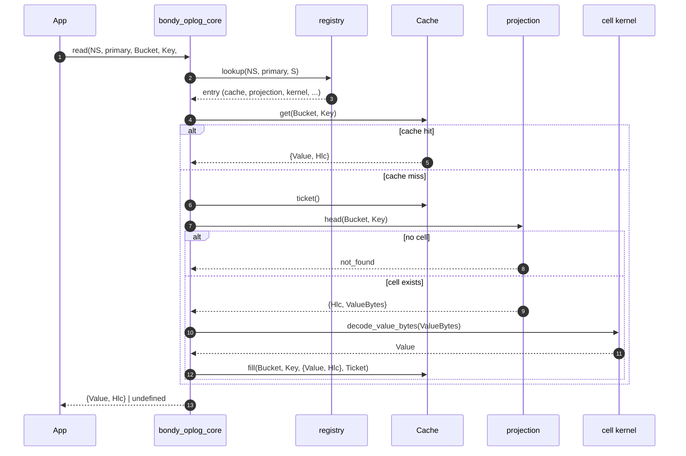
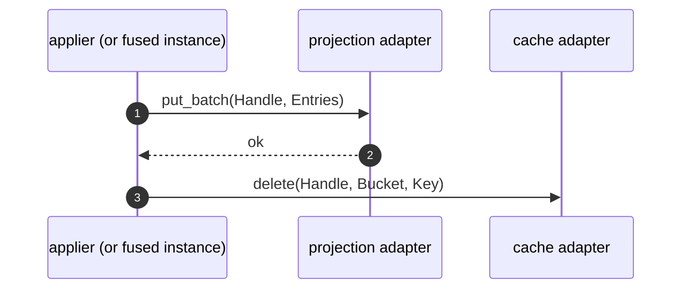
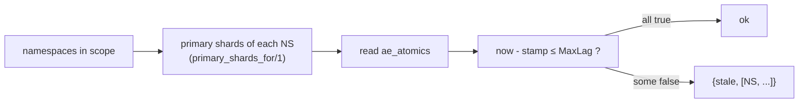
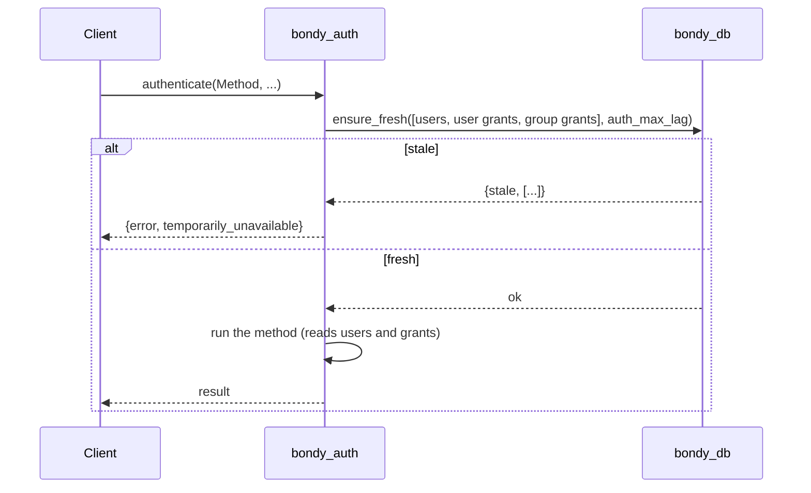
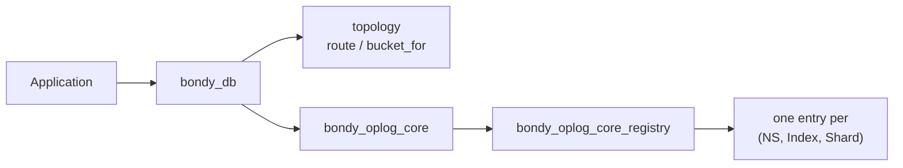

# bondy_db: the read side

> Audience: anyone who needs to know what `bondy_db:read/3` does and which
> guarantees a read gets.
> Time to read: ~15 min.

`bondy_db` is the consumer-facing facade. Applications open tables, write and
read through it. It adds tables, realms, topologies, a write barrier and
secondary indexes on top of the read substrate, `bondy_oplog_core`.

`bondy_oplog_core` and its registry, cache and projection behaviours live in
the `bondy_oplog` application. The topologies, the leveled projection adapter
and the topology manifest live in `bondy_db`.

## The mental model: two tiers



- The **cache** holds decoded `{Value, Hlc}` pairs. A hit returns without
  touching the projection.
- The **projection** holds the materialised state, one cell per
  `(Bucket, Key)`.
- The **CRDT module** of the table gives the cell its meaning.
  [Chapter 05](05_crdt_model.md) covers the contract. The read path selects
  a cell kernel for the table (`bondy_oplog_cell_kernel`) and uses it to
  decode the cell and turn its state into a value.

`bondy_oplog_core` also supports a third, optional tier: a per-shard read
overlay (`bondy_oplog_db_overlay`) of events not yet in the projection, which
a read interprets on top of the projection state. `bondy_db` registers every
shard with `overlay = disabled`, so Bondy reads never use it. The section
[Read-your-writes and the write barrier](#read-your-writes-and-the-write-barrier)
explains why.

## What a cell looks like

A projection cell value, on disk:



The value column is present only for CRDTs whose value differs from their
state. The fast read path asks the projection for the shorter HEAD form,
`<<HlcLen:16, HlcBin, ValueBytes>>`, so a point read does not decode the
full state.

The HLC is always present, and reads return `{Value, Hlc}`. Causality is
exposed, not synthesised, so a caller of a multi-cell read can detect skew
without cluster coordination.

## Following a read

`bondy_db:read(Table, Realm, Key)` computes the bucket, the storage key and
the shard, then calls `bondy_oplog_core:read/5` with an explicit `shard`
option. It returns `{ok, {Value, Hlc}}` or `{error, not_found}`.



## Cache coherence

The cache is filled on read and invalidated on write. After a writer
commits projection cells, it deletes the cache entry of each cell it wrote
(`bondy_oplog_cell_apply:invalidate_cache/4`).



A reader can race that invalidation: it reads the old cell, the writer
deletes the entry, and then the reader fills the old value. The ticket
closes that window. A reader takes a ticket before it reads the projection
and fills under that ticket. `bondy_oplog_cache_ets` advances a generation on
every delete and removes its own row if the generation moved during the
fill. The `SettledCoherent` invariant of `proofs/tla/ReadCache.tla` checks
this protocol, and `bondy_db_read_cache_race_test` forces the race. A cache
hit that runs concurrently with such a fill can still return the older value
until the fill returns.

`bondy_oplog_core:write_through/5` deletes the cache entry for one cell. It
does not write the projection.

## Read-your-writes and the write barrier

`apply/4` is designed to give **read-your-writes**: once `apply/4` returns
`ok`, the caller's next `read/3` observes the write. The facade provides this
with a **write barrier**, not with a read overlay.

`apply/4` appends through `bondy_oplog:append_applied/4`, a per-event
barrier. The caller blocks until its own event is applied: the applier has
written the cell to the projection and deleted the stale cache entry, and the
instance has installed the event in the MST. The applier writes the
projection before it sends the install to the instance, and the instance
answers the caller only after the install. The caller waits for its own
event only, not for the whole backlog of the shard
(`bondy_oplog_apply_barrier_test`). `apply_batch/4`,
`map_update/4` and `counter_inc/4` carry the same barrier.

`apply_async/4` skips the barrier and returns once the WAL append succeeds.
A caller that mixes it with an immediate read calls `await/3` first.

### Why the facade disables the read overlay

A read overlay could make a staged write visible before it is applied,
which gives read-your-writes without blocking the writer. The facade does
not use it because facade reads are **cache-first**, and a cache hit never
consults the overlay. To keep an overlay coherent with the cache, every
*staged* write would have to invalidate the cache. A key that is written
often would then keep a cold cache permanently, which defeats the cache on a
read-dominated workload.

So `overlay = disabled | tid()` is a per-shard choice between read cost and
write cost. `bondy_oplog_core` offers the overlay path for a consumer whose
balance favours it. The read-heavy `bondy_db` facade keeps its cache hot and
pays for read-your-writes on the write.

### What the barrier gives

Blocking until the event is applied gives three properties that a
non-blocking write does not:

- **Read-your-writes.** The writer's next read sees the write.
- **Session order on one node.** A caller issues write B only after write A
  is applied, so no reader on that node sees B without A. This holds even
  when A and B are on different shards with independent drains. Cross-node
  reads are the job of the [freshness fence](#the-freshness-fence).
- **Correct read-modify-write for `tier_2` types.** Before it appends, a
  `tier_2` write reads the committed causal context of the cell and stamps
  it into the event. Because the caller's earlier writes are already
  applied, that context includes them, so the new write is recorded as
  causally later. Without the barrier, the context could miss an in-flight
  earlier write, and the new write would show up as a false concurrent
  sibling.

### The trade-off

Reads are cache-fast and writes carry the barrier. This suits the
read-dominated, consistency-sensitive tables that the facade serves:
authentication, RBAC and registry resolution. The cost is that the latency
of a write, and the write throughput of one caller, are bounded by the
time to apply the event (the applier's projection write and the MST
install), not by the append.

## The freshness fence

A read can require bounded staleness. The fence is a predicate on
`bondy_oplog_core`, exposed by the facade as `bondy_db:ensure_fresh/2`:

```erlang
ok = bondy_db:ensure_fresh([UsersTable, GrantsTable], 1000).
```

It returns `ok` or `{stale, [NS]}`. A `MaxLag` of `infinity` disables the
check.

Each primary shard `(NS, primary, Shard)` has an **`ae_atomics`** reference
in its registry entry: a one-slot `atomics` array that holds the monotonic
time, in milliseconds, at which the shard last proved itself current. The
predicate reads that slot for every primary shard of each namespace
(`bondy_oplog_core_registry:primary_shards_for/1`), subtracts it from now,
and compares the result with `MaxLag`. It takes no lock and makes no call.
Secondary-index shards are excluded; an index has its own `max_lag` check.

Two writers stamp the slot:

- the **applier**, after it commits a batch for the shard;
- the **sync session**, at the end of every completed anti-entropy round,
  *including an empty round* in which the peer had nothing new.

Without the second writer, a shard with few writes (the security tables are
the typical case) would turn stale when writes stopped, even on a healthy
cluster, and the fence would refuse all authentication. The targets that a
round stamps are fixed when the instance starts (its `ae_targets`).

A node that cannot reach a peer must not certify itself fresh. Otherwise a
partitioned replica would authenticate against stale data. When clustering is
enabled, the `db.aae.fence.on_isolation` setting decides whether a round may
certify freshness:

| Policy | A round certifies freshness when… |
|---|---|
| `refuse` (default) | the round reached a peer. A node with no reachable peer never certifies, so its fence closes. |
| `proceed` | always: availability over consistency, for a single-node or trusted deployment. |
| `quorum` | the node is connected to a strict majority of the expected membership. |

When clustering is disabled, every round certifies, because there is no peer
for the node to lag behind. The policy lives on the side that produces
freshness (the sync session), so the read path stays one atomic read with no
policy logic.



Bondy's authentication path applies the fence before any authentication
method runs. When the `bondy_oplog` application has AAE enabled
(`db.aae`), `bondy_auth` calls `bondy_db:ensure_fresh/2` on the user, user
grant and group grant tables with the `auth_max_lag` bound:



A stale node refuses every authentication method with one reason,
`temporarily_unavailable`. A WAMP client receives an ABORT that marks the
condition as retryable, not as a bad credential.

The predicate does not look at the projection. The stamp records when the
shard last committed a batch or completed a sync round with its peers, which
is what a security decision needs to know.

## `read_batch/2`: fenced multi-cell reads

`bondy_oplog_core:read_batch/2` reads several cells under one fence:

```erlang
bondy_oplog_core:read_batch(
    %% batch keys are {Namespace, Index, Bucket, Key}
    [{users, primary, Bucket, U1}, {grants, primary, Bucket, U1}],
    #{fence => Hlc,
      max_lag => 100,
      consistency => causal,
      require_skew_below => 50}
).
```

It checks freshness only for the shards that the keys touch, reads each cell
with the overlay bounded by the fence HLC, and refuses when the per-cell HLCs
are further apart than `require_skew_below`. It returns
`{ok, #{BatchKey => Result}, FenceHlc}` or `{error, _}`. The `consistency`
option is `eventual` (the default), `causal` or `snapshot`. A namespace
registered as `cp` refuses `eventual` batch reads. The authentication path
does not use `read_batch/2`; it uses the fence described above.

## Change notification

A read gives the value now. A consumer that needs to *react* when a value
changes, and to tell its own change from a peer's, subscribes:

```erlang
{ok, Ref} = bondy_oplog_core:subscribe(NS, all),
%% The subscriber then receives, per change to NS:
%%   {bondy_oplog_core_event,           NS, Key, Hlc, Op}       a local write
%%   {bondy_oplog_core_merge_event,     NS, Key, Hlc, Op, Old}  a peer's write
%%   {bondy_oplog_core_bootstrap_event, NS, Bucket}             a snapshot install
```

The pattern is `all`, `{prefix, P}`, `{exact, K}` or `{match, Fun}`. `Op` is
the operation that the writer passed to `bondy_db`, and `Hlc` travels as its
own field. The merge tag carries one extra field, `Old`: the cell's value
before the merge (`undefined` when the cell did not exist), so a reactor can
compute what the peer's write changed.

- A **local** event follows a write on this node. The application code that
  made the write already ran its side effects, so a reactor that cares only
  about peers can ignore this tag.
- A **merge** event reports a change that originated on a *peer* and arrived
  through anti-entropy. The cell-apply engine publishes it when it applies a
  remote event ([chapter 04](04_applier.md)).
- A **bootstrap** event reports that a catalogue-snapshot install replaced
  the projection of a bucket wholesale. That install publishes no per-cell
  merge events, so a reactor that derives state from the table rebuilds it
  on this event. The dispatcher delivers it to every subscriber of the
  namespace, whatever its pattern.

Notification is **opt-in per table**: only a table opened with
`publish => true` emits events. The dispatcher (`bondy_oplog_core_dispatcher`)
selects the subscribers from an ETS table and sends to each one from the
publishing process, with no gen_server round-trip. For a table whose topology
folds the realm into the key, `Key` is the folded `<<Realm, 0, Key>>`;
`bondy_db:unfold_key/1` splits it.

The typical consumer is a node-local reactor that turns a peer's change into
a local effect: it closes sessions when a peer deletes a user or realm, or
re-evaluates cached authorisation when a peer changes a grant.
[Chapter 07](07_app_developers_tour.md#5-reacting-to-a-peers-change) works
through that example on the Bondy Router tables.

## Secondary indexes

A table opened with `indexes => [Spec]` gets a term-sharded index keyspace
for each declared index. The index answers "which primary keys have term
`T`?" without scanning and decoding every value.

```erlang
{ok, Users} = bondy_db:open_table(Db, users, #{
    fold_module => lww_register,
    indexes => [#{
        name      => by_status,
        extract   => [status],      %% path into the value
        normalize => downcase,
        projects  => [name, status] %% denormalised columns (optional)
    }]
}),
%% ... apply some writes, then:
{ok, Rows} = bondy_db:index_get(Users, <<"acme">>, by_status, <<"active">>, #{}),
%% Rows :: [{PrimaryKey, ColumnsMap}]
```

**Storage follows the table.** The index shards route through the table's
topology, so index cells live in the same projection backend as the table's
cells. The index is a deterministic function of the primary cells, so the
primary is always the authoritative copy. Bondy builds these index cells
itself rather than using leveled's native secondary indexes, because the
durable projection runs leveled in `head_only` mode.

**Term-sharded.** Each index has its own shard set under
`(NS, IndexName, SecShard)`. A term's shard is
`phash2({SecBucket, Term}, SecShardCount)`. An equality read (`index_get/5`)
reads one shard. A range read (`index_range/6`) scatters across every shard
and merges the results into one list ordered by `(term, primary key)`.

**Asynchronous writer and a lag fence.** The primary applier computes the
old and new terms of each changed cell, because it already decoded both
values. After the primary write commits, it sends the index operations to a
`bondy_oplog_secondary_writer` per index shard. The writer batches and
coalesces them, and applies each one to the index cell through the
`index_entry` CRDT. Each operation carries an index version, the next value
of its primary shard's counter, and the CRDT keeps the entry with the highest
version. An index can therefore lag the primary, and reads can fence on that
lag:

- `index_get(.., #{max_lag => Ms})` refuses with
  `{error, {stale_secondary, IndexName, Lag}}` when the shard was not
  freshened within `Ms`. `Lag` is the lag in milliseconds, or `infinity`
  when the shard was never freshened or is flagged for rebuild.
- `#{fallback => primary}` scans the primary cells instead and recomputes
  the matching keys. It is slower and bounded by an internal cell cap.

**Index intents.** On a durable table, a batch that yields index operations
stores them as an intent in the same primary write as its cells. An
operation the writer had not yet written when a node or a writer stopped is
therefore still in the primary. A restarted writer registers for dispatch,
then replays the leftover intents of every durable primary shard of its
namespace. The compaction barrier flushes the writer, syncs the index, and
then clears each shard's intents up to the version that shard had
dispatched. `proofs/tla/IndexIntents.tla` models the mechanism; its README
lists the configs that check it.

**Opening a table.** As each primary shard registers, it replays its
leftover intents to the index writers, before its applier starts. The open
then waits for the primary shards to apply their WAL tail and checks a trust
marker on each index shard. An index whose every shard has one is trusted:
the open freshens each shard once its writer has written the replayed
operations. Otherwise `bondy_oplog_index_rebuild` rebuilds the index from the
primary cells before the open returns.

**Catalogue installs.** A catalogue install writes primary cells outside the
WAL. It computes their index operations and writes them as intents with the
cells. Each group of cells syncs the primary before its first cell and, when
the group has index operations, syncs again before it dispatches them. A
failed group marks the table's indexes for rebuild.

**Back-pressure and self-healing.** Each index shard carries an in-flight
counter. When a batch would push the backlog of a shard past its
`max_inflight` cap, the applier drops the batch, flags the shard
`needs_rebuild` and requests a rebuild from `bondy_oplog_index_rebuild`. A
restarted writer replays the intents of a durable index; an index held in RAM
has none, so a writer crash marks it for rebuild. A rebuild removes the index's trust marker, syncs the
index, wipes it, re-folds every primary cell, and writes the marker again
once the writer that took the re-fold has flushed it. Until the rebuild
finishes, fenced reads refuse. `bondy_db:rebuild_index/2` runs a rebuild on
demand and returns when it is complete. `bondy_db:index_lag/2` reports
`#{lag, inflight, needs_rebuild}` for each index shard.

## Range scans

`bondy_db:range/5` scans one shard over `(Realm, [Low, High))`. The shard
is the one that holds `Low` under the table's partition strategy, unless the
caller passes `#{shard => N}`. The scan routes through
`bondy_oplog_core:range/4` and reads the projection only, because the facade
disables the overlay. It returns `{ok, [{Key, Value, Hlc}]}` in ascending key
order. A range that spans shards uses `range_all/5` or `list/2`, which
scatter across the shards and merge.

## Topology and the registry

`bondy_db` introduces:

- **Tables**: like SQL tables, but scoped by realm.
- **Topologies**: pluggable strategies for which Bookie owns which shard
  and how a cell key is formed. Four ship:
  - `bondy_db_topology_single_bookie`, `bondy_db_topology_per_entity` and
    `bondy_db_topology_shared_shards`, the leveled-backed topologies, which
    share their Bookie and directory code in
    `bondy_db_topology_leveled_common`;
  - `bondy_db_topology_memory`, an in-RAM ETS provider for ephemeral
    tables.

### Realm folding

The topology decides how the realm enters the cell key. This matters
because the security and routing tables hold many tenants. Under
`shared_shards` and `memory`, the facade **folds the realm into the key**: a
cell is stored at `<<Realm, 0, Key>>`. The facade rejects a realm that
contains a NUL byte, so the separator is unambiguous and two realms that
write the same key reach different cells. Under `per_entity` and
`single_bookie`, the key is stored verbatim. `bondy_db:unfold_key/1` recovers
`{Realm, Key}` from a folded storage key.

### The topology manifest

The keying configuration of a durable database decides where every cell
lives on disk: the partition strategy, the shard count, the realm prefix
depth and each table's shard key. If that configuration changes after data
exists, reads miss. `bondy_db_manifest` defends against that. The first time
a durable database opens, it **freezes** the configuration to an on-disk
manifest, and every later open reconciles the running configuration against
it. The `db.main.on_topology_mismatch` setting decides what a mismatch does:
`warn` (the default) logs the diverging keys and keeps the on-disk topology,
and `stop` refuses to boot. Ephemeral databases (the registry) keep no
manifest. The `main` database's partition strategy
(`db.main.partition_strategy`: `aggregate`, the default, `realm` or `entity`)
is part of the frozen set. It decides which shard a `(realm, key)` write
goes to.

The manifest also yields a **topology fingerprint**
(`bondy_db_manifest:fingerprint/1`). Bondy publishes it per database with
`bondy_oplog:set_topology_fingerprint/2`, and the responder includes it in
its `get_root` and `get_frontier` replies. A sync session refuses to pull
from a peer whose fingerprint differs from its own, with
`{error, {topology_mismatch, Local, Peer}}`, so a node that keys its data
differently is never taken for a divergent replica of the same data. The
operator sync view compares applied frontiers, not MST roots
([chapter 06](06_compaction_and_bootstrap.md#the-applied-frontier-the-convergence-oracle)),
and only when both fingerprints match.



The registry entry for each `(NS, Index, Shard)` carries:

- `projection_adapter` and `projection_handle`, registered by `bondy_db`
  when it opens the table, not by the applier;
- `cache_adapter` and `cache_handle`, likewise;
- `overlay`, which `bondy_db` sets to `disabled`;
- `crdt_module`, `fold_module` and `causal_tier`, which select the cell
  kernel ([chapter 05](05_crdt_model.md)). A `fold_module` label resolves to
  its native CRDT when no `crdt_module` is set;
- `ae_atomics`, the freshness stamp that `ensure_fresh/2` reads;
- `high_water_ref`, the highest HLC applied to the shard's projection;
- `consistency_class`, `ap` or `cp`;
- for a secondary-index shard, a `writer_pid` and an `inflight_ref` (the
  in-flight counter and the `needs_rebuild` flag); a primary shard carries
  an `instance_id` so that a rebuild can find its applier.

## Projection backend: durable or ephemeral

The `projection_backend` option of `open_table/3` chooses the projection
adapter **per table**:

- `leveled` (the default on the leveled topologies): the durable path. The
  topology's `route/2` returns a Bookie handle, and the state survives a
  restart.
- `ets` (the default on `bondy_db_topology_memory`): an in-RAM projection
  (`bondy_oplog_projection_ets`). Nothing is persisted. The table starts
  empty and reconverges from peers through anti-entropy.

`ets` makes a table **ephemeral** only when the *whole* stack is in memory,
including the MST store. The caller assembles that stack from three
independent settings:

- `projection_backend => ets`;
- `oplog_instance_opts => #{backend => ets}`, the in-memory MST store;
- no `storage_path` anywhere in the option cascade.

`durability => ephemeral`, inside `oplog_instance_opts`, acknowledges that
intent. It does not enforce the three settings; it only silences the
warning about a missing `storage_path`. The disk WAL of such a table writes
under `/tmp/bondy_oplog_wal/<os_pid>/`. A fresh BEAM has a different OS pid,
so it never replays the previous run's segments.

Ephemeral namespaces need this. WAMP registrations and subscriptions die
with the node's transport connections, so persisting them would only bring
back dead, unroutable entries after a restart. An ephemeral table starts
empty after a restart and rebuilds its live state from peers, not from disk.

One database can mix backends: a durable `leveled` table and an ephemeral
`ets` table can coexist. Under a leveled topology, `bondy_db` keeps a
`bondy_db_topology_memory` provider for the database, which hosts its
ephemeral tables.

### Fused ephemeral tables

An ephemeral table can also opt into **fused mode** with
`open_table(Db, Name, #{fused => true, ...})`. Fused mode moves the applier's
work into the instance gen_server of each shard. `open_table/3` raises
`{fused_requires_ephemeral, Backend}` for a table whose projection is not
`ets`. A fused table can also select the in-memory WAL with
`oplog_instance_opts => #{wal_backend => mem}`, which removes disk I/O from
the write path. A non-fused instance that asks for `mem` falls back to the
disk WAL and logs a warning. Peers hold the data through anti-entropy, as for
any ephemeral table. [Chapter 01](01_bondy_oplog.md) describes the mechanics;
the read and write API does not change.

## Things to keep in mind

- **A cache hit is one ETS read.** A miss reads the projection through its
  adapter and fills the cache under a ticket.
- **The HLC is always returned.** Causality is part of the API.
- **`apply/4` blocks until its own event is applied.** That barrier, not an
  overlay, gives read-your-writes. `apply_async/4` skips it.
- **Bounded staleness is per shard.** `ensure_fresh/2` reads the
  `ae_atomics` stamp of each primary shard. The applier stamps it on commit
  and the sync session stamps it after each round. The authentication path
  fences on it.
- **Changes can be subscribed to.** A `publish => true` table emits a local
  event, a merge event for each peer write, and a bootstrap event for a
  snapshot install.
- **Cache coherence is by invalidation.** Each projection writer deletes
  the cache entries of the cells it wrote, and the ticket protocol stops a
  racing reader from filling a stale value.
- **Secondary indexes follow the table.** Index cells use the table's
  projection backend, an asynchronous writer feeds them, and reads can fence
  on their lag with `max_lag`.
- **Writes can be packed.** `apply_batch/4` packs several operations on one
  cell (for example `[{put, F, V}, {rmv, F}]` on an add-wins map, or the
  `map_update/4` form `#{put => ..., rmv => ...}`) into one `{batch, Ops}`
  event: one WAL entry, one MST entry and one projection read-modify-write.
  Only CRDTs that declare the `batchable` callback accept a batch; a counter
  or register table returns `{error, {not_batchable, Module}}`. See
  [The CRDT model](05_crdt_model.md#batched-operations-packing-many-commands).

## Pointers

Implementation:

- `bondy_db.erl`: the facade (tables, realms, topology, the write barrier,
  secondary-index reads).
- `bondy_oplog_core.erl`: the substrate read API, including `read/3,4,5`,
  `read_batch/2`, `range/4,5`, `ensure_fresh/2` and `write_through/5`; and
  the change-notification calls `subscribe/2`, `publish/4`,
  `publish_merge/5` and `publish_bootstrap/2`.
- `bondy_oplog_core_registry.erl`: the per-`(NS, Index, Shard)` handle
  store, `primary_shards_for/1` (the fence scope) and the `ae_atomics`
  stamping (`bump_ae/3,4`, `bump_ae_targets/1,2`).
- `bondy_oplog_core_dispatcher.erl`: the subscription dispatcher and its
  three message tags.
- `bondy_db_topology_single_bookie.erl`, `bondy_db_topology_per_entity.erl`
  and `bondy_db_topology_shared_shards.erl`: the leveled topologies, with
  shared code in `bondy_db_topology_leveled_common.erl`.
  `bondy_db_topology_memory.erl` is the in-RAM provider for ephemeral
  tables.
- `bondy_db_manifest.erl`: the on-disk topology manifest.
- `bondy_oplog_cache_adapter.erl` and `bondy_oplog_cache_ets.erl`: the cache
  behaviour, its coherence contract, and the ETS implementation.
- `bondy_oplog_projection_adapter.erl`, `bondy_db_projection_leveled.erl`
  and `bondy_oplog_projection_ets.erl`: the projection behaviour and its
  durable and in-RAM implementations.
- `bondy_oplog_cell_frame.erl`: the V2 cell encoding and the HEAD form.
- `bondy_oplog_db_overlay.erl`: the optional read overlay.

Secondary indexes:

- `bondy_oplog_index_spec.erl`: the declarative index spec (`extract`,
  `normalize`, `projects`, `max_lag`, `max_inflight`).
- `bondy_oplog_index_key.erl`: the order-preserving `(Term, PrimaryKey)`
  key codec and the term-to-shard function.
- `bondy_oplog_crdt_index_entry.erl`: the `index_entry` CRDT.
- `bondy_oplog_secondary_writer.erl` and `bondy_oplog_secondary_sup.erl`:
  the asynchronous writer for each index shard and its supervisor.
- `bondy_oplog_index_rebuild.erl`: the rebuild orchestrator, which derives
  an index from the primary cells.
