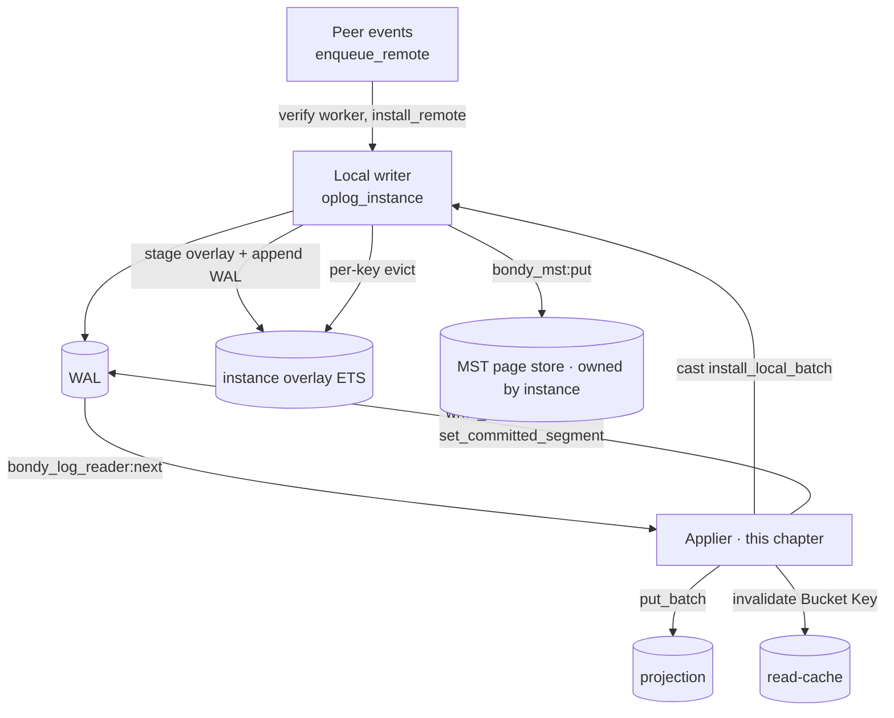
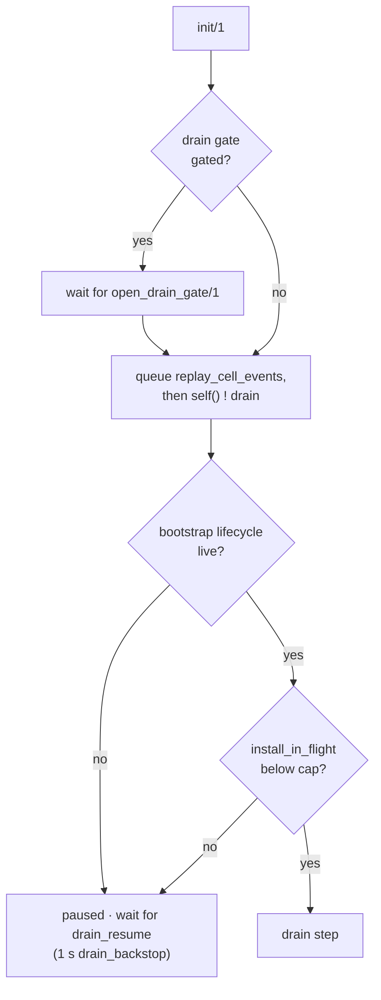
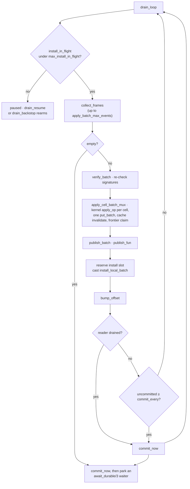
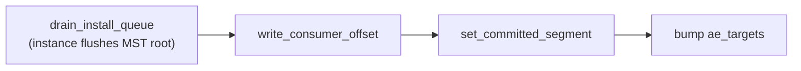
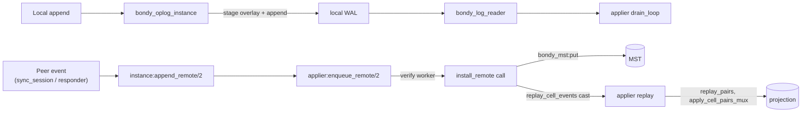
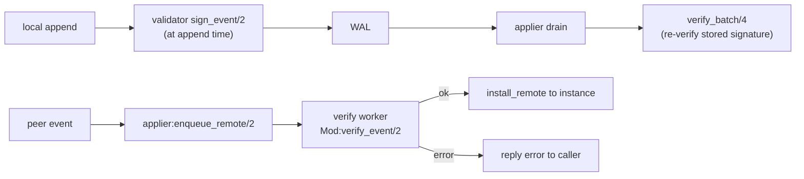
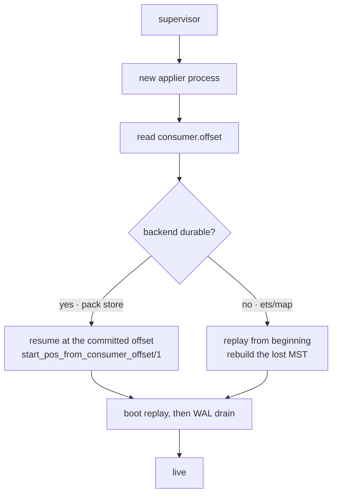

# The applier: the reconciler at the centre

> Audience: anyone debugging why a write isn't visible, or extending
> the substrate.
> Time to read: ~15 min.

If chapters [01](01_bondy_oplog.md) / 02 (in the bondy_mst library docs) /
[03](03_bondy_db.md) are the three packages, this chapter is the
**reconciler** that ties them together. The applier
(`bondy_oplog_applier`) is one gen_server per instance. The
`one_for_all` supervisor `bondy_oplog_instance_sup` starts it beside
the instance, the WAL writer and the WAL scrubber.

> **Fused mode has no applier.** An ephemeral instance opened with
> `fused => true` runs the same stages inside the instance gen_server
> (`fused_apply_batch/2`): it drains its WAL, verifies, applies cells
> through the same cell-apply engine, installs and publishes. It yields
> back to its mailbox when its per-tick batch budget is spent.
> `bondy_db` refuses `fused => true` on a durable (leveled) table
> (`{fused_requires_ephemeral, Backend}`). A fused instance has no
> applier child; it keeps the scrubber only when its WAL is on disk.
> The rest of this chapter describes the non-fused path. See
> [chapter 01](01_bondy_oplog.md) for fused mode itself.

The applier has four jobs:

1. Drain events from the WAL (via `bondy_log_reader`).
2. Re-verify their signatures. The instance signed local events at
   append time; the re-check is a defence against WAL tampering.
3. Apply each event to the projection through the cell-apply engine
   (`bondy_oplog_cell_apply:apply_cell_batch_mux/3` →
   `bondy_oplog_cell_kernel:apply/6` → the CRDT's `apply_op`), then
   ask the instance to install the events in the MST
   (`install_local_batch`).
4. Persist the consumer offset and advance the WAL committed
   segment, so retention can sweep older segments.

Peer-received events take a separate door:
`bondy_oplog_instance:append_remote/2` → `enqueue_remote/2` → verify
in a worker process → `install_remote` call to the instance. They do
not go through the WAL on the receiving side.

## Where it sits



The applier writes the projection for every event it drains from the
WAL, and for every peer event it replays from the MST (see
[Two kinds of input](#two-kinds-of-input-wal-and-peer-events)). It
does not write the MST page store. It sends each verified batch to the
instance with `cast(install_local_batch)`, and the instance inserts
the events into the MST in its own process.

## When the loop runs

The applier has no explicit state machine. Four conditions decide
whether a `drain` tick reads the WAL:



- **Drain gate.** An instance opened with `drain_gated => true` (a
  shard instance whose sibling tables have not all registered) holds
  both the WAL drain and the boot replay until the orchestrator calls
  `open_drain_gate/1`.
- **Bootstrap lifecycle.** While the instance is `pre_bootstrap`, the
  applier does not touch the projection
  ([chapter 06](06_compaction_and_bootstrap.md)).
- **Install cap.** See [the hot loop](#the-hot-loop).

## The hot loop

`drain_loop/1` in `bondy_oplog_applier.erl`:



- **`install_in_flight` is a counter atomic.** It bounds how many
  install batches the applier may have outstanding at the instance.
  The cap is the instance option `max_install_in_flight` (default
  64). The applier increments the counter before each
  `install_local_batch` cast, and the instance decrements it after the
  install. When the cap is full the loop stops reading and waits for
  the instance's `drain_resume` cast. A `drain_backstop` timer re-arms
  the loop after one second if that cast is lost.
- **Frames are coalesced under a backlog.** `collect_frames/2` reads
  WAL frames until the batch holds `apply_batch_max_events` events
  (default 256). The cap is soft: a frame is never split. When the
  WAL is caught up, one frame is available before `end_of_log`, so a
  batch is one frame.
- **Commits are count-driven and drain-driven.** `maybe_commit/1`
  commits after `commit_every` events (default 64). The loop also
  commits when the reader reaches `end_of_log`.
- **The idle applier does not poll.** At `end_of_log` it parks a
  helper process on `bondy_oplog_wal:await_durable/3` and monitors it.
  The helper's exit wakes the applier, which drains again.

## What "apply a batch" does

`apply_batch/2` runs four stages per batch, in this order: verify,
cell apply, publish, install cast. The order is part of the
read-your-writes contract. The instance answers a waiting appender
only after it handles the install cast, and the projection write and
the publish happen before that cast.

Events that fail verification are dropped from the batch. The applier
sends their keys to the instance in an `evict_rejected` cast, and the
instance evicts their overlay rows and answers their appenders.

The cell apply stage groups the batch by bucket and applies each group
under that bucket's `cell_apply_ctx`
(`bondy_oplog_cell_apply:apply_cell_batch_mux/3`). A shard instance
shared by several tables resolves each bucket to its own table's
context and CRDT.

```mermaid
sequenceDiagram
    autonumber
    participant Loop as applier
    participant CA as cell_apply engine
    participant K as cell kernel
    participant Adapter as projection_adapter
    participant Cache as cache_adapter
    participant Sec as secondary writer
    participant Reg as bondy_oplog_registry

    Loop->>CA: apply_cell_batch_mux(Source, Id, Events)
    loop each cell_apply event
        CA->>Adapter: get prior frame (on shadow and cache miss)
        CA->>K: apply/6 (OldState, _, Op, Key, Context)
        K-->>CA: {NewState, Hlc, StateBytes, ValueBytes, VES}
    end
    CA->>Adapter: put_batch(all new frames)
    CA->>Cache: invalidate touched (Bucket, Key)s
    CA->>Sec: index_entry ops (old vs new value diff)
    CA->>Reg: merge_applied(Id, materialised seqs)
```

- **Writes are batched.** All new frames of a group go to the
  projection in one `put_batch`. Reads of prior cells go first to an
  **in-batch shadow**, so a later event sees the frame an earlier
  event in the same batch produced. Next they go to an optional
  write-through **old-state cache** (`oldstate_cache`), and last to
  the projection.
- **The kernel runs the CRDT's `apply_op`.** This is the eager
  operation-based step ([chapter 05](05_crdt_model.md)). For a CRDT
  whose context is over event dots (`dotted_context/0`), the kernel
  leaves the state unchanged when the cell's context already covers
  the event's dot.
- **A kernel error skips one event.** `compute_one_cell/13` catches
  only the kernel apply. An event whose apply raises is skipped and
  still counts as materialised. A projection read error is not caught:
  it stops the applier, which resumes from the consumer offset
  (`bondy_oplog_commit_barrier_test`).
- **Secondary indexes are fed after the primary write.** When the
  `put_batch` returns `ok`, the engine dispatches the `index_entry`
  ops it derived from the old and new cell values to the per-shard
  secondary writers ([chapter 03](03_bondy_db.md)). When the
  `put_batch` fails, the engine dispatches nothing and claims no seq
  for that group; the cells are applied again on the next replay.
- **The applied frontier is advanced here.** The engine claims, per
  origin, the seqs that materialised. The claim includes the batch's
  `seq_fill` events, which occupy seqs that a failed WAL append burned
  and carry nothing to fold. A bucket with no context contributes
  nothing, so the prefix stops below its skipped seq.
  `bondy_oplog_registry:merge_applied/2` advances the contiguous
  prefix and holds anything above a gap. The engine makes one claim
  per batch, after every group has reported, so the claim never leads
  the projection write. The merge is a join, so a single over-claiming
  call site would defeat every conservative one; this is why there is
  only one site. See
  [chapter 06](06_compaction_and_bootstrap.md#the-applied-frontier-the-convergence-oracle).

`publish_batch` announces a node's **own** writes: for each verified
event it calls `publish_fun` and forwards the result to
`bondy_oplog_core:publish/4`. A shard instance shared by several
tables resolves the namespace per bucket. The **remote** half of the
change-notification seam is described under
[Two kinds of input](#two-kinds-of-input-wal-and-peer-events).

### tier_2: the context read and the regression guard

A tier_2 table ([chapter 05](05_crdt_model.md)) adds one step before
the WAL append. `bondy_db:apply/4` calls
`bondy_oplog_applier:cell_context/3`, and then appends the event with
the returned context as its `meta`:

- **The prepare fence.** Before it reads the context, the applier
  calls `ensure_remote_caught_up/1`. When the instance has delivered
  peer events since the applier's last replay, the applier replays
  them first. The context it reads then reflects every event delivered
  to this replica for the cell.
- **The read.** The applier decodes the cell's current projection
  state and calls the CRDT's `context_of/1`.
- **`ctx_guard`.** `bondy_oplog_ctx_guard` remembers the highest
  context handed out per cell. A context that regresses below it is
  refused with `{error, {context_regression, Bucket, Key}}` and a
  `[bondy_oplog, applier, context_regression]` telemetry event. A
  regression is the signature of lost durable state. Two paths shrink
  a context on purpose and tell the guard: origin reaping
  (`coevict/2`) and the stability sweep that deletes a cell
  (`forget/2`).

The read and the append are two calls, not one critical section. Two
concurrent writes from the same origin to the same cell can read the
same context.

## The commit point



`commit_now/1` runs these steps in order. The **commit point** is the
consumer-offset write.

`drain_install_queue` is a synchronous call to the instance. It queues
behind every earlier `install_local_batch` cast. The instance replies
`ok` only after `bondy_mst:flush/1` makes the root that holds those
events durable. A failed flush raises in the instance, and an instance
that is gone makes the call exit in the applier, so the offset is not
written. The consumer offset therefore does not pass an event that the
durable MST root lacks (`bondy_oplog_commit_barrier_test`). With
`pack_seal_mode => async` the same call is where the instance rolls the
incoming pack and starts the seal worker.

A failed `write_consumer_offset` is logged, and the next commit
boundary tries again.

## Atomicity

These steps are not transactional across stores. The order makes each
crash recoverable:

- Crash **before `write_consumer_offset`**: on restart the reader
  resumes at the persisted offset. The events after it are read and
  applied again.
- Crash **after the offset write, before `set_committed_segment`**:
  the same as above. The committed segment gates WAL retention only.
- The leveled projection runs with `db.leveled.sync_strategy`, default
  `none`, so a projection write is not fsynced on acknowledgement. A
  write lost to a power failure is folded again from the oplog at
  boot. The boot fold runs when the oplog holds a cell event that the
  restored applied frontier does not claim
  (`bondy_oplog_instance:replay_anchor/1`). This needs the oplog to
  keep that event, so the instance syncs the projection before it
  truncates the oplog and before it persists a frontier claim
  (`bondy_oplog_projection_sync_test`).

Re-applying an event must not change the cell. The kernel's
covered-dot skip and each CRDT's own redelivery rule give that
property; [chapter 05](05_crdt_model.md#2-redelivery-is-a-no-op)
names the evidence.

## Two kinds of input: WAL and peer events



Peer-received events do not flow through the local WAL, and they are
not staged in the overlay. The applier verifies each one in a
short-lived worker and forwards it to the instance with a synchronous
`install_remote` call. The instance checks the origin ban, back
pressure and the watermark, and inserts a new event into the MST
directly. Then it bumps a remote-delivery generation and casts
`replay_cell_events` to the applier.

The replay asks the instance for the events between the last replayed
root and the current root (`bondy_oplog_instance:replay_pairs/2`) and
applies them with `apply_cell_pairs_mux`. A table opened with
`publish => true` emits one `bondy_oplog_core:publish_merge/5` event
per touched cell on this path. The merge event carries the pre-merge
value, so a node-local reactor can see what a peer changed
([chapter 03](03_bondy_db.md#change-notification)). A cast can be lost
in a crash. The boot replay in the next section covers that case.

## Overlay eviction

The instance overlay holds one row per local event, keyed by the event
key `{HLC, Origin, Seq}`. The instance stages rows before the WAL
append and deletes them per key:

- After `install_local_batch`, for every installed event
  (`evict_overlay_batch/3`). The MST insert happens before the
  eviction, so a reader that misses the row finds the event in the
  MST.
- On the applier's `evict_rejected` cast, for every event the applier
  refused.

Each eviction releases the row's share of the admission counters and
answers the appender that waits on the row.

## Validator gateway



The instance signs local events on the append path. The applier
re-verifies them when it reads them from the WAL; a failure is logged,
counted in `[bondy_oplog, applier, verify_failed]`, and the event is
skipped. Peer events are verified once, in the `enqueue_remote`
worker.

The applier captures the validator snapshot at `init/1`. An operator
rotates it with `bondy_oplog_instance:refresh_validator/1`, which
sends the applier a `{refresh_validator, Reason}` cast. Workers spawned
before the cast keep the snapshot they captured.

## Crash recovery

A restarted applier chooses its resume position from the backend's
**durability capability** (`bondy_mst:capabilities/1`), never from
the MST's live state:



A **durable** backend keeps its MST and projection across a restart,
so the applier resumes at the WAL's committed consumer offset. A
consumer offset that never committed resumes from `beginning`. The
resume position does not depend on the MST root, so a stale or absent
on-disk root does not move it. A **volatile** (ets/map) backend loses
its MST on restart, so it replays the WAL from `beginning` to rebuild
it. If the committed segment was truncated away, the reader opens at
`beginning` instead.

The consumer offset is also the **durability fence** for WAL
retention: it tells the writer how far the applier has committed, so
older segments can be unlinked.

A fused instance has no consumer offset of its own. It positions its
reader with `bondy_oplog_applier:resume_position/2`, the higher of the
MST last-key HLC and the watermark, because its mem-WAL and MST live
and die together.

If the WAL writer crashes too, WAL recovery
([chapter 01](01_bondy_oplog.md)) runs first in the writer's
`init/1` and truncates the tail to the last valid frame. The applier
then resumes against the truncated tail.

## Boot replay

On an open drain gate, `init/1` queues a `replay_cell_events` cast and
then a `drain` message, in that order. The replay folds the MST events
that the restored applied frontier does not claim:

- peer events whose replay cast was lost, and
- own events whose projection write a crash lost. The WAL drain does
  not re-read these, because it resumes at the committed offset.

The replay runs first because a drained write's dot would cover such
an event, and the kernel would then skip it
(`bondy_oplog_bootstrap_rederive_test:write_after_lost_fold_keeps_the_add/0`).

## Things to keep in mind

- **The applier writes the projection; the instance writes the MST.**
  In fused mode the instance does both, inline.
- **Re-applying an event must not change a cell.** Every crash path
  relies on it.
- **The consumer-offset write is the commit point.** It never passes
  an event the durable MST root lacks.
- **Peer events skip the WAL and the overlay.** They are verified in
  an `enqueue_remote` worker, inserted into the MST by the instance,
  and folded into the projection by the replay.
- **Back pressure has two layers.** `install_in_flight` gates the
  applier-to-instance hand-off. On the append side the instance
  returns `{error, backpressure}` when the overlay exceeds
  `max_overlay_events` or `max_overlay_bytes`, and
  `{error, working_set_full}` when `max_working_set` is exceeded.

Applier options (see the `bondy_oplog_applier` moduledoc):

| Opt | Default | Purpose |
|---|---|---|
| `commit_every` | 64 | events between commits |
| `apply_batch_max_events` | 256 | soft cap on events coalesced into one batch |
| `poll_interval_ms` | 5 | fallback wake-up interval; the idle path waits on `await_durable/3` |
| `cell_apply_target` | none | the `{NS, Index, Shard}` whose registry entry names the projection, cache and CRDT |
| `oldstate_cache` | `false`; `bondy_db` sets it to `true` for leveled tables | write-through frame cache in front of projection reads |
| `publish_fun`, `publish_ns` | `undefined` | local-write publish hook |
| `ae_targets` | `[]` | the `{NS, Index, Shard}` freshness refs bumped after each commit; `bondy_db` sets them at instance birth ([chapter 03](03_bondy_db.md#the-freshness-fence)) |

The instance option `max_install_in_flight` (default 64) sets the
install cap.

## Write→readable latency telemetry

`bondy_oplog_latency` reports, per instance, how long a user write
takes to become **readable in the projection**.

`bondy_db:apply/4` is synchronous. It appends the event and waits on
the per-event barrier `bondy_oplog:append_applied/4`, which returns
once the applier has written this event to the projection. For a
tier_2 table the span also includes the context read. `bondy_db`
times that span with two `monotonic_time` reads and records successful
writes in a `bondy_metrics` histogram, one per instance. A periodic
tick subtracts the previous snapshot and emits one event per instance
that took writes in the window:

| Event | Measurements | Metadata |
|---|---|---|
| `[bondy_oplog, instance, write_latency]` | `count`, `mean_us`, `p50_us`, `p95_us`, `p99_us`, `max_us` | `instance_id`, `interval_ms` |

`mean_us` is exact. The percentiles are nearest-rank estimates from
the histogram bucket bounds. When sampling is disabled, the hot path
pays one `persistent_term` read.

The scope is the **local origin node**. Latency to readability on a
replica is out of scope, because monotonic clocks are not comparable
across VMs.

```erlang
{bondy_oplog, [
    {oplog_latency, #{
        enabled => true,             %% default: true
        interval_ms => 10000,        %% default: 10 s reporting window
        probe => #{enabled => false} %% default: idle probe off
    }}
]}.
```

`interval_ms => 0` (or `disabled`) keeps sampling but suppresses the
periodic emit.

**Idle probe (opt-in).** An instance with no traffic in a window
reports nothing. When the probe is on, the tick writes one type-correct
op (`bondy_db:probe_write/1`) to a reserved cell of each idle instance,
so it reports a value in the next window. The cell lives in the bucket
`$probe`, which no user query targets, and each probe overwrites it. A
probe is a real, replicated write; this is why the probe is off by
default.

## Pointers

Implementation:

- `bondy_oplog_applier.erl` — the gen_server: `drain_loop/1`,
  `enqueue_remote/2`, `cell_context/3`, `replay_cell_events/1`,
  `refresh_validator/2`, `open_drain_gate/1`, `resume_position/2`.
- `bondy_oplog_cell_apply.erl` — the shared per-cell engine
  (`apply_cell_batch_mux/3`, `apply_cell_pairs_mux/4`,
  `compute_one_cell/13`, `invalidate_cache/4`,
  `dispatch_index_ops/4`); called by the applier and by the fused
  instance.
- `bondy_oplog_cell_kernel.erl` — the CRDT seam the engine drives
  ([chapter 05](05_crdt_model.md)).
- `bondy_oplog_ctx_guard.erl` — the tier_2 context-regression guard.
- `bondy_oplog_instance.erl` — the `install_local_batch`,
  `install_remote`, `evict_rejected` and `drain_install_queue`
  handlers; `replay_pairs/2`, `replay_anchor/1`,
  `refresh_validator/1`.
- `bondy_log_reader.erl` — the WAL drain cursor.
- `bondy_oplog_wal.erl` — `set_committed_segment/2`,
  `await_durable/3`.
- `bondy_log_state.erl` — `write_consumer_offset/2`, the durable
  consumer offset.
- `bondy_oplog_validator.erl` (and the `_crypto` / `_trust` variants)
  — the verifier callbacks.
- `bondy_oplog_latency.erl` — the per-instance latency sampler.
- `bondy_oplog_instance_sup.erl` — the supervisor wiring.

Background: see [chapter 06](06_compaction_and_bootstrap.md) for how
the applier's writes feed compaction.
