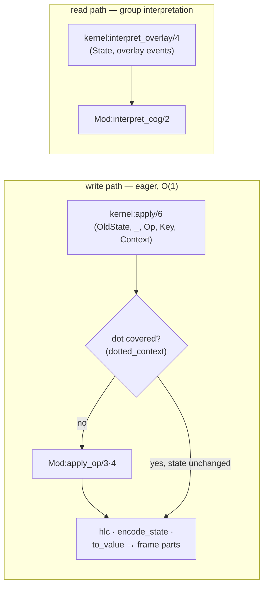
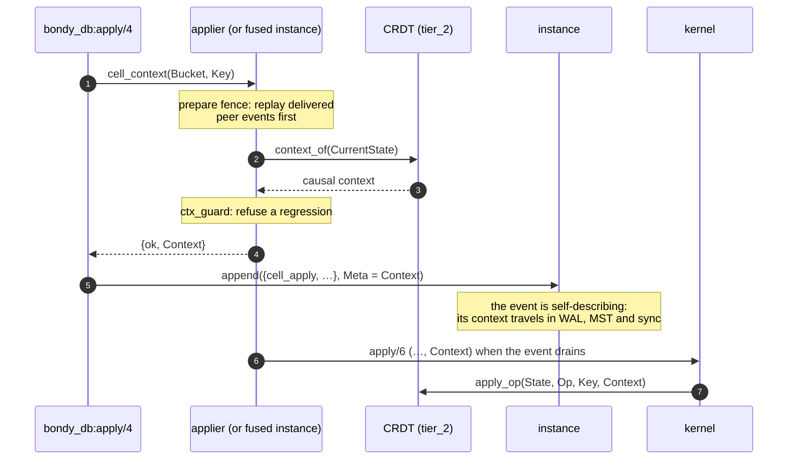
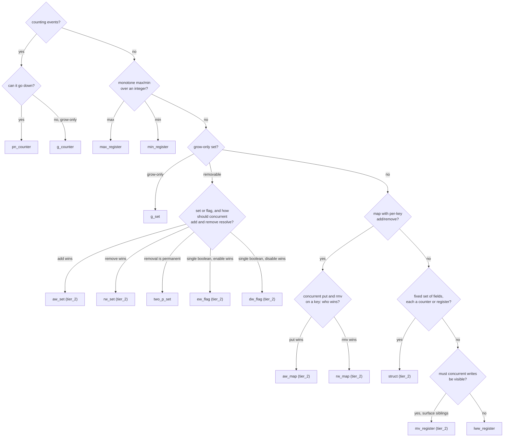
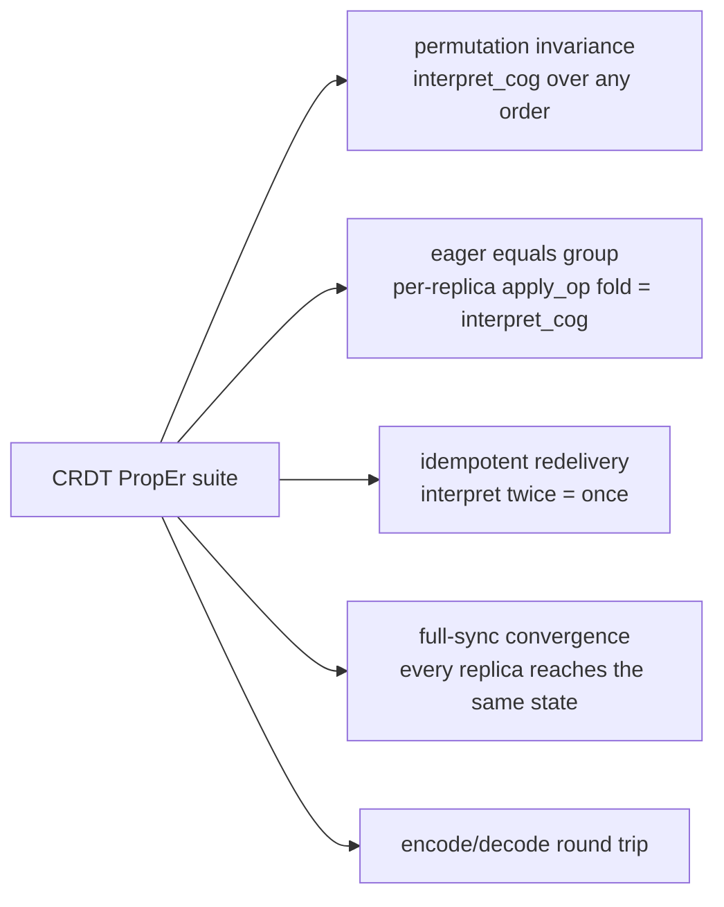

# The CRDT model

> Audience: anyone declaring a new table, implementing a custom CRDT,
> or curious why one substrate can serve LWW, counters, sets,
> multi-value registers and add-wins maps all at once.
> Time to read: ~15 min.

The substrate is **CRDT-agnostic**. It appends operations, replicates
them and applies them, but it does not know what an operation
*means*. The meaning lives in a per-table **CRDT module** that
implements the `bondy_oplog_crdt` behaviour. The design is **pure
operation-based**, in the sense of Baquero, Almeida and Shoker (*Pure
Operation-Based Replicated Data Types*, 2017): the log carries
operations, the substrate supplies the causal metadata, and the data
type only *interprets* operations. Replicas exchange operations, never
CRDT states.

At its core a CRDT module is a single-operation step, a group
interpreter and a projection:

```
state' = apply_op(state, op, key)          %% one operation, the eager write step
state' = interpret_cog(events, state)      %% a group of operations
value  = to_value(state)
```

Operations travel as **opaque terms** in the WAL and the MST. There is
no `encode_event`/`decode_event`: the substrate never asks a CRDT to
serialise an operation. Only the *state* has an encoding
(`encode_state/1` / `decode_state/1`), which the projection frame
stores.

`interpret_cog/2` is the Concurrent Operation Group interpreter, after
McCrary's *Canteen* (UC Berkeley, 2022, EECS-2022-160). It is the
convergence kernel. The eager `apply_op` path is an optimisation that
has to agree with it.

## The two design dials

Every CRDT declares two independent properties.

- **`causal_tier()`** — the clock.
  - `tier_0` — scalar HLC only. It is sufficient for types whose
    resolution rule does not depend on happens-before: registers,
    counters and grow-only or two-phase sets.
  - `tier_1` — per-operation dot sets. The type exists; no catalogue
    CRDT declares it.
  - `tier_2` — a per-cell **causal context** (a version vector built
    with `bondy_dvvset`) carried in the event `meta`. With it,
    `interpret_cog/2` can compute *happens-before* and resolve
    concurrency-detecting types such as the multi-value register and
    the add-wins map. A scalar HLC cannot do this: HLC(A) < HLC(B)
    does not imply A → B.
- **`order_independent()`** — the write path. `true` selects the
  O(1) eager step (`apply_op`) on the materialised cell. `false` means
  the type has no correct O(1) eager step. `bondy_oplog_cell_kernel`
  then refuses the write with
  `{non_commutative_crdt_eager_unsupported, Mod}`. Every catalogue type
  declares `true`.

tier_2 types are also `order_independent`, so they use the same eager
write path as tier_0 types, with a causal context passed in.

## The behaviour, at a glance

```mermaid
classDiagram
    class bondy_oplog_crdt {
      <<behaviour>>
      +causal_tier() tier_0 | tier_1 | tier_2
      +init() state
      +interpret_cog(events, state) state
      +query(query, state) result
      +to_value(state) value
      +hlc(state) hlc
      +encode_state(state) binary
      +decode_state(binary) state
      +removal_op() op °
      +stabilize(stable_hlc, state) keep | {keep, state} | discard °
      +value_equals_state() bool °
      +order_independent() bool °
      +state_to_op(state) op °
      +context_of(state) context °
      +dotted_context() bool °
      +reap_origins(state, retired) {state, reaped} °
    }
    class bondy_oplog_crdt_commutative {
      <<behaviour>>
      +apply_op(state, op, key) state °tier_0
      +apply_op(state, op, key, context) state °tier_2
      +batchable() bool °
    }
    bondy_oplog_crdt <|-- lww_register
    bondy_oplog_crdt <|-- mv_register
    bondy_oplog_crdt_commutative <|-- lww_register
    bondy_oplog_crdt_commutative <|-- mv_register
    %% every catalogue type implements both
    %% behaviours; see the catalogue table for the full list
```

(`°` marks an optional callback.) The required set is
`causal_tier/0`, `init/0`, `interpret_cog/2`, `query/2`, `to_value/1`,
`hlc/1`, `encode_state/1` and `decode_state/1`. The optional callbacks:

| Callback | Meaning |
|---|---|
| `removal_op/0` | The operation `bondy_db:delete/3` uses to remove the whole cell (`clear` for registers, `disable` for flags). Collection types return `undefined`. |
| `stabilize/2` | What remains of a state once an HLC is causally stable: `discard`, `keep`, or `{keep, Reduced}`. |
| `value_equals_state/0` | `to_value/1` is the identity, so the frame stores no separate value. Default `false`. |
| `order_independent/0` | Selects the eager write path. Default `false`. |
| `state_to_op/1` | A tier_0 accumulator's single operation that rebuilds an equivalent state from `init/0`. Stabilization folding uses it. |
| `context_of/1` | tier_2: the cell's current causal context, read to stamp a new write. |
| `dotted_context/0` | `true` when the context is a version vector over event dots. The kernel then skips an event whose dot the context already covers. |
| `reap_origins/2` | Drops the per-cell entries of retired origins. |

The eager step lives in the companion behaviour
`bondy_oplog_crdt_commutative`. A module implements exactly one of
`apply_op/3` (tier_0, context-free) or `apply_op/4` (tier_2, with the
write's causal context). The helper also provides a generic
`interpret_cog/3`: it sorts the group into canonical key order
`{hlc, origin, seq}` and folds `apply_op`. A commutative type
delegates its `interpret_cog/2` to it, so the group path and the eager
path run the same step.

## The kernel: one seam for every cell

A table selects its CRDT at `open_table` with `crdt_module`.
`bondy_oplog_cell_kernel:from_modules/2` applies these rules:

- A configured `crdt_module` wins.
- Otherwise the `fold_module` label resolves through
  `default_crdt_for_fold/1`. Short labels (`lww_register`, `g_counter`,
  `aw_set`, `dw_flag` and others) resolve to their
  `bondy_oplog_crdt_*` module. A full module name that exports
  `causal_tier/0` resolves to itself.
- A label with no CRDT raises `{unknown_cell_module, _}`.

In this chapter `kernel:` abbreviates `bondy_oplog_cell_kernel:`. It
is not OTP's `kernel` application.

All per-cell compute goes through the kernel:



- **Write.** The applier, or a fused instance, calls `kernel:apply/6`.
  The kernel dispatches the CRDT's `apply_op` and returns what the cell
  frame needs: `{NewState, Hlc, StateBytes, ValueBytes,
  ValueEqualsState}`.
- **Read.** `bondy_oplog_core` reads the projection frame and calls
  `kernel:interpret_overlay/4`. The kernel runs the CRDT's own
  `interpret_cog/2` over the cell's pending overlay events on top of
  the projection state.
- **Compaction folds nothing.** The projection, maintained on write,
  is the materialised state
  ([chapter 06](06_compaction_and_bootstrap.md#the-compaction-checkpoint)).

### The agreement obligation

The eager path is an optimisation over the group interpreter, so every
`order_independent` CRDT owes one equation. On each replica, folding
`apply_op` over the events in the order the replica delivered them
gives the same state as `interpret_cog/2` over that set of events.
Because `interpret_cog` sorts by key, its result does not depend on
arrival order.

The substrate delivers a cell's events causally on the replay path
(`proofs/isabelle/Aw_Kernel.thy`, `causal_hold_delivers_causally`).
The equation is not required over arbitrary permutations of the eager
fold. The counters, for example, dedup per origin on `MaxSeq` and hold
only under causal delivery.

The evidence per type is a test:

- `prop_per_replica_eager_equals_group/0` in the PropEr suites
  (`bondy_oplog_crdt_*_proper_test`) of `aw_map`, `aw_set`, `rw_map`,
  `rw_set`, `ew_flag`, `dw_flag` and `struct`.
- `incremental_equals_interpret_cog_test/0` in
  `bondy_oplog_crdt_commutative_test` for the generic helper.
- `batch_eager_equals_group_test/0` in
  `bondy_oplog_crdt_commutative_batch_test` for packed batches.

## tier_2: causal contexts

A tier_2 write needs to know *what the writer had observed*. The
substrate supplies this generically, and the CRDT only consumes it:



The rules that make this correct:

- **The context is read only at the origin.** `bondy_db` reads it
  from the applier's single-cell scope and appends the event with it as
  `meta`. Before the read, the applier replays every peer event the
  instance has delivered, so the context reflects them
  ([chapter 04](04_applier.md#tier_2-the-context-read-and-the-regression-guard)).
- **Remote events keep their stamp.** A receiving replica applies a
  peer's event with the `meta` it carries and never stamps it again.
- **Each event carries its own observed context.** `interpret_cog/2`
  reconstructs each operation with its own context.
- **A regressed context is refused.** `bondy_oplog_ctx_guard`
  refuses a context below the highest one it handed out for the cell.
  A regression is the signature of lost durable state.

The read and the append are separate calls. Two concurrent writes from
the same origin to the same cell can read the same context.

A tier_2 cell carries one version-vector entry per origin that ever
wrote it. Entries of *retired* origins stay. `reap_origins/2` is the
membership-driven collection: the operator supplies the retired
origins and takes the obligation that they are permanently gone and
causally stable cluster-wide. The callback drops only entries that
carry no live value, so `to_value/1` is unchanged. These modules export
it: `aw_set`, `aw_map`, `ew_flag`, `mv_register`, `rw_map` and
`struct`. `rw_set` and `dw_flag` do not. One tier_0 type exports it:
`owned_reading`, whose cells are single-writer by declaration, drops a
retired origin's readings outright and so changes the value
(`bondy_oplog_crdt_owned_reading_proper_test`,
`prop_reap_equals_building_from_the_survivors/0`). The kernel returns
`not_supported` for a module that does not export the callback.

## The required properties

### 1. Determinism of `interpret_cog/2`

The same event set gives the same state on every replica, whatever the
arrival order or duplication. A non-deterministic implementation makes
replicas that received the same events diverge. The generic helper
sorts by key before it folds. `prop_permutation_invariant/0` checks
the property in the PropEr suites of every tier_2 type and of
`two_p_set`.

### 2. Redelivery is a no-op

The same operation can reach a replica through the WAL, through
anti-entropy, and again after a crash-recovery replay. Applying it
again must not change the state. The catalogue uses three mechanisms:

- **Join semantics.** Registers and grow-only sets take a maximum or a
  union, which absorbs a duplicate.
- **Per-origin `Seq` dedup.** `g_counter` and `pn_counter` ignore an
  event with `Seq =< MaxSeq` for its origin.
- **The kernel's covered-dot skip.** For a `dotted_context` type the
  kernel leaves the state unchanged when the cell's context already
  covers the event's dot. Applying a covered event again is not a
  no-op for every kernel: an `aw_set` add folded after its remove
  restores the element. The skip makes re-delivery a no-op
  (`proofs/isabelle/Aw_Kernel.thy`, `dotted_kernel`).

For the group path, `prop_idempotent_redelivery/0` checks that
interpreting every event twice gives the same state as interpreting it
once, in the PropEr suites of every tier_2 type and of `two_p_set`.

### 3. The HLC contract

Every CRDT answers one question: *what is the maximum HLC ever
interpreted into this state?* `hlc/1` does not decrease as operations
are interpreted. The substrate stores it in the cell frame, and reads
return it as the cell's logical timestamp.

`stabilize/2` is a separate optional hook. The reclamation sweep calls
it with a causally stable HLC ([chapter 06](06_compaction_and_bootstrap.md))
and the CRDT returns `discard`, `keep`, or `{keep, Reduced}`. A
reduced state must have the same `to_value/1` as the original, and it
must not shrink `context_of/1`; shrinking a context is
`reap_origins/2`'s job. The kernel returns `not_supported` for a module
without the callback, and the sweep then reclaims nothing.

## The catalogue

| module (`bondy_oplog_crdt_*`) | tier | eager | `value_equals_state` | `batchable` | semantics |
|---|---|---|---|---|---|
| `lww_register` | 0 | ✓ | no | no | last-writer-wins register; higher HLC wins, a tie is broken on the encoded payload, and `cleared` beats `set` at a tie |
| `g_counter` | 0 | ✓ | no | no | grow-only counter; per-origin `{Count, MaxSeq}` with Seq dedup |
| `pn_counter` | 0 | ✓ | no | no | increment/decrement counter; per-origin `{Pos, Neg, MaxSeq}` with Seq dedup |
| `g_set` | 0 | ✓ | **yes** | yes | grow-only set; `ordsets` union |
| `max_register` | 0 | ✓ | no | no | maximum of every integer written |
| `min_register` | 0 | ✓ | no | no | minimum of every integer written |
| `two_p_set` | 0 | ✓ | no | yes | two-phase set: an add-set and a remove-set; **removal is permanent** |
| `owned_reading` | 0 | ✓ | no | no | the latest `{Stamp, Count}` reading of a quantity measured by the one node named in the cell key |
| `index_entry` | 0 | ✓ | **yes** | no | internal: one secondary-index entry, an LWW register over presence keyed by the primary HLC in the operation ([chapter 03](03_bondy_db.md#secondary-indexes)) |
| `mv_register` | **2** | ✓ | no | no | multi-value register on `bondy_dvvset`; concurrent writes survive as siblings and `to_value` returns all of them |
| `aw_map` | **2** | ✓ | no | yes | add-wins map; a key resolves to its concurrent sibling values, or to a nested tier_0 sub-CRDT's value |
| `rw_map` | **2** | ✓ | no | yes | remove-wins map; the causal dual of `aw_map` |
| `aw_set` | **2** | ✓ | no | yes | add-wins (observed-remove) set; concurrent add and remove ⇒ **add wins** |
| `rw_set` | **2** | ✓ | no | yes | remove-wins set; an add survives only if it observed every remove |
| `ew_flag` | **2** | ✓ | no | yes | enable-wins flag: an add-wins set over one token |
| `dw_flag` | **2** | ✓ | no | yes | disable-wins flag: a remove-wins set over one token |
| `struct` | **2** | ✓ | no | yes | fixed-schema record; each field is a nested tier_0 sub-CRDT declared in the table's `crdt_opts` |

`two_p_set`, `aw_set`, `rw_set`, `ew_flag` and `dw_flag` are the
operation-based equivalents of the `pure_*` types of Baquero, Almeida
and Shoker. `struct` is the "ImmutableCRDT" of Bauwens and Gonzalez
Boix (*Nested Pure Operation-Based CRDTs*, ECOOP 2023).

Notes on the tier_2 types:

- **`mv_register`** — the state is a `bondy_dvvset` clock paired with
  the maximum HLC it has absorbed. `{set, V}` adds a contribution
  under the write's context and merges it with `bondy_dvvset:sync/1`.
  A sibling is a concurrent write that no other write observed.
- **`aw_map`** — the state is a dot-store per key plus one per-cell
  context, a version vector over `{Origin, Seq}` dots. A single
  per-cell context keeps the size proportional to the number of
  origins. The operations:
  - `{put, K, V}` drops the dots of `K` the writer observed, then adds
    the new dot. A sequential overwrite dominates; a concurrent put
    survives as a sibling.
  - `{rmv, K}` drops the dots of `K` the writer observed and adds
    nothing. A concurrent put the remover never observed survives:
    add wins.
  - `{apply, K, SubMod, SubOp}` adds a sub-operation for a nested
    tier_0 sub-CRDT and drops nothing, because every sub-operation has
    to survive to be folded through `SubMod`'s own `interpret_cog/2`.
    `SubMod` is fixed by the key's first `apply`.

  The observed set comes from the stamped context. There is no server
  round-trip and no client-supplied observed-dots argument.
- **`struct`** — the module's own `init/0` raises. The table supplies
  the schema in `crdt_opts`, and `kernel:init/2` calls the module's
  `init/1` with it. The only operation is `{apply, Field, SubOp}`; no
  field is added or removed.

### Add-wins and remove-wins: the shared cores

The two families are causal duals, and each shares one
implementation:

- **Add-wins** (`bondy_oplog_crdt_aw_core`): a dot-store of adds and a
  per-cell context. A remove drops only the dots the remover
  *observed*; a concurrent add survives. Used by `aw_set`, `aw_map`,
  `ew_flag` and `struct`, through `bondy_oplog_crdt_nested_core`.
- **Remove-wins** (`bondy_oplog_crdt_rw_core`): per element, the
  surviving adds and a *remove frontier*, the join of the remove
  contexts. An add survives only while its context dominates the
  frontier, that is, when it observed every remove. The frontier only
  grows, so a beaten add stays beaten. Used by `rw_set`, `dw_flag` and,
  through `bondy_oplog_crdt_rw_nested_core`, `rw_map`.

`two_p_set` is the tier_0 alternative for sets. It needs no causal
context, but a removed element can never be added again. Choose it
only when "removed means gone for good" is the requirement.

> **MST same-key collisions are not CRDT resolution.** When the MST
> sees two values for the same *event key*, the instance applies a
> fixed rule (`bondy_oplog_instance:merge_page_value/3`): identical
> values pass through (an idempotent re-receive), and divergent values
> raise `{divergent_value, Key, V1, V2}`. Event keys `{HLC, Origin,
> Seq}` are meant to be unique, so a divergent duplicate is a bug or an
> attack. Cell values converge through the table's CRDT, not through
> this rule.

## The projection-value seam

`kernel:apply/6` builds the parts of the cell frame the projection
stores: the HLC, the encoded state bytes, and, unless
`value_equals_state()` returns `true`, a value column holding
`term_to_binary(to_value(State))`. HEAD reads serve the value from
that column without decoding the full state. For `g_set` and
`index_entry` the column is omitted and the state bytes double as the
value; `kernel:decode_value_bytes/2` handles both cases.

The state bytes are a replica-local materialisation. Anti-entropy ships
events, not states. Bootstrap is the one path that transfers frames: a
new replica installs a peer's projection frames from the catalogue
snapshot ([chapter 06](06_compaction_and_bootstrap.md#bootstrap-how-a-new-replica-joins)),
so `decode_state/1` has to read what a peer's `encode_state/1` wrote.

## Batched operations (packing many commands)

A single write to a map or set cell can carry **many** commands.
`bondy_db:apply_batch/4` packs a list of the table CRDT's operations
into one `{batch, Ops}` operation:

```erlang
ok = bondy_db:apply_batch(Users, Realm, <<"alice">>, [
    {put, <<"name">>, <<"Alice">>},
    {put, <<"age">>, 30},
    {rmv, <<"temp">>}
]),

%% declarative sugar over apply_batch/4:
ok = bondy_db:map_update(Users, Realm, <<"alice">>, #{
    put => #{<<"name">> => <<"Alice">>, <<"age">> => 30},
    rmv => [<<"temp">>]
}).
```

**One event, expanded where state is computed.** The packed operation
travels as one opaque event: one WAL entry, one MST entry and one
projection read-modify-write. The substrate never unpacks it.
`bondy_oplog_crdt_commutative:apply_op/5`, which both the eager path
and `interpret_cog/3` call, folds the inner operations onto the state
in list order. Install, sync and compaction treat the batch as one
entry. Compared with N separate `apply/4` calls, the batch pays for one
append, one barrier wait and, for tier_2, one context read.

**Atomic, mutually concurrent semantics.** Every inner operation
shares the event's dot `{Origin, Seq}` and its one observed context:

- The commands do **not** observe each other. A `{put, K, V}` and a
  `{rmv, K}` in the same batch resolve add-wins: the remove's context
  does not contain the put's dot, so the put survives.
- A concurrent remote operation observed either the whole batch or
  none of it.
- Two writes to the same field in one batch share the dot, so the
  later one in the list wins.

**Type scope.** Packing is safe only for types whose operations are
identified per sub-key or element. These modules declare
`batchable() -> true`: `aw_map`, `rw_map`, `aw_set`, `rw_set`,
`two_p_set`, `g_set`, `ew_flag`, `dw_flag` and `struct`. Counters and
scalar registers dedup or resolve on the event's Seq or HLC, so several
of their operations under one identity would collapse into one.
`apply_batch/4` refuses such a table with
`{error, {not_batchable, Mod}}`. Combine those operations on the
client side and use `apply/4` or `counter_inc/4`.

## Choosing a CRDT for a table



Prefer tier_0 when the semantics allow it. A tier_2 write pays for the
context read before the append, and a tier_2 cell carries one entry
per origin. When concurrent writes violate an invariant, use
`mv_register`: its siblings are the conflict signal. See
[chapter 07](07_app_developers_tour.md) for worked examples.

## Testing a custom CRDT

A CRDT should come with PropEr properties. The tier_2 suites in
`apps/bondy_oplog/test` use these:



P2 is the agreement obligation above. Add a property for every
optional callback the type exports: `to_value/1` unchanged by
`stabilize/2` and `reap_origins/2`, and the state being the value when
`value_equals_state/0` is `true`. `bondy_oplog_crdt_aw_map_proper_test`
is a full template. `bondy_oplog_crdt_commutative_test`,
`bondy_oplog_crdt_context_test` and `bondy_db_mv_register_e2e_test`
cover the helper, the context threading and the end-to-end tier_2 path.

## Things to keep in mind

- **The substrate does not know what an operation means.** Every
  table declares its CRDT module, and operations stay opaque terms end
  to end.
- **Replicas exchange operations, not states.** `interpret_cog/2` is
  the convergence kernel; the eager `apply_op` path has to agree with
  it.
- **Determinism and no-op redelivery are the contract.** Recovery,
  anti-entropy and the eager path all depend on them.
- **HLC orders; the tier_2 context detects concurrency.**
- **Concurrent writes are resolved in the CRDT module.** LWW picks one
  writer deterministically, `mv_register` keeps siblings, `aw_map`
  lets adds win and `rw_map` lets removes win.
- **Many commands can ride one event.** `apply_batch/4` packs a list
  of map or set operations into one `{batch, Ops}` event. Only
  `batchable` types accept it.

## Pointers

Implementation:

- `bondy_oplog_crdt.erl` — the behaviour: required and optional
  callbacks, tier semantics, the determinism invariant.
- `bondy_oplog_crdt_commutative.erl` — the eager-step behaviour
  (`apply_op/3·4`, `batchable/0`), the generic sort-and-fold
  `interpret_cog/3`, the `{batch, Ops}` expansion in `apply_op/5`, and
  `is_batchable/1`.
- `bondy_oplog_cell_kernel.erl` — the per-cell seam: `from_modules/2`
  and `default_crdt_for_fold/1` (selection), `init/2`
  (`crdt_opts`), `apply/5·6` (the eager step and the covered-dot
  skip), `interpret_overlay/4` and `decode_value_bytes/2` (the read
  seam), `reap_origins/3` and `stabilize/3`.
- The catalogue — `bondy_oplog_crdt_lww_register.erl`,
  `_g_counter`, `_pn_counter`, `_g_set`, `_two_p_set`,
  `_max_register`, `_min_register`, `_owned_reading`, `_index_entry`,
  `_mv_register`, `_aw_map`, `_rw_map`, `_aw_set`,
  `_rw_set`, `_ew_flag`, `_dw_flag`, `_struct`.
- Shared cores — `bondy_oplog_crdt_aw_core.erl`,
  `bondy_oplog_crdt_rw_core.erl`, `bondy_oplog_crdt_nested_core.erl`,
  `bondy_oplog_crdt_rw_nested_core.erl`.
- `bondy_oplog_ctx_guard.erl` — the tier_2 context-regression guard.
- `bondy_dvvset.erl` — the dotted version vector set the tier_2 types
  build on.
- `bondy_oplog_cell_frame.erl` — the cell frame that wraps the
  kernel's output.

Related:

- [Chapter 04](04_applier.md) — how the applier and the fused instance
  drive `kernel:apply/6` per batch.
- [Chapter 06](06_compaction_and_bootstrap.md) — stability,
  compaction, checkpoints and bootstrap.
