# Causal stability, compaction & bootstrap

> Audience: anyone who wants to know **why the log is bounded**, why a
> long-running cluster eventually holds no live events at all, and how a
> new replica gets up to speed.
> Time to read: ~25 min.

**The oplog truncates itself.** Once every cluster member has applied
an event, the replica removes it from the MST. The removal is physical,
not a tombstone. The applied state lives in the projection, which the
cell kernel maintains on every apply, so the MST only has to hold the
events some member still lacks. At full convergence the live MST is
**empty**, and the replica's persistent state is the projection plus
one compaction checkpoint.

Five modules carry the mechanism:

| Module | Role |
| --- | --- |
| `bondy_oplog_gc_scheduler` | Fires a compaction cycle for each instance on a timer. |
| `bondy_oplog_compaction` | Collects the witnesses and calls the instance. |
| `bondy_oplog_instance` | Runs the cycle, the watermark door and the rebuild. |
| `bondy_mst` | Unlinks the stable prefix (`truncate/2`) and sweeps unlinked pages (`gc/2`). |
| `bondy_oplog_sync_session` | Carries the catalogue snapshot to a new replica (`bootstrap_catalogue/3`). |

## The MST is a window, not a log

The rest of the architecture documentation speaks of "events in the
MST". Over time, an instance looks like this:

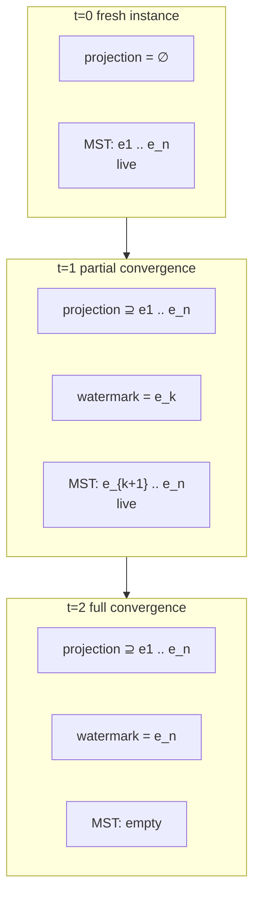

The MST is the **live window** of events that some member may still
lack. The **watermark** is the largest key this replica has truncated.
As members exchange events and confirm that they hold them, the
watermark advances.

Four consequences follow:

1. **Network propagation bounds the oplog, not application lifetime.**
   The MST of a quiet cluster shrinks to nothing.
2. **A new replica transfers the projection once, then catches up the
   live tail.** It does not replay the whole history.
3. **Truncation changes the MST root.** Two replicas that have truncated
   to the same watermark hold the same live tail and compute the same
   root. Two replicas at different watermarks compute different roots
   for identical data, and a fully compacted instance has the root
   `undefined`. The root describes the live window, not the materialised
   state.
4. **Convergence is therefore judged by what each replica applied.** The
   oracle is the **applied frontier**, a per-origin version vector of
   applied events, described in
   [its own section](#the-applied-frontier-the-convergence-oracle).

## What does "stable" mean here?

An event is **stable** when the **durable frontier** of every cluster
member covers it. A durable frontier is a per-origin version vector of
applied events (`bondy_oplog_instance:durable_frontier/1`):

- On a durable backend, it is the frontier in the last compaction
  checkpoint.
- On the `ets` and `map` backends, it is the live applied frontier
  (`durable_frontier_of/1`). A fused instance is always `ets`
  (`bondy_db:assert_fused_requires_ephemeral/2`).

On a durable backend each compaction cycle first checkpoints the applied
frontier when it has moved (`checkpoint_moved_frontier/1`). A member
whose compaction cycles stop therefore stops advancing its durable
frontier, except through the other checkpoint writers:
`persist_frontier/1`, `mark_install/1`, the truncation record and
`terminate/2`.

Sync sessions record the durable frontier of every member:

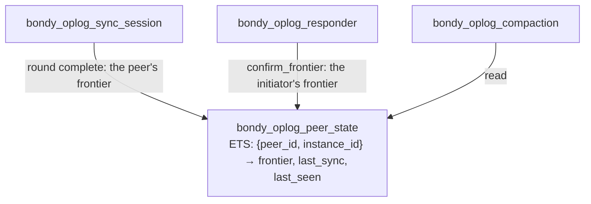

A completed round records a frontier in each direction. The initiator
reads the peer's durable frontier before the round (`get_frontier`) and
records it when the round completes. The initiator then reports its own
durable frontier, read after the round, and the peer's responder records
it (`confirm_frontier`). A report with no frontier, or an empty one,
keeps the frontier the row already held
(`bondy_oplog_peer_state:record_sync_complete/4`).

The **witnesses** of a compaction are the recorded frontier of every
other member plus this replica's own durable frontier
(`compaction_witnesses/1` and `member_vvs/2` in `bondy_oplog_instance`).
Every member is a witness on every instance, reachable or not:
`bondy_oplog_peer_state:confirmed_peer_states/2` reads every row with no
recency filter. A member with no recorded frontier holds compaction
(`{error, {unconfirmed, Members}}`).

A down or partitioned member therefore pins the watermark until it
returns or a Partisan `leave` removes it. We do not truncate past it,
because once both sides of a partition truncate, the writes each side
accepted alone are lost
(`proofs/tla/ConfirmedCompaction_3R_Fresh_Partition.cfg` violates
`NoLoss` under a recency filter; `_3R_Partition.cfg` holds it). A node
with clustering disabled (`bondy_cluster:enabled/0`) has its own
frontier as its only witness. A node with clustering enabled and no
other member confirms nothing.

A frontier records what the member has *folded*, not what its tree
holds, so it survives the member's own compaction. Two replicas that
both compact keep confirming each other's prefix
(`bondy_oplog_compaction_fused_test:peer_compaction_does_not_stall_ours/0`;
`proofs/tla/ConfirmedCompaction_2R_Async_Live.cfg` empties every tree).

## Computing the stability frontier

The **stability frontier** is the largest local key K such that every
witness confirms every local key ≤ K. A witness confirms a key in two
cases:

- The witness covers the key's `{origin, seq}`: the seq is at or below
  the witness's entry for that origin (`bondy_oplog_event:covered/2`).
- The key's origin is retired (`bondy_oplog_origin_bans:retired_set/0`).

`compute_frontier_for/2` in `bondy_oplog_instance` computes it:

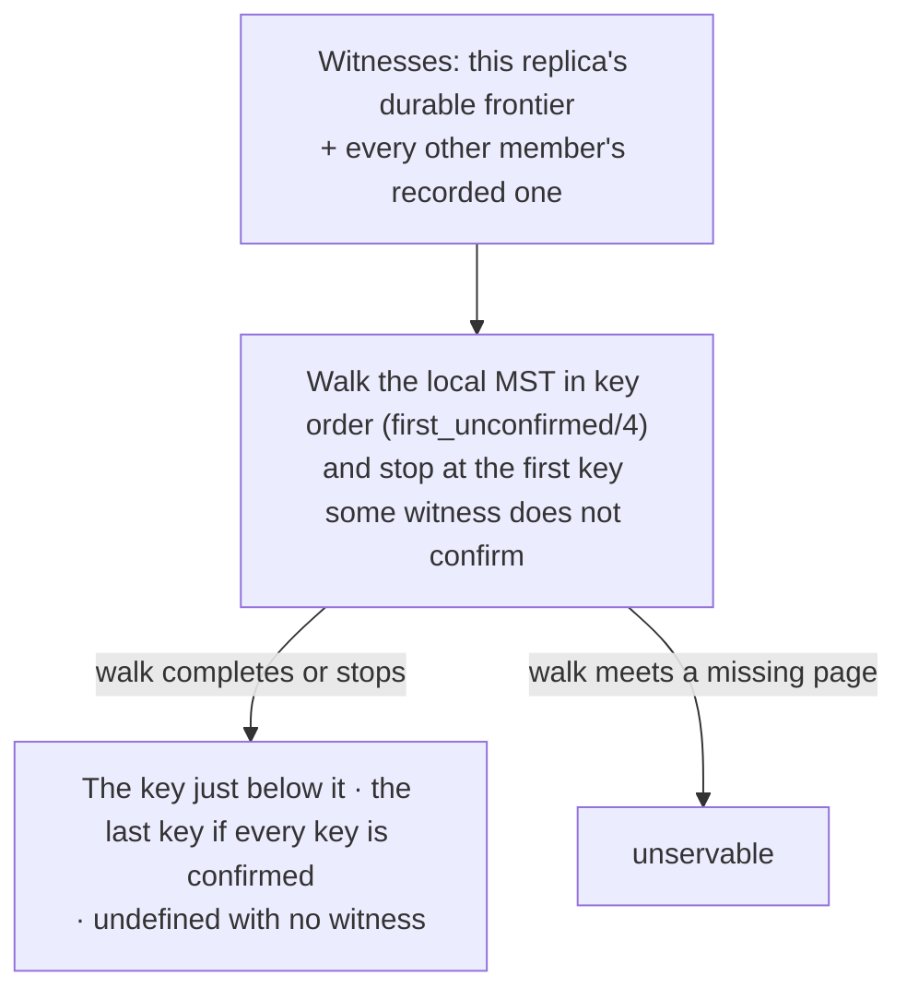

Four properties of the walk:

- **The walk costs the confirmed prefix, not the tree.** It stops at the
  first unconfirmed key. `bondy_mst:fold/4` has no early exit, so the
  walk stops by a throw.
- **This replica is one of its own witnesses.** The frontier never
  passes a key that this replica's durable frontier does not cover,
  except a key of a retired origin.
- **A member that has applied none of our events holds compaction**
  until it pulls them. An empty frontier confirms nothing.
- **A missing page stops the walk.** The walk folds with
  `{missing, throw}` and returns `unservable` when it meets a page the
  store lacks. It cannot tell whether the members hold the keys on that
  page, so it confirms nothing, and neither compaction nor the
  watermark door truncates on that cycle
  (`proofs/tla/ConfirmedCompaction_3R_Lost.cfg` holds `NoStrand`;
  `_3R_Lost_SkipWalk.cfg`, whose walk skips the page, violates it). The
  section [When the own root loses pages](#when-the-own-root-loses-pages)
  describes what the cycle does instead.

## The compaction cycle

`bondy_oplog_gc_scheduler` ticks every `gc_interval_ms` (default 1 s)
and spawns one short-lived worker per instance. The
`gc_max_concurrency` cap (default 4) admits only that many workers per
tick. The scheduler fires the **least-recently-fired instances first**.
With a fixed head-of-list order, the instances at the head would
complete within one interval and take every slot, and no instance beyond
the cap would ever compact.

The worker only issues the compaction call. The instance gen_server runs
the whole cycle synchronously:

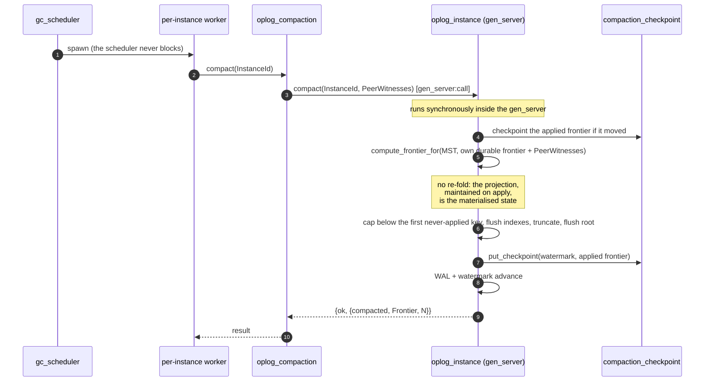

Three design choices shape the cycle:

- **Compaction runs synchronously inside the instance gen_server.**
  Frontier computation, checkpoint persistence and the
  truncate/watermark/HLC commit all run in the `compact` handler. The
  scheduler's worker only issues the call, so the scheduler never blocks.
  While a compaction runs, lock-free reads and stateless appends proceed,
  because they bypass the gen_server. Only the applier's install casts
  queue behind it.
- **The cycle is guarded against concurrency.** One compaction per
  instance runs at a time. An overlapping request replies
  `{ok, no_change}`, and the next tick retries. Compaction is idempotent,
  so a missed tick costs nothing.
- **No overlay-drain barrier.** `compact/1` drains nothing before the
  cycle. The frontier never passes a key that this replica's durable
  frontier does not cover, and `capped_truncation_point/2` then caps the
  truncation point strictly below the first key the applied frontier does
  not cover. In fused mode the yielding drain lets the gen_server service
  the compact request between drain slices. `truncate_prefix/2` takes a
  caller-supplied watermark, so it keeps its barrier.

Most ticks return `{ok, no_change}`: there is no witness, no confirmed
key, or nothing confirmed past the watermark and nothing left below it.
When the membership cannot be read, or a member has no recorded
frontier, `compact/1` still runs the cycle with no witness and returns
the cause as an error.

While the re-fold mark of a catalogue install is held, the cycle
truncates nothing (`truncate_unmarked/3`). The section
[Re-bootstrap ordering](#re-bootstrap-ordering) explains the mark.

## Truncation deletes pages

The MST truncation step is the step that bounds the tree. It is not a
soft delete. The instance calls `bondy_mst:truncate/2` with the
watermark, a **structural prefix truncation** that removes every key
≤ watermark in one pass:

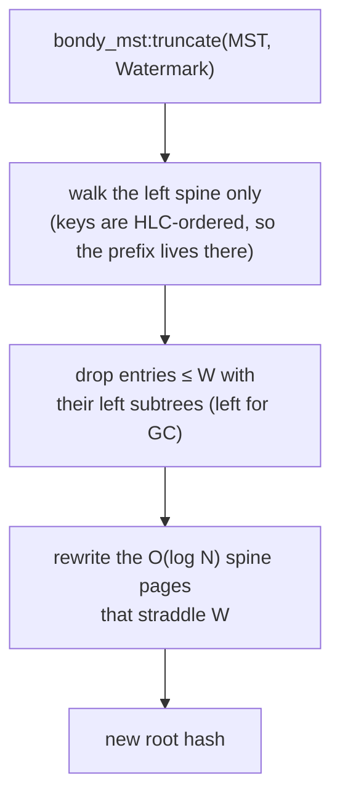

Calling `bondy_mst:delete/2` once per stale key costs `O(P·log N)` in
the prefix size, one spine rebuild per key. `truncate/2` walks the left
spine once, rewrites only the `O(log N)` pages that straddle the
watermark, and leaves the dropped subtrees unreferenced. The MST is
history-independent, so the result has the same root hash as the
equivalent sequence of deletes and as a fresh tree built from the
surviving keys
(`bondy_mst_truncate_test:truncate_matches_delete_and_fresh_test_/0`).

Two consequences follow:

- **Anti-entropy ships no tombstones.** Sync sessions exchange only
  pages that exist, and truncated keys are gone.
- **Truncation is deterministic.** Every replica that truncates the same
  prefix arrives at the same tree, with the same pages and the same root
  hash.

Truncation does **not** free space. It unlinks the dropped subtrees.
Reclamation is a separate step with its own cost model.

### Reclamation: when the space comes back

Truncation and reclamation are decoupled because the two backends pay
very different prices for reclamation.

| | ephemeral (`bondy_mst_ets_store`) | durable (`bondy_mst_pack_store`) |
| --- | --- | --- |
| Cost of one collection | Mark from the roots, `ets:delete` the rest. | Rewrite every sealed pack into a new one. |
| When it runs | On every truncation (`truncate_below_or_equal/4`). | On the compaction tick, at most once per `durable_gc_interval_ms` (`maybe_collect_durable/1`). |
| What it reclaims | RAM | Disk |

On the **ephemeral** backend a collection is cheap enough to run on
every truncation. `truncate_below_or_equal/4` composes
`bondy_mst:truncate/2` with `bondy_mst:gc/2` in one step. The collection
is reachability-based: the caller passes the roots that sync sessions
have pinned, and `gc/2` adds the current root. Nothing else collects the
unlinked pages on this backend.

On the **durable** backend a collection rewrites every sealed pack, so
it cannot run on every truncation. `should_compact/3` coalesces whenever
there is more than one sealed pack, so a call per truncation would
rewrite the whole sealed set every cycle. The collection runs instead
from the compaction tick, the instance's one periodic in-process hook,
behind three gates:

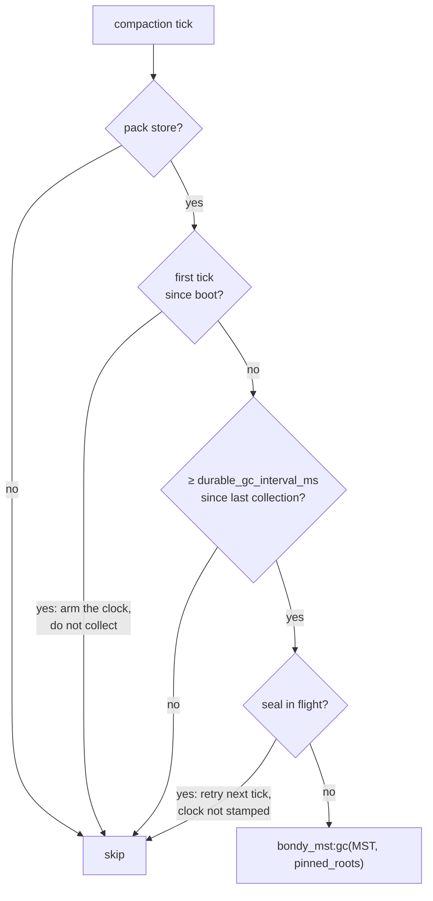

Each gate has a reason:

- **Arm on boot.** A shard that ran for months reopens with many sealed
  packs. A collection on the first tick would stall the instance on a
  full rewrite while it comes up. The first tick records the time and
  collects nothing.
- **Interval** (`bondy_oplog.durable_gc_interval_ms`, default 1 h).
  Durable namespaces have a low write volume, so garbage accumulates
  slowly, and the rewrite is the most expensive operation the instance
  performs.
- **Seal in flight.** A collection rewrites the packs that a seal is
  producing. When the collection is skipped for this reason, the clock is
  not stamped, so the next tick retries.

The collection runs **in the instance process**. The pack store declares
`process_bound_reads => true`, because that process owns the file
descriptors of the sealed packs, and the rewrite reads every sealed
record.

#### Liveness is reachability only

Both backends decide what to keep by marking from the keep-roots. The
pack rewrite keeps exactly the reachable set. A tombstone (`free/3`,
which on the pack backend adds the hash to the `free_set`) is a hint that
a page is probably garbage. It is never an independent reason to delete
the page.

`get/2` on that backend follows the same rule: the `free_set` is not a
read mask either. A keep test of "reachable and not tombstoned" differs
from "reachable" only for a page that is reachable from a live root yet
tombstoned, and it would delete that page from disk permanently. A stray
`free/3`, such as a merge that frees a donor page hash inside the
receiver's store, produces exactly such a page. The reachability rule
costs no reclamation, because a dead page is unreachable and the
reachability test drops it anyway
(`bondy_mst_gc_reachability_proper_test`).

`bondy_mst:gc/2` **refuses to sweep** while the current root is
unservable. The mark walk skips missing pages silently, so a hole would
leave everything beneath it unmarked, and the sweep would delete live,
reachable pages. On that path `gc/2` keeps the garbage for the cycle,
records a classified report that `bondy_mst:gc_aborts()` returns, and
emits `[bondy_mst, gc, aborted]`.

`bondy_mst:truncate/2` is implemented by `truncate_at`, `truncate_scan`
and `rebuild_truncated` in `bondy_mst.erl`. `bondy_mst:delete/2` removes
a single key.

## When the own root loses pages

A replica's own MST root can lose pages: a page that a live root
references is absent from the store. The frontier walk then returns
`unservable` (see
[Computing the stability frontier](#computing-the-stability-frontier)),
so neither compaction nor the watermark door truncates. Peers fail to
pull from this replica, and this replica cannot shrink its own tree.

The cycle turns to the **rebuild** (`rebuild_frontier/2`). Once every
witness covers the local applied frontier, the rebuild takes the whole
tree as the frontier and sends it through the ordinary compaction tail:
the cap, the index flush, the durable root, the checkpoint and the WAL
advance. The rebuild point is the largest readable key, or the watermark
when that is higher. The cap lowers it below the first readable key this
replica has not applied (`_2R_Seq2_Lost_Uncapped.cfg` violates `NoDrop`
without the cap). An uncapped point is at or above every readable key,
so `bondy_mst:truncate/2` empties the tree, lost pages included
(`bondy_oplog_compaction_fused_test:unservable_own_root_self_heals_when_right_edge_lost/0`).
A capped point can leave a lost page above it, and a later cycle
finishes the rebuild (`_2R_Async_Lost_Live.cfg` holds `Convergence`).
The rebuild emits `[bondy_oplog, instance, mst_rebuilt]` with
`reason => unservable_root` only when the tree it leaves has every page
(`bondy_oplog_compaction_fused_test:unservable_own_root_rebuild_holds_unapplied_applier/0`).

The cover makes every member hold every event this replica applied, so
no member needs one that the rebuild drops
(`proofs/tla/ConfirmedCompaction_3R_Lost.cfg` holds `NoStrand`;
`_3R_Lost_Ungated.cfg` violates it without the cover). A lost page can
also carry an event this replica has not applied: the fused replay holds
a merged event back (`fused_replay_diff/3`), and the applier lags. The
rebuild drops such an event, and a sync from a peer that holds it brings
it back (`_2R_Async_Lost_Live.cfg` and `_2R_Seq2_Lost_Live.cfg` hold
`Convergence`).

The peer side completes the recovery. The responder answers
`{error, {root_unservable, _}}` for the broken root. The initiating
session reports `root_unservable_behind` when the peer's applied
frontier is strictly ahead of its own. Three consecutive such verdicts
for one instance and peer escalate to a catalogue re-bootstrap, whose
snapshot producer reads the peer's projection, which is servable when
its MST is not. Without both halves, the pair deadlocks: every round
errors, no round completes, the frontier-gap verdict never fires, and
the shard never compacts (`_2R_Seq2_Lost_Live.cfg` converges;
`_2R_Seq2_Lost_NoHeal_Live.cfg` does not).

## The watermark door

Two replicas can compact at different rates. Say replica X has truncated
up to `e6` and replica Y only up to `e4`. When anti-entropy pulls Y's
pages into X, X must not take back events it has already truncated.
`bondy_oplog_instance:do_integrate_peer_root/2` handles this:

```erlang
%% bondy_oplog_instance.erl — do_integrate_peer_root/2
MST1 = bondy_mst:merge(MST0, MST0, PeerRoot),
{MST2, State} = watermark_door(State0, MST1),
```

After the merge, the **watermark door** (`watermark_door/2`) truncates
the keys at or below the local watermark that every compaction witness
confirms (`compaction_witnesses/1`). A key that some member has not
confirmed stays, so X can still ship it to that member. Dropping on key
order alone would leave a member that lacks the key with a frontier gap
(`proofs/tla/ConfirmedCompaction_3R_DoorDrop.cfg` violates `NoGap`;
`_3R.cfg` holds it). The door does nothing while the re-fold mark is
held.

The door never drops a never-applied event. "At or below the watermark"
does not mean "already folded here". A peer event that this replica
never applied can arrive with a key at or below the watermark. Nothing
replays a key the tree no longer holds, so discarding that event loses
it on this replica permanently
(`bondy_oplog_compaction_fused_test:compaction_holds_doored_event_until_applied_watermark_path/0`
builds that arrival). The door therefore checks every key at or below
the watermark against the applied frontier:

- A fused instance folds the never-applied events into the projection
  inline, then truncates.
- An applier-backed instance holds them below the watermark until the
  applier's replay folds them.

The compaction cycle applies the same rule at its own truncation site
(`capped_truncation_point/2`). A tick caps its truncation point strictly
below the first never-applied key at or below the frontier. Compaction
folds nothing itself: the applier's replay, cast at delivery, is the
only fold path for remote events, and a tick that finds an un-applied
event holds until the next tick. Events of a retired origin are exempt
from the hold at both sites, because the applier declines them by
design and nothing will ever fold them.

The live single-event path (`append_remote/2` → `do_append_remote/2`)
applies the same judgement in the **live-event watermark door**
(`append_remote_below_watermark/3`). It accepts, installs and delivers
an event at or below the watermark that the applied frontier does not
witness. Only re-shipped events that the applied frontier witnesses, and
events for instances with no projection, keep the plain filter.

Both MST entry paths then reach one delivery point,
`deliver_remote/1`. A fused instance folds inline before the handler
returns. An applier-backed instance bumps the applier's prepare fence
and casts the applier replay, so a pushed event reaches the projection
without waiting for the next anti-entropy round.

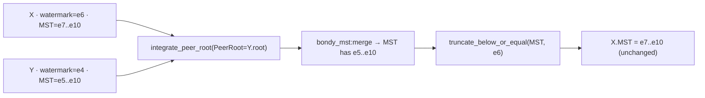

Two replicas with different watermarks are **not divergent**. They agree
on the applied state, and one holds a shorter live window. On Y's next
compaction tick, Y reads X's recorded durable frontier from
`bondy_oplog_peer_state` and computes a frontier that truncates
`e5..e6` too.

## Retention-bounded truncation for ephemeral catalogue instances

Peer-confirmed compaction is the primary history bound for ephemeral
catalogue instances, as for durable ones. It trails the write rate by
about one sync round plus one compaction tick, so propagation bounds the
live history of a loaded shard.

Retention covers the risk that confirmed compaction cannot: a live but
lagging member pins the frontier, and on the memory topology pinned
history is RAM. **Retention is an opt-in backstop and is off by
default.** Enabling it trades the invariant that peer confirmation
provides, *never truncate what a live member still lacks*, for a hard
local bound. The recovery paths below pay for that trade.

The instance opt is `mst_retention => #{max_age_ms, max_events}`. The
registry exposes it as `db.registry.retention.*`. Both knobs default to
`0`, which disables them.

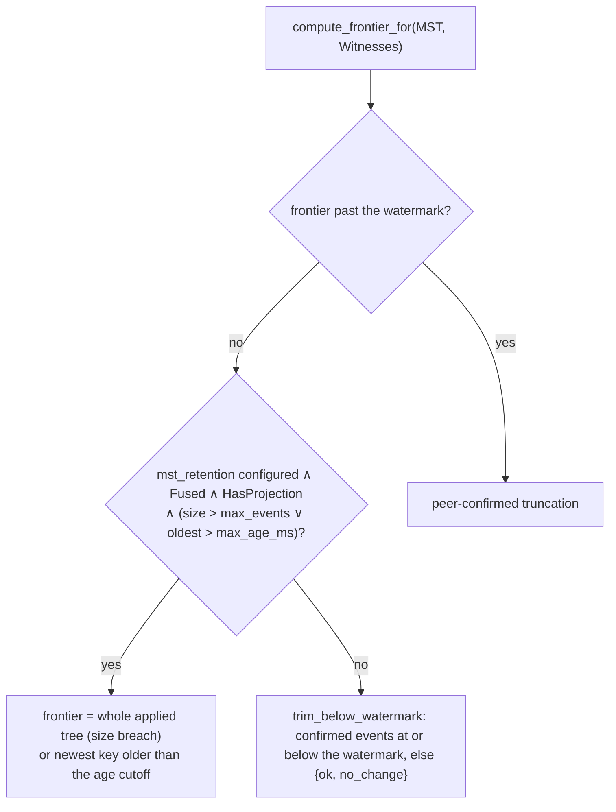

Three properties hold:

- **Peer-confirmed truncation comes first.** Every member already holds
  a confirmed prefix, so truncating it costs nobody a bootstrap.
  Retention fires only when the confirmed path yields nothing
  (`retention/4` → `retention_frontier/3` in `bondy_oplog_instance`).
- **Retention requires an ephemeral, projection-backed instance.** A
  restart wipes such an instance, so there is no durability to protect,
  and the projection holds all applied state, so truncation loses nothing
  locally. `mst_retention` requires `fused` (`validate_retention/2`), and
  `fused` requires ephemeral
  (`bondy_db:assert_fused_requires_ephemeral/2`).
  `bondy_oplog_instance_dyn_sup:start_instance/2` refuses an instance
  without a projection target. Durable instances never use retention.
- **The policy is uniform.** Every node bounds these instances by the
  same policy, so no node's frontier computation waits on another node's
  retained history. Retention truncates regardless of membership, so a
  single node needs no special case.

A replica that missed truncated history recovers in one of two ways:

- **A page pull fails.** The pages are gone. A miss usually means the
  peer truncated and collected pages during the round, so the session
  first requests the peer's current root again and continues against it
  (`chase_refreshed_root/7`, bounded by a budget). The session ends with
  `{peer_pages_unavailable, _}` only when the peer's root has not moved
  and the peer's applied frontier is strictly ahead of this replica's.
  The scheduler then flags a catalogue re-bootstrap, with deduplication
  and backoff. A miss with no frontier deficit ends the round as benign:
  the unpullable pages covered only events this replica already applied.
  Treating every miss as terminal would re-bootstrap on every truncation
  round.
- **A silent deficit.** The peer truncated events that this replica never
  received, so no page pull fails. After every complete round, the
  session compares the peer's applied frontier from before the round with
  its own, after settling the local apply pipeline. When the replica is
  strictly behind on any origin, the session fails with
  `{frontier_gap, Origins}`. A second consecutive verdict for the same
  instance and peer, within the strike window, flags a catalogue
  re-bootstrap. A live round never adopts the peer's frontier; it only
  compares against it. This verdict turns a deficit that page sync cannot
  close into an action, rather than a false converged report.

Two causes reach the frontier-gap verdict, and the remedy is the same:
the peer truncated events that this replica never received, or this
replica [withheld the peer's frontier](#adoption-is-all-or-nothing) at
its last bootstrap. The verdict is also how a new replica joins a
cluster that truncates: its first sync lands here and bootstraps. A new
cluster that has truncated nothing syncs without a bootstrap.

Catalogue bootstrap works on fused instances, which it has to, because
it is the only complete recovery source once history is truncated. The
snapshot producer resolves the projection target through the fused
instance itself when there is no applier
(`bondy_oplog_catalogue_snapshot:resolve_cell_apply_target/1`). The
rederive runs in the instance for a fused instance and in its applier
otherwise (`bondy_oplog_applier:rederive_projection_sync/2`).

The install replaces each shipped cell, so it can drop a local event
that the peer's copy omits. The rederive restores it: it re-applies
every retained MST event that the adopted frontier does not claim (see
[Bootstrap](#bootstrap-how-a-new-replica-joins)). This remedy is
complete only for events still inside the retained window. Under
peer-confirmed compaction that holds, because every member already has
every truncated event in its cells. Retention truncates past
confirmation, which is why it is an opt-in trade and not a default.

## The compaction checkpoint

Compaction folds nothing. The cell kernel maintains the projection on
apply, so the projection is the materialised state. Compaction only
truncates the MST and records the new watermark, together with the
applied frontier, in the **compaction checkpoint**. Its payload is
`{projection_managed, frontier, FrontierVV, MintedSeq, Meta}`
(`frontier_checkpoint/3`). The `bondy_oplog_compaction_checkpoint`
behaviour stores it. The name distinguishes it from the *catalogue
snapshot* that bootstrap transfers.

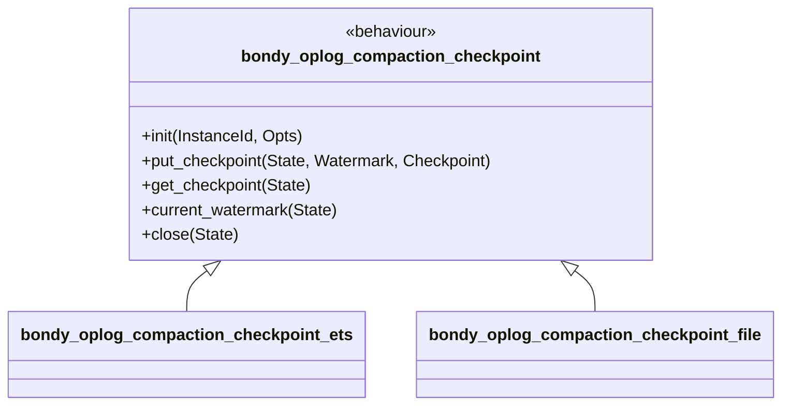

Two implementations ship. The default is the file backend when
`storage_path` is set, and ETS otherwise:

| Backend | Durability | Use |
| --- | --- | --- |
| `bondy_oplog_compaction_checkpoint_ets` | In memory. | Tests and ephemeral instances. |
| `bondy_oplog_compaction_checkpoint_file` | Temporary file, rename, directory fsync, at `<storage_path>/<InstanceId>/checkpoint.etf`. | Production. |

The file backend returns `{error, {corrupted, _}}` for a checkpoint it
cannot decode, and the instance **refuses to start** on it.

The library keeps **one checkpoint per instance**, the most recent one.
The live MST plus that checkpoint reconstruct the application state.

The checkpoint also carries the applied frontier of the compacted
prefix, so a restart restores it instead of rebuilding it from a scan of
the projection (see
[The applied frontier](#the-applied-frontier-the-convergence-oracle)).

## The CRDT module

The substrate gives events no meaning. A table's cell kernel names a
CRDT module that implements the `bondy_oplog_crdt` behaviour. The
callbacks this chapter refers to are:

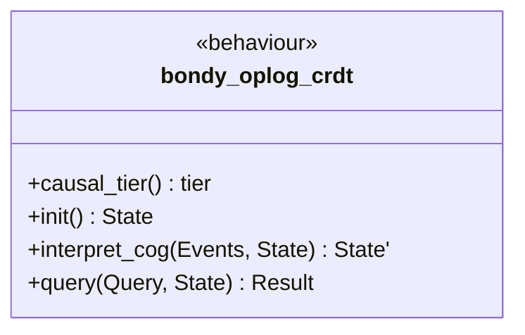

`interpret_cog/2` interprets a concurrent operation group (COG):

1. **It is deterministic.** The same `(Events, State)` yields the same
   `State'` on every replica. A non-deterministic interpreter breaks
   Strong Eventual Consistency.
2. **It receives events in key (HLC) order.** Concurrent operations
   arrive in the same group, and the interpreter resolves conflicts as
   its CRDT semantics require.
3. **It runs on the read path, not in compaction.**
   `bondy_oplog_cell_kernel:interpret_overlay/4` calls it to fold pending
   overlay events on top of a cell's projected state. Compaction never
   calls it (`run_compaction/2`).

The name comes from the Canteen design, where the COG interpreter has
the same role and the same determinism contract.

## The empty-MST steady state

Picture three members, a moderate write rate and steady anti-entropy:

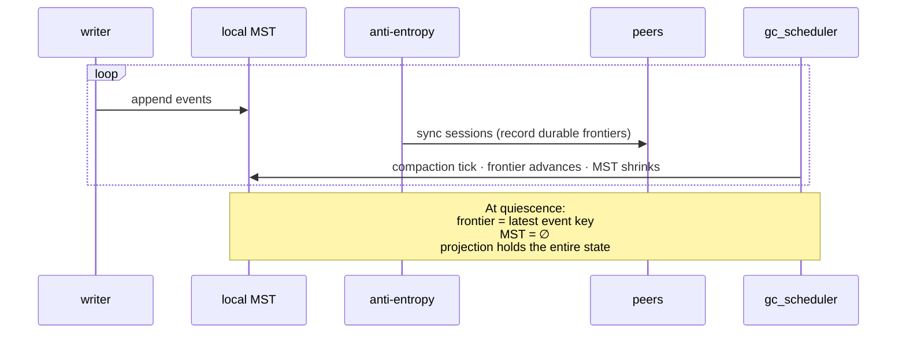

In a quiet, converged cluster the live MST is empty. New appends fill it
briefly, and a compaction tick after the next sync round drains it. The
durable state is the projection plus the checkpoint. The MST buffers the
events that the cluster has not yet all confirmed.

This inverts the usual model of log replication:

- **Old replicas do not carry old log.** The size of the projection
  bounds their disk footprint, not the write history.
- **Anti-entropy bandwidth is bounded.** Catching up costs at most the
  live tail, never the history.
- **New replicas do not replay the history.** They receive the catalogue
  snapshot and a short live tail.

## The applied frontier: the convergence oracle

Once two converged replicas both hold an empty MST, something other than
the MST root has to show that they hold the same data. Truncation moves
the root without changing the data, and a fully compacted instance has
the root `undefined`. Comparing roots gives two false verdicts:

- **Diverged** for identical data, when one replica has compacted and the
  other has not.
- **In sync** when both have compacted to empty and both advertise
  `undefined`, although nothing was compared.

The convergence oracle is therefore taken over **what each instance has
applied**. Each instance maintains an **applied frontier**, a version
vector that maps every event origin to the highest sequence number
applied from that origin:

```
frontier = #{ Origin => max Seq applied from Origin }
```

over every `{HLC, Origin, Seq}` `cell_apply` event the instance has
materialised. One number per origin describes that set completely only
if the applied seqs form a **contiguous prefix**. Delivery does not
supply that property, so the substrate enforces it. Events arrive out of
order, and a cell can fail to materialise while later ones from the same
origin succeed: its bucket's table is not registered here, or its value
is too large to frame.

The entry therefore means "every seq from this origin up to N
materialised here", and it advances only across a contiguous run.
`bondy_oplog_cell_apply:partition_contiguous/4` takes that run from the
seqs that routed. Anything above a gap is **held** in the `pending` set
of `bondy_oplog_registry`, not claimed. The cost is one interval per
hole, not one per seq above it, so a permanently unroutable bucket costs
one interval however much folds behind it.

Held state is visible. `pending/1` is non-empty for an origin exactly
when that origin has a hole. An instance that carries a hole for longer
than `db.frontier.hole_alarm`
(`bondy_oplog_config:frontier_hole_alarm_ms/0`, default 5 min) raises
`bondy_oplog_frontier_hole`. The alarm names the origins, where each gap
starts, and how much is stranded above it.

Two instances with equal frontiers have applied the same op-set, and the
op-based CRDT yields the same state for the same op-set (see
[chapter 05](05_crdt_model.md)). Two further properties make the
frontier a good oracle:

- **It does not change under compaction.** The frontier is a cumulative
  applied position. Compaction truncates the MST and advances the
  checkpoint, and it removes no position already reached. An empty MST
  and a full MST over the same applied history carry the same frontier.
- **It is cheap.** The frontier is `O(#origins)`, one integer per node
  that has ever authored an event, not `O(#cells)`. No path folds over
  the projection to compute it.

The applier maintains the frontier on the apply path: at each commit
barrier it max-merges the per-origin maxima of the batch into the
frontier (see [chapter 04](04_applier.md)). Max-merge is idempotent and
monotone, so re-applying an event that is already counted leaves the
frontier unchanged.

### Restart: restore the claim, re-fold the rest

At `init/1` an instance restores its frontier from two durable sources
and earns the remainder back by folding:

1. **The compaction checkpoint** carries the frontier of the compacted
   prefix: the events truncated from both the WAL and the MST, whose
   maxima exist nowhere else. `terminate/2` and every compaction commit
   persist it.
2. **The WAL tail** carries events past the durable root. The applier
   replays them on the normal apply path after `init/1`, and the frontier
   advances as it goes.

The range between the compaction watermark and the durable root is
**not declared applied at startup**. The instance presents it to the
fold again, and the frontier follows whatever materialises.

Folding the event keys of the live MST into the frontier would be
shorter, and it would be wrong, because the MST records **receipt**, not
application. `install_event/5` is the shared insert path, and only a
local event folds before it installs. A peer event installs first and
folds later through a best-effort cast, which a crash or a shutdown can
lose. Counting such an event as applied claims data that the projection
does not hold. It also disarms the repair: `watermark_door/2` and
`capped_truncation_point/2` judge "never applied" against this same
frontier, so the over-claim lets the never-applied event be truncated.

`bondy_oplog_instance:replay_anchor/1` decides. It returns the current
root when the restored frontier already claims every `cell_apply` event
in the live MST. It returns `undefined`, which re-folds the live tree,
when the frontier does not claim one, and emits
`[bondy_oplog, instance, boot_refold]`. A replica that shut down with
everything folded and checkpointed boots without a re-fold. The re-fold
runs only where there is something to recover, and it is idempotent.

The re-fold is one `O(live MST)` fold over the log, which compaction
bounds. It never scans the projection. A checkpoint whose frontier was
counted on receipt carries a provenance stamp that says so, and an
instance that restores one raises `bondy_oplog_frontier_receipt_derived`.
No merge can lower a frontier entry, so the alarm names the repair:
wipe the instance's data directory and let it re-bootstrap.

### Comparing across replicas

A replica fetches another replica's frontier with a `get_frontier`
request over the anti-entropy channel. The reply carries the frontier
map and the node's keying-topology fingerprint (see
[chapter 03](03_bondy_db.md#the-topology-manifest)). Two instances are
converged when their fingerprints agree, so the projections are keyed
the same way, and their frontiers are equal. That includes the case
where both frontiers are empty, which the MST root cannot tell apart
from "untested". The operator sync view (`bondy_observer_cli_sync`)
judges convergence this way. A peer that does not answer `get_frontier`
reads as `not_found`.

`bondy_oplog_registry` holds the frontier and its max-merge.
`bondy_oplog_cell_apply` maintains it on the apply path, and
`bondy_oplog_instance` restores it at startup (`boot_frontier/2`).

## Bootstrap: how a new replica joins

The complement of truncation is **snapshot transfer**. A replica that
joins a cluster, or recovers from a long outage, has a stale or empty
MST. Anti-entropy alone would have to ship the entire history, and
truncated history is gone from every tree. Instead, the replica
bootstraps from a peer's projection.

The state is millions of cells, not one term, so the transfer is a
**cursor-paginated cell stream**
(`bondy_oplog_sync_session:bootstrap_catalogue/3`):

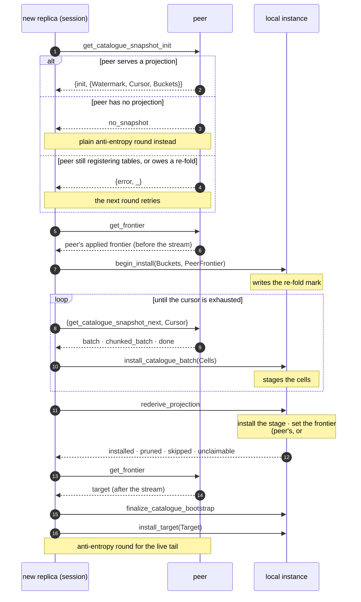

**The install replaces.** It replaces every cell whose bucket routes
here, whatever its HLC: the replica starts from the peer's state rather
than merging into its own. A live replica that re-bootstraps has local
state, and the rederive that follows the install folds back its events
that the peer lacks. Keeping a newer local cell instead would let the
adopted frontier claim peer events that the cell never folded
(`proofs/tla/LiveRebootstrapRefold_SkipIfOlder_TrailFail.cfg`).

**The install is whole.** `Buckets` in the init reply names every table
the peer scans, an empty one included, so the install can tell a table
with no cell from a table the peer does not have. The install deletes a
local cell of a listed table that the stream did not ship, because the
peer's scan found none there. A table the peer does not list keeps its
cells (`bondy_oplog_applier:commit_stage/4`;
`bondy_oplog_bootstrap_rederive_test`: `cell_the_snapshot_lacks_is_pruned`,
`empty_source_table_prunes_every_cell`,
`table_the_source_lacks_keeps_its_cells`).

**A cell too large to frame arrives in parts.** When the serialised size
of one value exceeds the sync byte ceiling, the producer emits it as
numbered `cell_chunk()` parts across consecutive batches, and the reply
becomes a `chunked_batch`. The session reassembles parts 1..Total and
**fails the bootstrap** with `{incomplete_chunked_cells, _}` when the
stream ends with a reassembly still open. A partial value never reaches
the projection.

**The frontier travels separately.** The streamed cells are
`{Bucket, Key, Frame}` triples: HLC and folded value only. They do not
carry the `{Origin, Seq}` pairs that the
[applied frontier](#the-applied-frontier-the-convergence-oracle) is built
from, and only the apply path advances the frontier. Installing every
cell therefore seeds the replica's data and leaves its frontier empty. A
replica that holds all the data yet reports an empty frontier would be
judged diverged indefinitely. The session reads the peer's frontier with
`get_frontier` before the stream and passes it to `begin_install/3`. The
rederive then sets the applied frontier to it.

**The install refuses a source behind this replica's truncation.**
`begin_install/3` returns `{error, {source_behind_truncation, Uncovered}}`
and writes nothing when the peer's frontier does not cover this
replica's truncation record. The events of `Uncovered` are in neither
the snapshot nor the tree, so the re-fold would lose them
(`proofs/tla/JoinInstall_Truncation_CompactMembers_NoCover.cfg`;
`bondy_oplog_bootstrap_rederive_test`,
`install_behind_truncation_is_refused`).

### Adoption is all-or-nothing

The install cannot say which origin a missing cell belongs to, so the
peer's frontier is adopted whole or not at all. The peer's vector states
"every event of this origin up to N materialised here". If one cell did
not land, that statement is false for whichever origin minted it. A cell
carries no origin and no seq, so the install can answer only one
question: *did everything the peer shipped land?*

The rederive reports `unclaimable`, the buckets whose cells did not
land: an unregistered bucket, or a frame that would not decode.
`skipped` counts those cells but cannot name their buckets.
`bondy_oplog_applier:adopt_frontier/3`, called from `commit_stage/4`,
sets the applied frontier to the peer's vector when `unclaimable` is
empty and to `#{}` when it is not
(`proofs/tla/MuxBucketSkip_Minus_AdoptIfComplete.cfg` violates
`NoOverClaim` without the condition).

Withholding the frontier is not failing the bootstrap. The bootstrap
completes and installs every routable cell; only the frontier claim is
declined. The usual cause, a peer that declares a table this node does
not, never resolves on its own. Refusing the bootstrap would leave the
replica without the data it *can* route, and adopting regardless is the
over-claim that the oracle cannot see.

The replica then reports **diverged** against that peer, which raises a
frontier-gap verdict and a re-bootstrap on the usual cadence. That cycle
does useful work. The contiguity rule holds a routable event above an
unroutable seq of the same origin, so the fold can never deliver it, and
the catalogue install is the only writer of applied state that bypasses
the fold. Re-bootstrapping is therefore how those events reach the
projection. An operator ends the cycle, which is why the condition raises
`bondy_oplog_bucket_unroutable` naming the buckets to declare.

### Bootstrap completion ordering

`bondy_oplog_sync_session:bootstrap_catalogue/3` completes in this
order:

1. `begin_install/3` writes the **re-fold mark** durably into the
   compaction checkpoint. It refuses with `{serving_snapshot, _}` while
   another replica streams a snapshot from this instance, deletes the
   expired snapshot cursors, and discards anything an earlier session
   staged.
2. The session stages the streamed cells.
3. `rederive_projection/2` installs the staged cells, sets the applied
   frontier (adopted or `#{}`), and replays the retained MST through the
   causal hold, which folds the events that the frontier does not claim.
4. `finalize_catalogue_bootstrap/4` advances the high-water mark, absorbs
   the highest installed HLC into the clock, and makes the frontier
   durable in the compaction checkpoint (`persist_frontier/1`). For a
   fresh replica it then calls `mark_live/1`, which writes the durable
   flag file. A replica that was already `live` skips that call.
5. `install_target/2` hands the instance the peer's frontier, read after
   the stream. The mark stays until the applied frontier claims that
   target, because the installed cells can reflect events that the peer
   applied while it streamed them
   (`proofs/tla/JoinInstall_Truncation_CompactMembers_NoTarget.cfg`
   violates `SettledSound`; `bondy_oplog_bootstrap_rederive_test`,
   `install_holds_until_claims_cover_source`). The first compaction tick
   that finds the target claimed writes a checkpoint without the mark
   (`checkpoint_moved_frontier/1`).
6. An anti-entropy round pulls events past the new watermark. A failure
   here loses nothing, because the rederive already ran. When the peer
   answers `root_unservable`, the session completes with
   `{ok, bootstrapped_unservable_tail}`.

`mark_live/1` runs after every other durable step of a fresh bootstrap.
A crash before it leaves no flag file, so on restart the instance is
`pre_bootstrap` again and the scheduler bootstraps it anew.

### Re-bootstrap ordering

The registry catalogue seeds its instances `live`
(`bondy_namespace_catalog`, `seed => true`), so for them the lifecycle
flag protects nothing, and the re-fold mark is what keeps a
re-bootstrap safe. `proofs/tla/LiveRebootstrapRefold.tla` checks the
order under trailing-round failures and crashes. Its `_Proposed_*`
configs model the order above. Each ingredient below has a config that
removes it and fails:

- **Re-fold before finalize.** A re-fold that runs only after the
  trailing anti-entropy round loses the local events the install
  replaced whenever that round fails (`_LateRederive_TrailFail`).
- **The re-fold mark.** Without the mark, a crash after the install and
  before the re-fold leaves a checkpoint that claims events the replaced
  cells no longer reflect, and the restart anchors its replay past them
  (`_NoMarker_Crash`). A boot that finds the mark trusts neither the
  checkpointed frontier nor the one in the registry row: it empties the
  frontier (`boot_frontier/2`), so the replay re-folds the whole MST.
  Only a later catalogue re-bootstrap clears a mark found at boot, and
  `owes_install/1` tells the scheduler to dispatch one.
- **Reset, not merge.** A frontier max-merged across the rederive keeps
  claiming events that an earlier install carried and this one dropped
  (`_MergeFrontier_3R_Safety`).
- **No serving while the mark is set.** The install can shrink the
  cells, so a replica in the middle of a re-bootstrap would ship a
  snapshot below the frontier it reports. While the mark is held, the
  responder refuses `get_catalogue_snapshot_init` and `get_frontier` with
  `{error, {refold_owed, _}}` (`bondy_oplog_instance:serving/1`;
  `_NoServeGuard_TwoFaults`).

While the mark is held, the instance also truncates nothing: compaction,
the watermark door and `truncate_prefix/2` all stand down. A stream that
fails drops what it staged (`abort_install/2`) and leaves the mark, and
`owes_install/1` makes the scheduler dispatch another session. The
tests in `bondy_oplog_bootstrap_rederive_test` replay these
counterexamples on the real code.

## Bootstrap lifecycle: gating the applier

Between "instance process starts" and "snapshot installed", the applier
must not drain live events onto an empty projection. Without a gate it
would apply `+100` to bottom state and converge to wrong values. The
failure is silent and affects every fold strategy, not only counters.

Each instance therefore has a two-state lifecycle that the substrate
enforces:

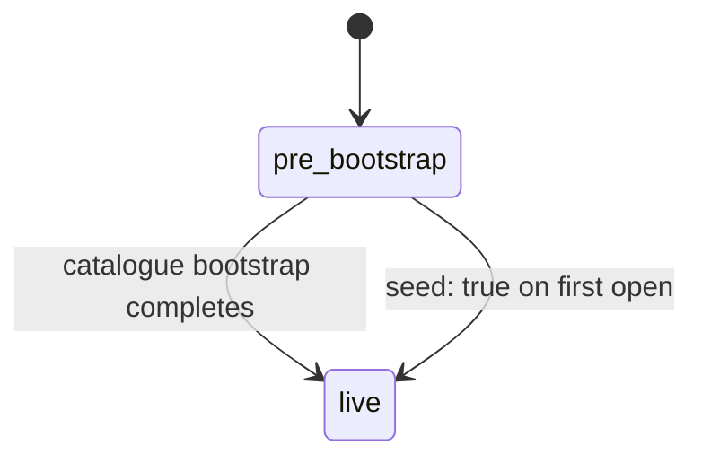

- **`pre_bootstrap`** is the default state of a newly opened
  *persistent* instance. The WAL accepts writes from local appenders and
  sync sessions, because the WAL is the durable buffer. The applier does
  not drain.
- **`live`**: the applier drains normally.

The lifecycle bit is the empty flag file `<instance_dir>/lifecycle.live`.
Its presence means `live`; its absence means `pre_bootstrap`.
`file:rename/2` makes the transition atomic, with no parsing, checksum
or version handshake. A boolean mirror in `atomics` keeps the applier's
check free of system calls.

### Genesis: `seed: true`

The first replica in a new cluster has nothing to bootstrap from. The
instance opt `seed => true` declares a genesis replica. On first open it
sets the lifecycle to `live` and, when `storage_path` is set, writes the
flag file, so later restarts are `live` without the opt.

### Ephemeral instances

An instance without `storage_path` cannot persist a flag file. Its
lifecycle is held in memory only and defaults to `live`: there is no
persistent state to bootstrap from. `seed: false` is still honoured, so
tests can exercise the gate.

### Initial state

| Configuration | Initial state |
| --- | --- |
| `lifecycle.live` exists on disk | `live` |
| `seed: true` in opts | `live` (writes the flag file if persistent) |
| No `storage_path` (ephemeral) | `live` |
| Persistent, no flag file, `seed: false` | `pre_bootstrap` |

The lifecycle lives in `bondy_oplog_bootstrap_lifecycle` (the durable
bit and its atomic mirror), `bondy_oplog_instance` (`mark_live/1`,
`lifecycle_state/1`) and `bondy_oplog_applier` (the gate in
`drain_loop/1`).

## Auto-bootstrap and dispatch policy

The lifecycle gate keeps the applier from draining too early, but the
gate alone does nothing: something has to run a bootstrap session to
move a fresh persistent replica from `pre_bootstrap` to `live`.
`bondy_oplog_sync_scheduler` does. Each tick inspects every running
instance and routes it:

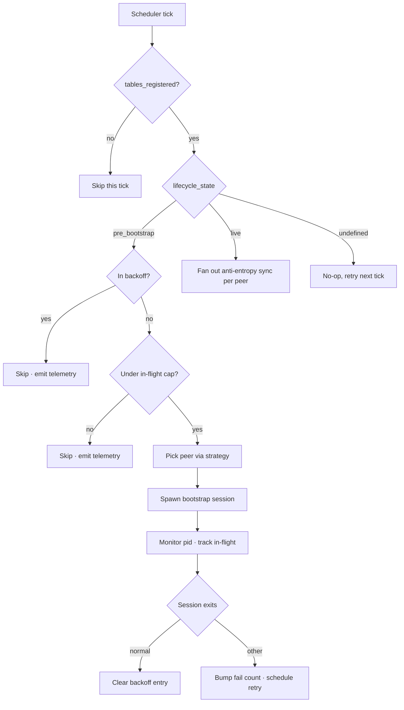

The scheduler dispatches a `pre_bootstrap` instance to **exactly one**
peer per tick. A bootstrap ships a full projection, so dispatching to
several peers would duplicate I/O without improving correctness. A
`live` instance fans out one pull-direction sync session per peer. Four
regulators bound that fan-out; they are described in
[Keeping anti-entropy subordinate to routing](#keeping-anti-entropy-subordinate-to-routing).

The `tables_registered` gate is `bondy_oplog_registry:tables_registered/1`,
the predicate that the responder applies when it serves. On the
dispatching side it is not a safety condition: adoption is already
[all-or-nothing](#adoption-is-all-or-nothing), so a bootstrap dispatched
during registration would install a partial projection and claim
nothing. The gate avoids doing that work twice.

### Dispatch knobs

| Knob | Default | Purpose |
| --- | --- | --- |
| `bootstrap_peer_strategy` | `first` | Selects the peer for a dispatch: `first` (the head of the peer list), `random` (uniform), or `round_robin` (a per-instance index). |
| `max_inflight_bootstraps` | `4` | Caps the parallel bootstrap sessions on the node. An over-cap dispatch is skipped, and the instance retries on a later tick. `0` disables dispatch. |
| `bootstrap_retry_base_ms` | `500` | Sets the first backoff after a session exit other than `normal`. The wait doubles on each consecutive failure. |
| `bootstrap_retry_max_ms` | `30000` | Bounds the exponential backoff. |
| `bootstrap_retry_jitter` | `true` | Multiplies the wait by a uniform factor in `[0.5, 1.5]`, which spreads retries when many instances fail together. |

Each knob has a runtime setter in `bondy_oplog_config`, with no restart.
`bondy_oplog_sync_scheduler:info/0` returns the current configuration.

### Gate ordering

The two skip gates run in this order on every `pre_bootstrap` dispatch:

1. **Backoff.** When `now < NextRetryMs` for this instance, the dispatch
   is skipped. An instance in backoff does not take an in-flight slot, so
   other instances still dispatch.
2. **Cap.** When `inflight_count >= max_inflight_bootstraps`, the
   dispatch is skipped. Within one tick the in-flight count only grows,
   because `DOWN` messages wait until the tick completes, so the cap is
   deterministic per tick.

### Dispatch states

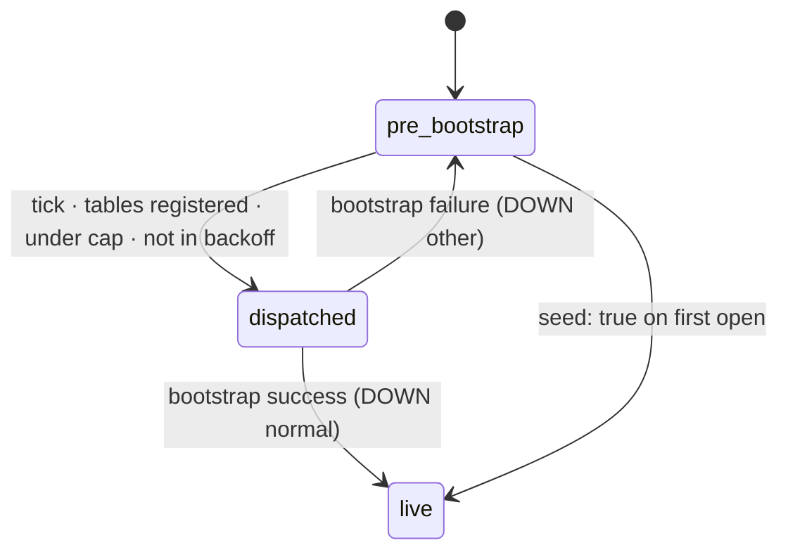

`dispatched` is the scheduler's in-flight record, not a lifecycle value.
A failed session leaves the instance `pre_bootstrap`. The next tick
evaluates the lifecycle again and, once the backoff has elapsed,
dispatches again. There is no separate retry mechanism.

### Telemetry

Each gate emits its own event, so operators can monitor retry pressure
without sampling logs:

| Event | When | Metadata |
| --- | --- | --- |
| `[bondy_oplog, sync_scheduler, dispatch_bootstrap]` | A session was spawned. | `instance_id`, `peer`, `strategy` |
| `[bondy_oplog, sync_scheduler, bootstrap, started]` | A session pid joined the in-flight set. | `instance_id`, `pid` |
| `[bondy_oplog, sync_scheduler, bootstrap, ended]` | A session pid exited, for any reason. | `instance_id`, `pid`, `reason` |
| `[bondy_oplog, sync_scheduler, bootstrap_capped]` | The in-flight cap skipped a dispatch. | `instance_id` |
| `[bondy_oplog, sync_scheduler, bootstrap_backoff_deferred]` | Backoff skipped a dispatch. | `instance_id` |
| `[bondy_oplog, sync_scheduler, bootstrap_retry_scheduled]` | A failure raised the fail count and set a new retry time. | `instance_id`, `wait_ms`, `fail_count` |
| `[bondy_oplog, sync, catalogue_bootstrap, complete]` | A catalogue bootstrap installed and finalised. | `instance_id`, `peer`, `was_live`, `frontier_adopted`, `unclaimable_buckets`; measurements `installed`, `pruned`, `skipped`, `unclaimable`, `watermark` |

`frontier_adopted` is the event to alert on. A run with
`frontier_adopted = false` installed data but declined the peer's
frontier, and `unclaimable_buckets` names the reason.

### Symptoms and levers

| Symptom | Cause and lever |
| --- | --- |
| A cold start of a new cluster saturates the network or disks of the peers. | Too many parallel bootstraps. Lower `max_inflight_bootstraps`. |
| One peer is hot under bootstrap load. | The `first` strategy picks the same peer. Set `bootstrap_peer_strategy` to `round_robin` or `random`. |
| One replica keeps failing to bootstrap. | `bootstrap_retry_scheduled` reports a rising `fail_count` for that `instance_id`. A count past 5 means the peers are unreachable from this replica, not a transient failure. |
| Bootstrap traffic has to stop while anti-entropy continues. | `bondy_oplog_config:set_max_inflight_bootstraps(0)` stops new sessions. Sessions in flight complete. |
| A test needs deterministic retry timing. | `bondy_oplog_config:set_bootstrap_retry_base_ms(0)` and `bondy_oplog_config:set_bootstrap_retry_jitter(false)`. |
| `bondy_oplog_bucket_unroutable` is raised and the replica keeps re-bootstrapping. | A peer holds data for a table this node does not declare; the alarm's `buckets` names them. Declaring the table here, usually by running the peer's build, lets the next bootstrap complete and clear the alarm. No change on the peer helps. |
| `bondy_oplog_frontier_hole` is raised. | This replica lacks seqs below events it has applied. The hole closes while a peer still holds the missing history. When every member has truncated it, the catalogue re-bootstrap is the only repair. The alarm's `origins` says where each gap starts and how much is stranded above it. |

## Keeping anti-entropy subordinate to routing

A Bondy node exists to route messages. Anti-entropy is background work
that must not make the node unusable. Bootstrap dispatch is gated as
described above, and four independent regulators bound the steady-state
`live` fan-out. Together they bound how much of the node anti-entropy
consumes, in concurrency, memory and scheduler time, without starving a
shard or the authentication path.

### The node-wide concurrency cap

`aae_max_concurrency` (default `3`) caps the sync sessions, bootstrap
**or** live, that run at once on the node. The scheduler tracks and
monitors every spawned session in a named ETS table, one row per pid,
tagged by kind and peer (`{Pid, InstanceId, bootstrap | live, Peer}`).
The cap reads the row count before every dispatch, so it holds across
instances within a tick. `max_inflight_bootstraps` (`4`) is a narrower
cap inside this one: a bootstrap dispatch needs room under both. A live
fan-out also skips any peer it already syncs with, so a slow shard never
stacks duplicate sessions on one peer.

### Bounded-memory sync

The cap governs speed and fairness, not the memory ceiling, which has
its own budget. `aae_max_pages_in_flight` (default `2048`) is the
node-wide ceiling on the MST pages that reconciliation may materialise at
once. A session pulls a peer's missing pages in **rounds**, each bounded
to `aae_pages_per_round = aae_max_pages_in_flight ÷ aae_max_concurrency`.
Dividing the budget by the concurrency makes the memory ceiling
independent of the number of sessions: one session pulls large batches,
three sessions each pull a third, and the node-wide peak is the same.
Without the bound, an initial sync would load a whole shard tree in one
round, once for every shard that syncs concurrently. The page budget
bounds the sync buffers. The per-instance heap monitor reclaims the
garbage that applying leaves in the instance process (see
[chapter 01](01_bondy_oplog.md#the-instance-heap-monitor)).

### Fairness: per-tick rotation

A low cap must not let the first shards take every slot. Each tick sorts
the running instances into a deterministic order and **rotates** the
list by a monotonic tick counter before it dispatches (`rotate/2`), so
the instances that win the free slots change from tick to tick. With
`aae_max_concurrency = 1`, a fixed order would give the only slot to the
first shard forever. The rotation offers every shard the slot in turn.

### The live-sync adaptive throttle

A converged `live` shard syncs only to *discover* divergence. Once its
data has settled it has nothing to pull, and polling every peer every
tick is constant load for no result. The throttle (`live_sync_adaptive`,
default on) uses the shard's in-memory MST root as a change detector.
While the root moves, through a local write, replicated data or a sync
that is catching up, the shard syncs every tick. Once the root is
quiet, the poll window doubles each round up to `live_sync_max_ms`
(default `5s`). The first poll that pulls anything moves the root and
resets the window. `bondy_db` applies by pull only, so this window is
also the steady-state convergence latency for an idle shard across
nodes, and `live_sync_max_ms` bounds it.

### Load-reactive yield (opt-in)

The cap bounds anti-entropy in aggregate. The load-reactive yield adds a
bound in time. During a routing burst, even three concurrent syncs add
scheduler pressure that competes with routing. When the yield is on
(`aae_load_adaptive`, default **off**), the scheduler samples a node-load
signal once per tick. While the node is backlogged, it skips its
throttleable dispatches for that tick: bootstrap transfers and live
syncs that do not back the fence.

The signal is a BEAM primitive, so the storage layer takes no dependency
on the router above it: `erlang:statistics(run_queue) ÷
schedulers_online`, the average number of ready processes queued per
scheduler. The scheduler smooths it with an EWMA across ticks and
compares it with `aae_load_run_queue_threshold` (default `2.0`). The
yield is **soft**: it never aborts a session in flight, and a deferred
shard retries on the next quiet tick. Deferring anti-entropy under load
changes only convergence latency, never the converged state. The yield
is off by default because the cap and the throttle already bound
anti-entropy and the run-queue signal depends on the environment.

### The fence exemption

One class of instance bypasses the cap, the throttle **and** the yield:
an instance that backs the authentication freshness fence, that is, one
that carries anti-entropy freshness targets
(`bondy_oplog_registry:set_ae_targets/2`). A successful sync round
renews those targets, and the read-side fence refuses authentication
once a target goes unconfirmed past `auth_max_lag`. Throttling, capping
or yielding such an instance would let the fence expire on an idle,
healthy node and refuse logins. A fence-backer therefore syncs every
tick regardless of load. The per-round page batch still bounds its
memory, and fence-backers are few.

### Regulator knobs

| Knob | Default | Purpose |
| --- | --- | --- |
| `aae_max_concurrency` | `3` | Caps concurrent sync sessions on the node, bootstrap and live. It also divides the page budget, so it tunes speed and fairness, never the memory ceiling. |
| `aae_max_pages_in_flight` | `2048` | Bounds, in MST pages, the reconciliation in flight on the node. It is the lever that bounds the peak memory of anti-entropy. |
| `aae_pages_per_round` | derived | Equals `aae_max_pages_in_flight ÷ aae_max_concurrency`: the batch one session pulls per round. |
| `live_sync_adaptive` | `on` | Backs off the sync cadence of a converged shard geometrically until its root moves. |
| `live_sync_max_ms` | `5000` | Bounds the backed-off live-sync window, which is the convergence latency of an idle shard. |
| `aae_load_adaptive` | `off` | Yields throttleable dispatches while the node is backlogged. |
| `aae_load_run_queue_threshold` | `2.0` | Sets the smoothed run queue per scheduler at or above which the yield fires. |

Each settable knob has a runtime setter in `bondy_oplog_config`.
`aae_max_pages_in_flight` is read from the application environment
only, and `aae_pages_per_round` is derived, so neither has a setter.
`bondy_oplog_sync_scheduler:info/0` returns the live configuration, the
in-flight total, the smoothed `current_load`, and whether the node is
`load_yielding` this tick. Telemetry reports every decision:
`[bondy_oplog, sync_scheduler, live_capped | live_load_deferred | load_yield]`
and the bootstrap events listed above.

## What can go wrong, and what catches it

| Hazard | Catch |
| --- | --- |
| Two replicas compact to an empty MST and both advertise the root `undefined`, so a root comparison reports "in sync" without comparing anything. | Convergence is judged by the [applied frontier](#the-applied-frontier-the-convergence-oracle), which compaction does not change and which is equal when both MSTs are empty. |
| A silent member pins the watermark indefinitely. | Confirmed compaction waits for it on every instance until it returns or a membership change removes it. `bondy_oplog_peer_state:confirmed_peer_states/2` reads every row, however old. Truncating past it would lose the writes it accepted alone (`proofs/tla/ConfirmedCompaction_3R_Fresh_Partition.cfg`). Only the opt-in `mst_retention` of a fused instance truncates past it. |
| A replica truncates a prefix that the projection does not yet reflect. | Compaction does not re-fold: the projection is maintained on apply. The frontier never passes a key that this replica's durable frontier does not cover. `capped_truncation_point/2` caps the truncation point below the first never-applied key. The truncated root is durable before the checkpoint is written, and the WAL advances only after the checkpoint (`finalize_catalogue_compaction/4`). |
| Two compactions race. | `bondy_oplog_instance` runs one at a time. A second `compact` request while one is in flight replies `{ok, no_change}`. |
| A replica's own root loses pages. | The frontier walk returns `unservable`, so compaction and the watermark door truncate nothing. On a fused instance, the rebuild truncates the whole tree once every witness covers the local applied frontier. A peer escalates to a catalogue re-bootstrap after three consecutive `root_unservable_behind` verdicts. See [When the own root loses pages](#when-the-own-root-loses-pages). |
| A peer ships events that this replica has already truncated. | On page sync, `watermark_door/2` drops a re-shipped event with `key ≤ watermark` only when this replica folded it **and** every compaction witness confirms it. The live single-event path (`append_remote_below_watermark/3`) drops one only when the applied frontier shows it was folded here. A never-applied event at or below the watermark is folded inline (fused) or held for the applier's replay. |
| A dangling root, from a transient race between truncation and page GC, is advertised over anti-entropy and read as "the peer's tree is empty". The initiator then runs a "complete" round that pulls nothing and records a false standing gap. | The responder's `get_root` distinguishes the two `undefined`s. The guard's refusal answers `{error, {root_unservable, _}}`, which fails the session benignly until the next tick. Only an empty tree (`root_hash/1 = undefined`) answers `undefined`. `chase_refreshed_root/7` propagates a failed root request instead of reading it as "root unmoved". |
| The local page GC sweeps pages that a sync session pulled but has not merged, because they are unreachable from the local root until `integrate_peer_root/2`. `bondy_mst:merge/3` would treat the missing subtrees as empty and complete a round that lost events. | Sessions pin the root they pull (`bondy_oplog_instance:pin_peer_root/2`; a successful integrate consumes the pin, and a TTL expires it otherwise). `truncate_below_or_equal/4` passes the pins to `bondy_mst:gc/2` as keep-roots. `integrate_peer_root/2` also checks `missing_set` atomically with the merge, in the process that runs the GC, and answers a retryable `{error, {peer_pages_missing, _}}` instead of merging partially. |
| `interpret_cog/2` is non-deterministic. | Convergence breaks silently. The behaviour documentation states determinism as the invariant, and `bondy_mst_crdt_SUITE` checks it for the test CRDT. |
| A fresh persistent replica never becomes `live` because no bootstrap runs. | The scheduler's default dispatch reads the lifecycle and bootstraps a `pre_bootstrap` instance from a peer on the next tick. |
| A cold start of the cluster runs N parallel snapshot transfers and saturates the peers. | `max_inflight_bootstraps` (default `4`) caps concurrent sessions. An over-cap dispatch waits for a later tick. |
| A replica whose peers are unreachable retries every 500 ms indefinitely. | Per-instance exponential backoff (500 ms up to 30 s, optional ±50 % jitter) lowers the steady retry rate to about one per 30 s after a few failures. |
| Many replicas bootstrap from the same first peer. | `bootstrap_peer_strategy` set to `round_robin` or `random` spreads the load. |
| The compaction scheduler admits only `gc_max_concurrency` instances per tick, and a fixed order gives every slot to the instances that complete fastest, so the rest never compact. | `bondy_oplog_gc_scheduler` fires the least-recently-fired instances first (see [The compaction cycle](#the-compaction-cycle)). Peer-confirmed compaction then bounds ephemeral history by propagation. When a live but lagging member pins the frontier, the opt-in [retention](#retention-bounded-truncation-for-ephemeral-catalogue-instances) is the backstop, and the lagging replica recovers through `peer_pages_unavailable` or `frontier_gap`, then a catalogue re-bootstrap and rederive. |
| Truncated subtrees stay in the ETS page store, because `bondy_mst:truncate/2` frees only the spine pages it rewrites. | `truncate_below_or_equal/4` follows every truncation with `bondy_mst:gc/2` on the ETS backend. The pack backend collects on the compaction tick (`maybe_collect_durable/1`). |

## Tests that pin this down

- `apps/bondy_oplog/test/bondy_oplog_compaction_test.erl`: frontier
  computation, watermark advance, idempotency, no-change cases and MST
  shrinkage.
- `apps/bondy_oplog/test/bondy_oplog_compaction_fused_test.erl`:
  - [retention](#retention-bounded-truncation-for-ephemeral-catalogue-instances):
    truncation on size and age breach, no truncation without a policy,
    the `fused` requirement, idempotence, the race between truncation and
    drain;
  - the peer-confirmed and mux paths;
  - the catalogue-bootstrap round trip between fused instances, the
    frontier-gap sequence (detect, decline, bootstrap) and the install,
    rederive and idempotent-rederive sequence;
  - physical page reclamation on truncation, asserted at the ETS level;
  - the watermark door: `watermark_door_folds_unapplied_peer_event_fused`
    and `watermark_door_holds_unapplied_peer_event_applier`;
  - the live-event door and delivery point:
    `live_door_accepts_unapplied_remote_event_fused`,
    `live_door_accepts_unapplied_remote_event_applier`,
    `live_filter_drops_already_applied_remote_event`,
    `live_append_remote_reaches_projection_fused` and
    `live_append_remote_reaches_projection_applier`;
  - the rebuild:
    `unservable_own_root_self_heals_when_right_edge_lost`.
- `apps/bondy_router/test/bondy_oplog_compaction_cluster_SUITE.erl`: the
  cluster regression test at default settings. Three nodes take sustained
  writes. Every `registry/*` shard stays under the propagation ceiling
  and drains after the load stops. The ETS bytes that instances own
  return to the size of the live tree. No node shows RIB divergence. No
  `(node, instance, peer)` triple records a frontier gap twice, and every
  recorded deficit heals by the end of the run. One transient verdict per
  pair is allowed: a peer's door fold can advance its applied frontier
  past what its truncated MST serves, and the scheduler's two-strike rule
  absorbs it. The suite prints the per-origin evidence of every node on
  failure.
- `apps/bondy_oplog/test/bondy_oplog_gc_scheduler_test.erl`: tick
  cadence, the semaphore cap, races of `set_interval` and `set_trigger`,
  isolation between instances.
- `apps/bondy_oplog/test/bondy_oplog_bootstrap_catalogue_test.erl`: the
  catalogue bootstrap end to end, the `live` transition at finalize and
  the `no_snapshot` fallback.
- `apps/bondy_oplog/test/bondy_oplog_bootstrap_rederive_test.erl`: the
  install, prune and rederive rules, and the re-bootstrap counterexamples
  of `LiveRebootstrapRefold.tla` on the real code.
- `apps/bondy_mst/test/bondy_mst_truncate_test.erl`: `truncate/2`
  against delete-each and a fresh tree.
- `apps/bondy_mst/test/bondy_mst_crdt_SUITE.erl`: determinism and Strong
  Eventual Consistency for the test CRDT (`bondy_mst_test_crdt_server`).
- `apps/bondy_oplog/test/bondy_oplog_sync_scheduler_bootstrap_test.erl`:
  dispatch by lifecycle (`pre_bootstrap` bootstraps, `live` fans out).
- `apps/bondy_oplog/test/bondy_oplog_sync_scheduler_peer_strategy_test.erl`:
  `first`, `random` and `round_robin`.
- `apps/bondy_oplog/test/bondy_oplog_sync_scheduler_cap_test.erl`: the
  bootstrap cap within a tick, `DOWN` cleanup and the `0` setting.
- `apps/bondy_oplog/test/bondy_oplog_sync_scheduler_aae_concurrency_test.erl`:
  the node-wide cap on live sessions, `rotate/2`, and a fence-backer that
  bypasses the cap.
- `apps/bondy_oplog/test/bondy_oplog_sync_scheduler_live_backoff_test.erl`:
  the live-sync throttle (`live_decide/5`): activity resets the window,
  the quiet window grows, fence-backers are never throttled.
- `apps/bondy_oplog/test/bondy_oplog_sync_scheduler_load_gate_test.erl`:
  the load-reactive yield (`load_decide/4`): EWMA hysteresis, a deferred
  live shard, a fence-backer that dispatches anyway.
- `apps/bondy_oplog/test/bondy_oplog_sync_bounded_batch_test.erl`: a
  session pulls at most `aae_pages_per_round` pages per round and still
  converges.
- `apps/bondy_oplog/test/bondy_oplog_sync_scheduler_backoff_test.erl`:
  exponential progression, clearing on a normal exit, deferral telemetry.
- `apps/bondy_oplog/test/bondy_oplog_bootstrap_lifecycle_test.erl`: the
  durable flag file and `mark_live` ordering, in isolation.
- `apps/bondy_oplog/test/bondy_oplog_bootstrap_lifecycle_e2e_test.erl`:
  the applier gate: appends wait in the overlay until `mark_live` changes
  the lifecycle.

## Pointers

Implementation:

- `bondy_oplog_compaction.erl`: collects the witnesses and calls the
  instance.
- `bondy_oplog_gc_scheduler.erl`: the periodic tick, the semaphore cap
  and the per-instance worker.
- `bondy_oplog_instance.erl`:
    - `compaction_witnesses/1`, `member_vvs/2`: the recorded durable
      frontier of every member, plus this replica's own.
    - `reclamation_members/0`: the membership from which both compaction
      and causal-stability reclamation draw their witnesses.
    - `compute_frontier_for/2`, `first_unconfirmed/4`: the largest key
      below the first key some witness does not confirm, or `unservable`.
    - `do_compact_sync/2`, `run_compaction/2`, `commit_compaction/3`: the
      cycle, run synchronously in the instance gen_server.
    - `rebuild_frontier/2`: the rebuild of a tree whose own root lost
      pages.
    - `capped_truncation_point/2`, `finalize_catalogue_compaction/4`: the
      cap and the compaction tail.
    - `truncate_below_or_equal/4`: drops keys ≤ watermark, then sweeps
      the dropped pages via `bondy_mst:gc/2` on the ETS backend.
    - `do_integrate_peer_root/2`, `watermark_door/2`,
      `append_remote_below_watermark/3`, `deliver_remote/1`: the
      watermark doors and the delivery point.
    - `retention/4`, `retention_frontier/3`, `retention_ctx/1`,
      `validate_retention/2`: retention-bounded truncation.
    - `begin_install/3`, `rederive_projection/2`,
      `finalize_catalogue_bootstrap/4`, `install_target/2`,
      `owes_install/1`, `serving/1`: the install side of bootstrap and
      the re-fold mark.
- `bondy_oplog_peer_state.erl`: the durable frontier that each
  `(peer, instance)` last reported. `confirmed_peer_states/2` requires a
  recorded frontier from every member, with no recency filter.
- `bondy_oplog_compaction_checkpoint.erl`, `_ets.erl`, `_file.erl`: the
  one-checkpoint-per-instance behaviour and its implementations.
- `bondy_oplog_sync_session.erl`:
    - `bootstrap_catalogue/3`: the bootstrap session.
    - `start_bootstrap_catalogue/3`: spawns a bootstrap session and
      returns `{ok, Pid}`. The scheduler monitors the pid and turns its
      exit reason into the backoff decision.
- `bondy_oplog_applier.erl`: `commit_stage/4` and `adopt_frontier/3`,
  the install and the all-or-nothing adoption.
- `bondy_oplog_bootstrap_lifecycle.erl`: the `<instance_dir>/lifecycle.live`
  flag file and its atomics mirror; `open/2`, `is_live/1`, `mark_live/1`.
- `bondy_oplog_sync_scheduler.erl`:
    - `default_dispatch/2`: routing by lifecycle (`pre_bootstrap` →
      bootstrap; `live` → anti-entropy fan-out).
    - `maybe_dispatch_bootstrap/2`: the backoff gate, then the cap gate.
    - `pick_bootstrap_peer/3`: the peer strategies. The round-robin
      counter lives in the `bondy_oplog_sync_scheduler_rr` ETS table.
    - `track_inflight/2`: monitors a spawned session and records
      `{Pid, InstanceId, bootstrap | live, Peer | undefined}` in the
      `bondy_oplog_sync_scheduler_inflight` ETS table.
    - `update_backoff/2`: clears the entry on a `normal` exit, and
      otherwise raises the fail count and writes a new `NextRetryMs`, in
      the `bondy_oplog_sync_scheduler_backoff` ETS table.
    - `info/0`: the current configuration, including
      `current_inflight_bootstraps`.
- `bondy_oplog_config.erl`: the `set_*/1` setters, for example
  `set_bootstrap_peer_strategy/1`. Each setter writes the `bondy_oplog`
  application environment, so the value survives a scheduler restart
  within the same VM, and the scheduler reads it on every tick.
- `bondy_oplog_crdt.erl`: the `interpret_cog/2` callback.
- `bondy_mst.erl`: `truncate/2` (`truncate_at`, `truncate_scan`,
  `rebuild_truncated`), `gc/2` and `gc_aborts/0`.

Background: Preston McCrary, *Canteen*, UC Berkeley EECS-2022-160, the
source of the COG and `interpret_cog` vocabulary. The code does not
depend on the paper.
