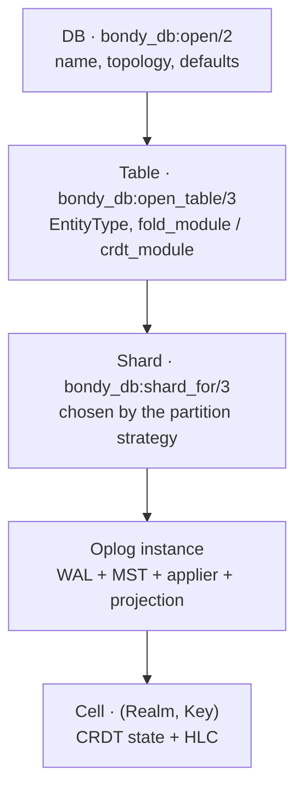
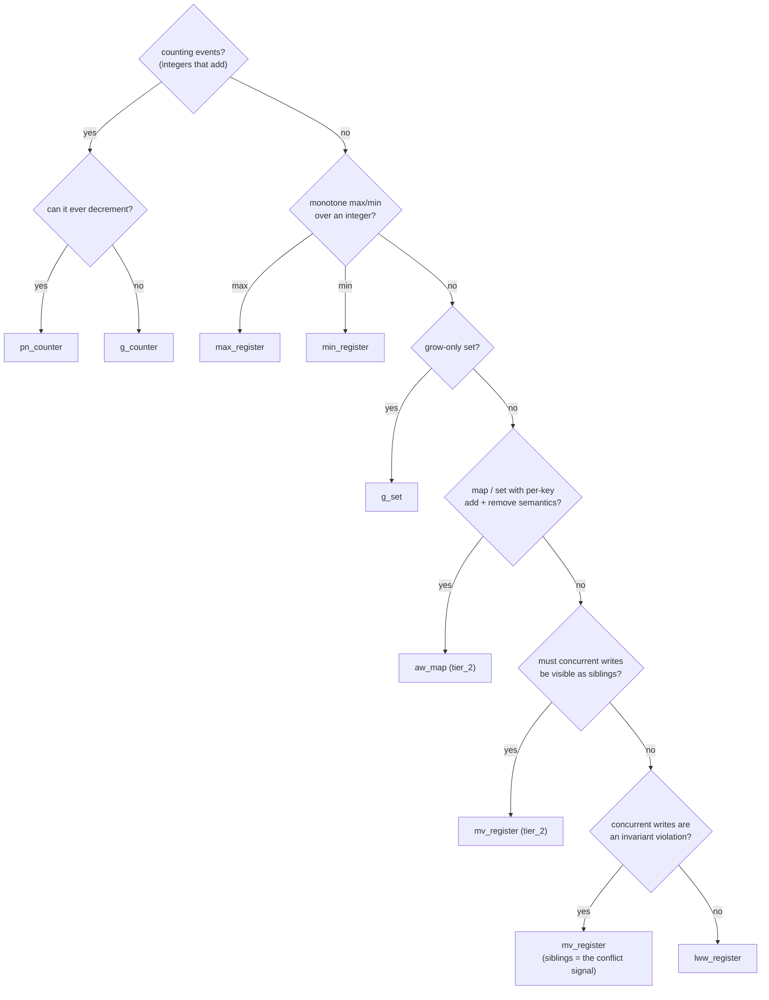
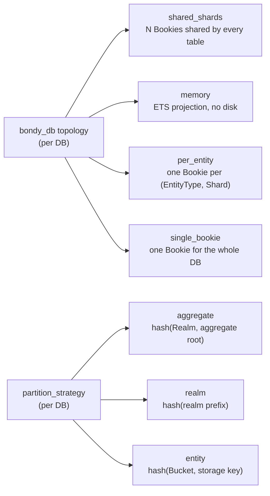
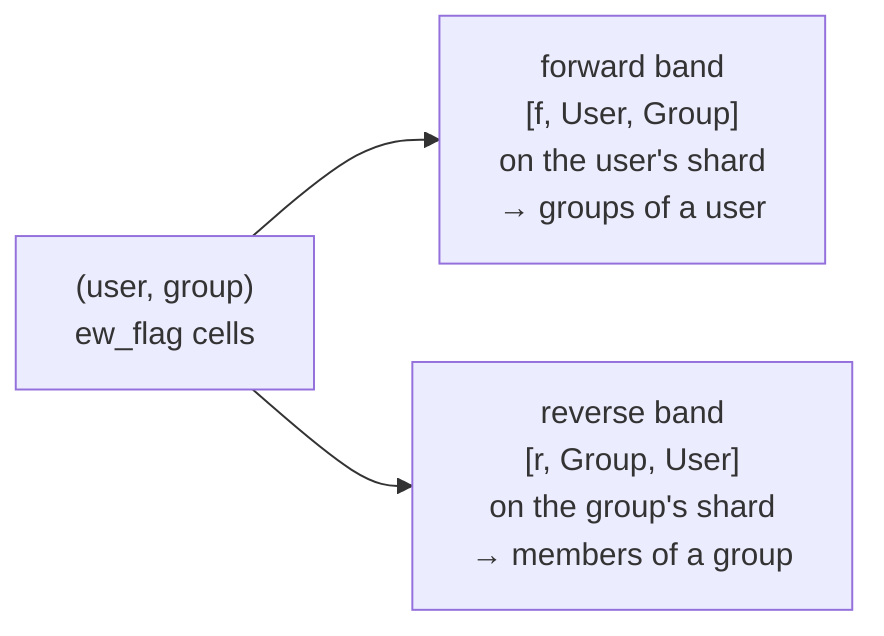

# An app developer's tour

> Audience: anyone designing a schema on top of `bondy_db`.
> Premise: by the end you will have mapped your domain onto a small
> set of tables, with a CRDT per table and a topology per database.

The previous chapters describe the substrate from the inside. This one
looks at it from your side of the API. The question is: **given a piece
of state you want to replicate, how do you turn it into a `bondy_db`
table?**

The worked example is the set of tables that Bondy Router declares in
`bondy_namespace_catalog`. Each table gets a short justification for its
CRDT and for the database it lives in.

## 1. The model, in one picture



A table is a namespace of cells. A cell is addressed by `(Realm, Key)`,
both binaries. `bondy_db:shard_for/3` maps the cell to one of the
database's shards, and each shard is served by an oplog instance. On
`bondy_db_topology_shared_shards` and `bondy_db_topology_memory` every
table on a shard shares that shard's instance; the other topologies start
one instance per table and shard.

Two API surfaces sit above this:

- **`bondy_db`** is the consumer facade. You open a database with
  `open/2` and a table with `open_table/3`. You then write with
  `apply/4`, `apply_batch/4`, `map_update/4` or `counter_inc/4`, read with
  `read/3`, and enumerate with `list/2`, `range/5`, `range_all/5` or
  `fold/6`. Every call takes the table handle that `open_table/3`
  returns. `bondy_db:ensure_fresh/2` is the freshness fence over table
  handles.
- **`bondy_oplog_core`** is the substrate read and notification layer
  ([chapter 03](03_bondy_db.md)). It addresses cells by namespace, index,
  bucket and storage key. You meet it for change notification
  (`subscribe/2`) and for fenced multi-cell reads (`read_batch/2`).

The rule this chapter keeps returning to:

> **The CRDT attaches to the table.** Two pieces of data that need
> different merge semantics belong in two tables.

## 2. Picking a CRDT

`bondy_db` ships a catalogue of native operation-based CRDTs
([chapter 05](05_crdt_model.md)). This tree covers the common choices,
framed by what the data looks like:



The catalogue also holds add-wins and remove-wins sets (`aw_set`,
`rw_set`), a remove-wins map (`rw_map`), a two-phase set (`two_p_set`),
and enable-wins and disable-wins flags (`ew_flag`, `dw_flag`). Chapter 05
describes each of them.

A table names its CRDT in one of two ways:

- **`fold_module`** takes a short label. `bondy_oplog_cell_kernel`
  resolves these labels: `lww_register`, `g_counter`, `pn_counter`,
  `g_set`, `max_register`, `min_register`, `two_p_set`, `aw_set`,
  `rw_set`, `ew_flag` and `dw_flag`. `open_table/3` returns
  `{error, {missing_required_opt, fold_module}}` when neither the table
  nor the database supplies a `fold_module`.
- **`crdt_module`** takes the full module name, for example
  `bondy_oplog_crdt_aw_map`, and overrides the CRDT that `fold_module`
  selects. The types without a short label (`aw_map`, `mv_register`,
  `rw_map`, `bondy_oplog_crdt_struct`,
  `bondy_oplog_crdt_owned_reading`) are always named this way.

A few practical notes:

- **`lww_register` covers the common case.** If your code
  reads, modifies and writes the whole record, `lww_register` matches
  that shape. Its operations are `{set, Value}` and `clear`. Do not reach
  for `aw_map` until concurrent per-key edits are an actual problem.
- **Conflict-surfacing is for invariants, not for performance.**
  Where two concurrent writes mean someone broke a rule, `mv_register`
  keeps both: a read returns the list of siblings, and your code decides
  what to do. Two events with the same event key but different contents
  are a different matter. The MST merger raises
  `{divergent_value, Key, V1, V2}` for them (`bondy_oplog_instance`), because
  event keys are meant to be unique.
- **Sets and maps with removal belong in their own table.** A set kept
  inside an `lww_register` record is the "members-in-record"
  anti-pattern: a whole-record write from one node replaces the members
  another node added.
- **`mv_register` is for when losing a concurrent write is worse than
  seeing two.** It is tier_2, so each cell carries a causal context.
- **Quantity CRDTs are for quantities, not records.** `pn_counter`,
  `g_counter`, `max_register`, `min_register` and `g_set` each model one
  value per cell. Use a separate cell key per quantity.
- **Counters use `bondy_db:counter_inc/4`.** It calls `apply/4` with an
  `{inc, Delta}` operation, and a negative `Delta` decrements.
  `bondy_oplog_crdt_pn_counter` ignores an event whose per-origin
  sequence number it has already seen, so substrate redelivery does not
  count twice. A retry by your code after `{error, timeout}` is a new
  event, and it counts again if the first one was durable.

## 3. Picking a topology, a partition strategy and `shard_count`

The topology decides where a database keeps its projection and how
realms are separated. The partition strategy decides which shard a cell
routes to.



For app developers the recommendation is short:

- **Use `bondy_db_topology_shared_shards` for durable state.** The
  topology starts one Bookie per shard and every table shares them, so
  the footprint does not grow with the number of tables. Bondy's `main`
  database uses it. The facade folds the realm into the storage key
  (`<<Realm/binary, 0, Key/binary>>`, see
  [chapter 03](03_bondy_db.md#realm-folding)), so tenants share shards
  without colliding.
- **Use `bondy_db_topology_memory` for ephemeral state.** Bondy's
  `registry` database uses it: the projection is in ETS and nothing is
  written to disk ([chapter 03](03_bondy_db.md#projection-backend-durable-vs-ephemeral)).
- **`bondy_db_topology_per_entity` gives each table its own Bookies**, one
  per `(EntityType, Shard)`, with the realm as the bucket. Bondy does not
  use it.
- **`bondy_db_topology_single_bookie` is for tests and very small
  deployments.** Every write in the database goes through one Bookie.

The partition strategy is a database option (`partition_strategy`,
default `entity` in `bondy_db`). Bondy sets it from
`db.main.partition_strategy`, whose default is `aggregate`:

- `aggregate` routes on `{Realm, AggregateRoot}`. The table option
  `aggregate_root` picks the root from the key: `identity` (the whole
  key, the default), `leading_col` (the first column of a composite key)
  or `second_col` (the second column). This co-locates a subject's
  record with the facts keyed by that subject.
- `realm` routes on the realm, or on its first `realm_prefix_depth`
  dotted components. A single realm then lands on one shard.
- `entity` routes on the bucket and storage key. `aggregate_root` has no
  effect under it.

**`shard_count` is effectively a per-database choice.** On
`shared_shards` the first table fixes the count, and a later table that
asks for a different one gets `{error, {shard_count_mismatch, _}}`. The
other topologies accept a per-table `shard_count`. Bondy sizes `main`
with `db.main.shard_count` and `registry` with `db.registry.shard_count`;
both default to 16.

Each oplog instance runs its own anti-entropy sessions, so more shards
means more sessions. The node-wide caps `db.aae.max_concurrency`
(default 3) and `db.aae.max_pages_in_flight` (default 2048) bound how
many sessions run at once and how many MST pages they hold, so extra
shards take turns rather than run in parallel
([chapter 06](06_compaction_and_bootstrap.md#keeping-anti-entropy-subordinate-to-routing)).
Start small and raise `shard_count` only when measurement shows a need.

## 4. The Bondy Router tour

Bondy Router declares its state in one catalogue,
`bondy_namespace_catalog`, which opens every table at boot. The tables
divide between **two databases**: a durable `main` database (leveled,
`shared_shards`) for state that survives a restart, and an ephemeral
`registry` database (`memory`) for routing summaries.

The catalogue gives each table a *fold class*, and `fold_opts/1` maps the
class to open options:

| Fold class | `fold_module` | `crdt_module` |
|---|---|---|
| `lww` | `lww_register` | — |
| `aw` | `lww_register` | `bondy_oplog_crdt_aw_map` |
| `ew` | `lww_register` | `bondy_oplog_crdt_ew_flag` |
| `mv` | `lww_register` | `bondy_oplog_crdt_mv_register` |
| `rib_registration` | `lww_register` | `bondy_oplog_crdt_struct` |
| `rib_subscription` | `lww_register` | `bondy_oplog_crdt_owned_reading` |

No table uses the `mv` class.

The examples below are abridged from the catalogue. The `main` database
is opened once, with the defaults every table inherits:

```erlang
{ok, Sup} = bondy_db_leveled_sup:start_link(),
{ok, Main} = bondy_db:open(main, #{
    topology           => bondy_db_topology_shared_shards,
    topology_opts      => #{sup => Sup, dir => "/var/lib/bondy/bondy_db/main"},
    shard_count        => 16,
    partition_strategy => aggregate,
    fold_module        => lww_register
}).
```

`shared_shards` requires `sup` and `dir` in `topology_opts`. Because the
database supplies `fold_module`, an `lww` table needs no CRDT option of
its own.

### 4.1 Registration and subscription RIB summaries

A WAMP registration or subscription entry (`#entry{}`) does not enter
`bondy_db`. It lives in `bondy_registry_store`'s partition-local ETS
tables, which back the local match tries. What `bondy_db` holds is the
**RIB** (Routing Information Base): one summary cell per
`{RealmUri, MatchPolicy, Uri, Nodestring}`. The cell tells other nodes
that this node can serve that URI. The cells live in the ephemeral
`registry` database:

```erlang
{ok, Registry} = bondy_db:open(registry, #{
    topology    => bondy_db_topology_memory,
    fold_module => lww_register
}),
Ephemeral = #{
    projection_backend  => ets,
    oplog_instance_opts => #{
        backend     => ets,
        wal_backend => mem,
        durability  => ephemeral
    },
    fused   => true,
    publish => true
},
{ok, RegsRib} = bondy_db:open_table(Registry, bondy_rib_registrations,
    Ephemeral#{
        crdt_module => bondy_oplog_crdt_struct,
        crdt_opts   => #{
            count    => {bondy_oplog_crdt_owned_reading,
                         #{stabilize_zero => 0, force_reap => true}},
            invoke   => {bondy_oplog_crdt_lww_register, #{force_reap => true}},
            earliest => {bondy_oplog_crdt_min_register, #{force_reap => true}},
            latest   => {bondy_oplog_crdt_max_register, #{force_reap => true}}
        }
    }),
{ok, SubsRib} = bondy_db:open_table(Registry, bondy_rib_subscriptions,
    Ephemeral#{crdt_module => bondy_oplog_crdt_owned_reading}).
```

Only the node named in a cell's key writes that cell
(`bondy_registry_rib`). A registration cell is a struct of per-field
CRDTs: `count` is the owner's latest reading of its live local entries,
`invoke` is a register, and `earliest` and `latest` are min and max
registers. A subscription cell is a bare `count` reading. Every field
declares `force_reap`, so a departed node's cells can be reclaimed.

Both tables are `publish => true`. When anti-entropy merges a peer's
cell, `bondy_aae_reactor` hands it to `bondy_registry_rib`, which keeps a
local stub store of remote summaries. Routing reads the local entries
and the stub store, not `bondy_db`. After every open of the `registry`
database, `bondy_registry_rib:restore/0` rewrites this node's own cells
from its local entries, because the database starts empty.

### 4.2 Realm

```erlang
{ok, Realms} = bondy_db:open_table(Main, bondy_realm, #{publish => true}).
```

A realm is a single record that Bondy reads, modifies and writes as a
whole, so `lww_register` matches. At equal HLC, `lww_register` keeps the
larger value in Erlang term order, and a `clear` wins over a `set`
(`bondy_oplog_crdt_lww_register:apply_op/3`). Every node therefore picks
the same winner.

Unlike the per-realm security tables, this table is a **global
registry**: every realm is stored under one constant realm band and keyed
by its URI, so `bondy_db:list/2` over that band enumerates all realms.
It is `publish => true`: when a peer deletes a realm, this node's reactor
runs `bondy_realm:teardown/1`, which closes the local sessions on that
realm (§5).

The realm's signing and encryption keys live in a separate table,
`bondy_realm_keys`, an `aw_map` of `kid => key bundle`. Key rotation mints
a new `kid`, so concurrent rotations on two nodes add two entries rather
than overwrite each other.

### 4.3 Users

```erlang
{ok, Users} = bondy_db:open_table(Main, security_users, #{publish => true}).
```

A user record is replaced as a whole on every write, so `lww_register`
is the right shape. The table is `publish => true`: when a peer deletes a
user or changes the user's credentials, this node's reactor closes that
user's local sessions (§5).

Group membership is not stored on the user record. It lives in its own
relation, `security_group_members` (§4.4).

### 4.4 Groups and group memberships

```erlang
{ok, Groups} = bondy_db:open_table(Main, security_groups, #{publish => true}),
{ok, Members} = bondy_db:open_table(Main, security_group_members, #{
    crdt_module    => bondy_oplog_crdt_ew_flag,
    aggregate_root => second_col,
    publish        => true
}).
```

The group record (name, parent groups, metadata) is an `lww_register`
cell in `security_groups`. It is `publish => true` so that a peer's
change to a group's parent groups invalidates this node's cached
authorization contexts.

Each `(user, group)` membership is one cell in `security_group_members`,
and its CRDT is an **enable-wins flag** (`ew_flag`, operations `enable`
and `disable`): a concurrent enable survives a disable that did not
observe it. A cell per fact lets two nodes that add the same user to two
different groups keep both additions. A `groups` list inside the user
record would let one whole-record write replace the other.

The relation answers both directions without a secondary index, using a
*permutation index*: every fact is written under two keys. A forward
band holds `[f, User, Group]` and a reverse band holds
`[r, Group, User]`, each encoded as an order-preserving composite
(`bondy_oplog_index_key:encode_tuple/1`). "Which groups is this user
in?" is a range scan of the forward band, and "who is in this group?" a
range scan of the reverse band. `aggregate_root => second_col` routes
each fact by its second column, so a forward fact lands on the user's
shard and a reverse fact on the group's. Each direction is then a scan of
one shard. The read and write functions live in `bondy_rbac_user`.

The table is `publish => true`: when anti-entropy merges a peer's
membership change, this node's reactor invalidates the realm's cached
authorization contexts. A membership change also writes the user cell,
so it advances the user's `token_version` (§5).



The lesson generalises: **a relation that must answer in two directions
works better as a cell-per-fact table with a permutation index than as a
list inside a record.** The record form forces a read-modify-write and an
`lww` merge that drops concurrent additions.

### 4.5 Grants (user and group)

```erlang
GrantIndexes = [#{name => by_resource, extract => [resource], normalize => canonical}],
{ok, UserGrants} = bondy_db:open_table(Main, security_user_grants, #{
    aggregate_root => leading_col,
    publish        => true,
    indexes        => GrantIndexes
}),
{ok, GroupGrants} = bondy_db:open_table(Main, security_group_grants, #{
    aggregate_root => leading_col,
    publish        => true,
    indexes        => GrantIndexes
}).
```

Grants run as `lww_register`. Their data model is the
conflict-surfacing case: two concurrent grants to the same
`(Realm, Role, Resource)` mean two operators edited the same fact. Under
`lww` the later write wins and the other is lost. To make that loss
visible, `bondy_aae_reactor` emits a `[bondy, aae, merge_conflict]`
telemetry event and a warning log whenever a merged remote value
replaces a different local value. The reactor cannot tell a concurrent
edit from an ordinary later update, so the alarm also fires for the
latter. `mv_register` is the intended CRDT if grants are ever to keep
both writes as siblings.

Two details apply whatever the CRDT:

- **The key is an order-preserving composite** of `{Rolename, Resource}`
  (`bondy_rbac:encode_key/1`), and `aggregate_root => leading_col` routes
  on the role. A role's grants share a shard with the role's own record,
  and "grants for role R" is a bounded range scan.
- **The `by_resource` secondary index** answers the reverse question,
  "which roles hold a grant on resource R". The table is
  `publish => true`: a peer's grant or revoke makes this node's reactor
  invalidate the realm's cached authorization contexts. The session
  stays open, and its next authorization reads the new grants (§5).

### 4.6 Sources

```erlang
{ok, Sources} = bondy_db:open_table(Main, security_sources, #{
    aggregate_root => leading_col,
    publish        => true
}).
```

An auth source binds a username and a CIDR mask to an authentication
method. Sources follow the grants pattern: they run as `lww_register`,
`mv_register` is the intended CRDT, and `publish => true` wires the same
merge-conflict alarm. Sources only gate new connections, so a merged
change has no effect on live sessions.

The key is the composite `{Username, AddressMask, Authmethod}` with
`aggregate_root => leading_col`, so "sources for user U", the lookup the
auth path makes on every login, is a bounded range scan on the user's
shard. There is no reverse index: matching a client address against a
stored CIDR is containment, not equality, so an equality index cannot
serve it.

### 4.7 API Gateway

```erlang
{ok, Gateway} = bondy_db:open_table(Main, api_gateway, #{publish => true}).
```

API specifications change rarely and usually from one operator at a
time, so `lww_register` is enough. The table is `publish => true` for a
different reason than the security tables: the Cowboy dispatch table is
derived from these specifications, and a subscriber rebuilds it when a
specification changes, including when a peer's edit arrives through
anti-entropy.

The MCP tables (`bondy_interface`, `mcp_gateway`, `mcp_upstream`) follow
the same whole-entry `lww` pattern.

### 4.8 Tickets

```erlang
{ok, Tickets} = bondy_db:open_table(Main, bondy_ticket, #{}).
```

Tickets are short-lived authentication artefacts with an expiry time.
The substrate has no expiring CRDT: an `lww_register` cell holds the
ticket, the expiry lives in the value, and `bondy_ticket` refuses an
expired ticket with `{error, expired}` when it verifies it. Nothing
subscribes to ticket changes, so the table does not publish.

### 4.9 OAuth tokens

```erlang
{ok, Tokens} = bondy_db:open_table(Main, bondy_oauth_token, #{
    aggregate_root => leading_col
}).
```

Each token is its own `lww_register` cell, keyed by the composite
`[UserHash, Realm, ClientId, DeviceId]` (`bondy_oauth_token`). Two things
follow from that design:

- **Every write touches one cell.** An issue or a refresh sets its own
  cell and a revocation clears it. Re-issuing for the same device
  replaces that device's token. A `clear` in `lww_register` is not
  terminal, so a later `set` on the same key writes a new token.
- **The per-user bound is application logic.** No CRDT can express
  "keep the N latest" without coordination.
  `oauth2.max_tokens_per_user` is enforced by the issuer and by
  `bondy_oauth_token:cleanup/0`, which evict the soonest-expiring tokens
  in the user's band. `leading_col` keeps that band on the user's shard.
  Expiry is checked by `is_expired/2` on use, not by deletion.

### 4.10 Bridge relays

```erlang
{ok, Bridges} = bondy_db:open_table(Main, bondy_bridge_relay, #{}).
```

Bridge configuration: whole-record updates and rare writes, so `lww`
fits. `bondy_bridge_relay_manager` reads it at boot and runs only its own
node's bridges, so the table does not publish.

### 4.11 When to use a counter (illustrative)

Bondy does not ship a counter table. The quantity CRDTs are domain-neutral
and available to any consumer:

```erlang
{ok, Counters} = bondy_db:open_table(Main, app_counters, #{
    fold_module => pn_counter
}),

ok = bondy_db:counter_inc(Counters, ~"com.example", ~"page:home", 1),
ok = bondy_db:counter_inc(Counters, ~"com.example", ~"page:home", 1),
ok = bondy_db:counter_inc(Counters, ~"com.example", ~"page:home", -1),

{ok, {1, _Hlc}} = bondy_db:read(Counters, ~"com.example", ~"page:home").
```

`counter_inc/4` returns after the projection write commits, so the read
on the same node sees all three increments.

When the shape fits:

- **Quantities that add up across replicas**: page views, click counts,
  retry counts. Every contribution is summed and the order does not
  matter.
- **Redelivery is absorbed.** `bondy_oplog_crdt_pn_counter` keeps, per
  origin, a positive sum, a negative sum and the highest sequence number
  applied. An event at or below that number changes nothing, so WAL
  replay and anti-entropy re-shipping do not count twice. Your own
  retries are not covered (§2).
- **Negative deltas decrement.** The converged value is the sum over
  origins of positive minus negative.

When *not* to use it:

- **You need an upper bound.** `pn_counter` cannot express "stop at
  100", or at zero; that needs coordination above the CRDT.
- **You need to know who contributed what.** The state keeps one sum per
  origin, not individual increments. For provenance, use a `g_set` of
  audit records.
- **You are counting unique members.** That is set cardinality. Use
  `g_set` (or `aw_set` if removals are needed) and read the set size.

#### Adjacent shapes

- **`max_register` / `min_register`** keep the largest or smallest integer
  any replica has written (operation `{set, N}`). Use `max_register` for
  high-water marks and `min_register` for "earliest deadline" across
  competing writers. The value never moves the other way.
- **`g_set`** is a grow-only set of binaries (operation `{add, Elem}`).
  It suits append-only catalogues and "members ever seen". If membership
  has to retract, use `aw_set` or a cell-per-fact `ew_flag` table.

### 4.12 Summary table

Topology, partition strategy and shard count are database options. Bondy
has two databases: `main` (`shared_shards`, `db.main.shard_count`) and
`registry` (`memory`, `db.registry.shard_count`).

| Table | CRDT | DB | `aggregate_root` | Notes |
|---|---|---|---|---|
| `bondy_rib_registrations` | `bondy_oplog_crdt_struct` | registry | `identity` | single writer per key; `publish` |
| `bondy_rib_subscriptions` | `bondy_oplog_crdt_owned_reading` | registry | `identity` | single writer per key; `publish` |
| `bondy_realm` | `lww_register` | main | `identity` | global registry; `publish` |
| `bondy_realm_keys` | `aw_map` | main | `identity` | global registry; `kid => key bundle` |
| `security_users` | `lww_register` | main | `identity` | `publish` |
| `security_groups` | `lww_register` | main | `identity` | `publish` |
| `security_group_members` | `ew_flag` | main | `second_col` | forward and reverse bands; `publish` |
| `security_user_grants` | `lww_register` (intended: `mv_register`) | main | `leading_col` | `by_resource` index; `publish` |
| `security_group_grants` | `lww_register` (intended: `mv_register`) | main | `leading_col` | `by_resource` index; `publish` |
| `security_sources` | `lww_register` (intended: `mv_register`) | main | `leading_col` | `publish` (conflict alarm only) |
| `api_gateway` | `lww_register` | main | `identity` | `publish` (dispatch rebuild) |
| `bondy_ticket` | `lww_register` | main | `identity` | expiry in the value |
| `bondy_oauth_token` | `lww_register` | main | `leading_col` | one cell per token |
| `bondy_bridge_relay` | `lww_register` | main | `identity` | read at boot |
| `retained_messages` | `lww_register` | main | `identity` | keyed by topic |
| `bondy_interface` | `lww_register` | main | `identity` | `publish` |
| `mcp_gateway` | `lww_register` | main | `identity` | `publish` |
| `mcp_upstream` | `lww_register` | main | `identity` | |

None of Bondy's tables use the quantity CRDTs. Among the causal types,
`ew_flag` backs the membership table, `aw_map` backs `bondy_realm_keys`,
and the RIB registration table uses `bondy_oplog_crdt_struct`.

## 5. Reacting to a peer's change

The security tables combine two substrate facilities: the freshness
fence ([chapter 03](03_bondy_db.md#the-freshness-fence)) and change
notification ([chapter 03](03_bondy_db.md#change-notification)). A
security decision has to stay correct across nodes without waiting for
consensus. Bondy combines three measures: **fence the read, version the
token, react to the merge.**

**Fence the read.** When `db.aae` is on, `bondy_auth` calls
`bondy_db:ensure_fresh/2` before authentication, with the
`security_users`, `security_user_grants` and `security_group_grants`
tables and the bound `db.aae.fence.max_lag` (default `60s`). If a primary
shard of one of those tables has not completed a local commit or an
anti-entropy round within the bound, authentication fails with
`temporarily_unavailable`. The check reads one atomic counter per primary
shard.

**Version the token.** A user's `token_version` is the HLC of the user's
cell (`bondy_rbac_user:token_version/2`). Every write to the user cell
advances it, including a membership change. A token carries the version
it was issued under, and authentication refuses a token whose version is
older than the cell's. Grant and source changes do not touch the user
cell; the freshness fence bounds their staleness instead.

**React to the merge.** Some changes cannot wait for the next
authentication. The `publish => true` tables feed merge events to one
node-local subscriber, `bondy_aae_reactor`. It acts only on the merge tag;
a node's own writes already ran the same side effects at the write site.

| A peer… | Table | This node… |
|---|---|---|
| deletes a user | `security_users` | **closes** that user's sessions (`bondy.user.deleted`) |
| changes a user's credentials | `security_users` | **closes** that user's sessions (`bondy.user.credentials_changed`) |
| deletes a realm | `bondy_realm` | runs `bondy_realm:teardown/1`, which **closes** the realm's sessions |
| grants or revokes a permission | `security_*_grants` | **invalidates** the realm's cached authorization contexts and raises the conflict alarm |
| changes a membership | `security_group_members` | **invalidates** the realm's cached authorization contexts |
| changes a group's parents | `security_groups` | **invalidates** cached authorization contexts |
| changes a source | `security_sources` | raises the conflict alarm only |

The split follows authentication versus authorization. An
authentication-level change (a delete or a credential change) closes the
session. An authorization change invalidates the session's cached
context, the session stays open, and its next authorization reads the
current grants.

## 6. Patterns you will keep using

- **New table when the CRDT differs.** Do not merge two tables that need
  different merge semantics. A table costs little; a wrong CRDT causes
  silent data loss.
- **Relations as cell-per-fact tables.** When the data shape is "X has
  many Y", store each `(X, Y)` fact as its own cell (an `ew_flag` as in
  `security_group_members`, or an `aw_set`) rather than a list inside X's
  record.
- **Expiry lives in the value.** Store the deadline in the cell value and
  treat an expired value as absent on read. Count caps also stay in
  application code.
- **Read-your-writes on the same node.** `bondy_db:apply/4` returns after
  this event's projection write commits, so a following
  `bondy_db:read/3` on the same node sees it
  ([chapter 03](03_bondy_db.md#read-your-writes-and-the-write-barrier)).
- **Cross-node freshness needs `ensure_fresh/2`.** Call
  `bondy_db:ensure_fresh(Tables, MaxLagMs)` before a read whose staleness
  must be bounded. It returns `ok` or `{stale, Namespaces}`. A shard is
  fresh within `MaxLagMs` of its last local commit or anti-entropy round.
  With anti-entropy off, only local commits refresh it, so a quiet shard
  reads as stale. Gate the call on `db.aae`, as `bondy_auth` does.
- **`bondy_oplog_core:read_batch/2` for an explicitly fenced multi-cell
  read.** It reads several cells as of one HLC fence, with optional
  freshness and skew checks. It takes `{Namespace, Index, Bucket, Key}`
  tuples, so the caller supplies storage keys, not `(Realm, Key)`. The
  authentication path does not use it.

## 7. Anti-patterns

- **`aw_map` for whole-record-update workloads.** Each cell pays for a
  tier_2 causal context. If your application already reads, modifies and
  writes the whole record, you pay the cost without the benefit. Start
  with `lww_register`.
- **Over-sharding.** Each oplog instance runs its own anti-entropy
  sessions, and on `shared_shards` the shard count is fixed when the
  first table opens. Start small.
- **Eager cluster-wide TTL sweepers.** A background job on every node
  that deletes expired entries generates delete traffic for cells every
  replica can already judge as expired. Put the deadline in the value,
  treat expired as absent on read, and sweep from one writer, as
  `bondy_oauth_token:cleanup/0` does per owned realm.
- **Splitting tables that share CRDT and lifecycle.** Two tables that are
  always written together with the same CRDT can usually be one table
  with a composite key (`bondy_oplog_index_key:encode_tuple/1`).
- **Conflating realms with shards.** Realms are an application concept.
  Depending on the topology, the realm is folded into the storage key or
  used as the bucket (`Topology:bucket_for/3`). Under the default
  `aggregate` strategy one realm spreads across every shard. Physical
  isolation per table is a topology question, not a schema question.
- **Records inside a quantity CRDT.** `pn_counter`, `max_register`,
  `min_register` and `g_set` each model one value per cell. An
  `{inc, Delta}` operation carries an integer; there is nowhere to put
  metadata. If the data has shape, it belongs in an `lww_register`, an
  `aw_map`, or its own table.
- **Counters used for set cardinality.** Two origins that each add `1`
  for the same logical member sum to `2`. Per-origin deduplication
  removes duplicate events, not duplicate members. Use a set and read its
  size.

## Pointers

- [Chapter 03](03_bondy_db.md): the read side, the freshness fence,
  `read_batch/2`, change notification, secondary indexes.
- [Chapter 05](05_crdt_model.md): the CRDT contract, the full native
  catalogue and the tier model.
- [Chapter 06](06_compaction_and_bootstrap.md): what happens to your
  events once peers have them.
- `bondy_db`: the consumer facade (`open/2`, `open_table/3`, `apply/4`,
  `apply_batch/4`, `map_update/4`, `counter_inc/4`, `read/3`, `list/2`,
  `range/5`, `fold/6`, `ensure_fresh/2`, `shard_for/3`).
- `bondy_oplog_core`: substrate primitives (`read/3`, `read_batch/2`,
  `range/4`, `ensure_fresh/2`, `subscribe/2`).
- `bondy_oplog_config` (in `bondy_oplog`): the layer-wide tuning surface
  (sync and GC intervals, the live-sync throttle, the anti-entropy caps,
  the fence isolation policy), separate from the per-table options of
  `open_table/3`.
- `bondy_namespace_catalog` (in `bondy_router`): the declaration of both
  databases and every table above, with each table's fold class,
  indexes, `aggregate_root` and `publish` flag.
- `bondy_aae_reactor` (in `bondy_router`): the subscriber that turns
  merge events into session closes, authorization invalidation and the
  conflict alarm (§5).
- `bondy_db_topology_shared_shards`, `bondy_db_topology_per_entity`,
  `bondy_db_topology_single_bookie` (durable, sharing
  `bondy_db_topology_leveled_common`) and `bondy_db_topology_memory`
  (ephemeral): the topologies.
