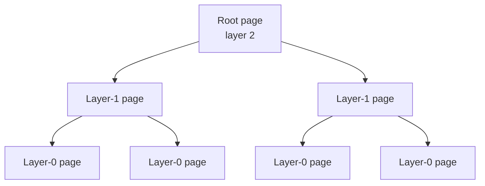
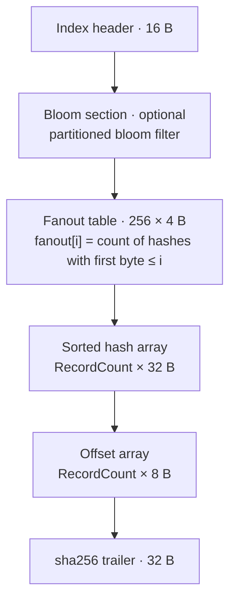
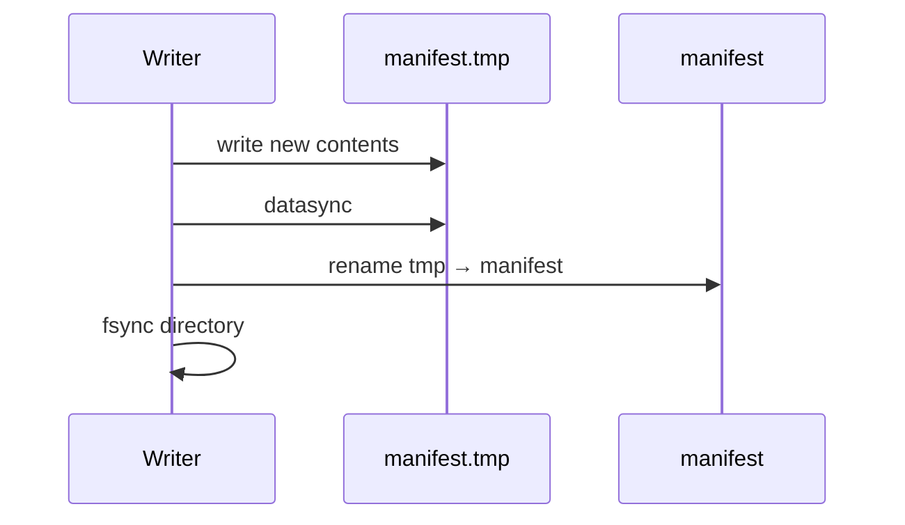
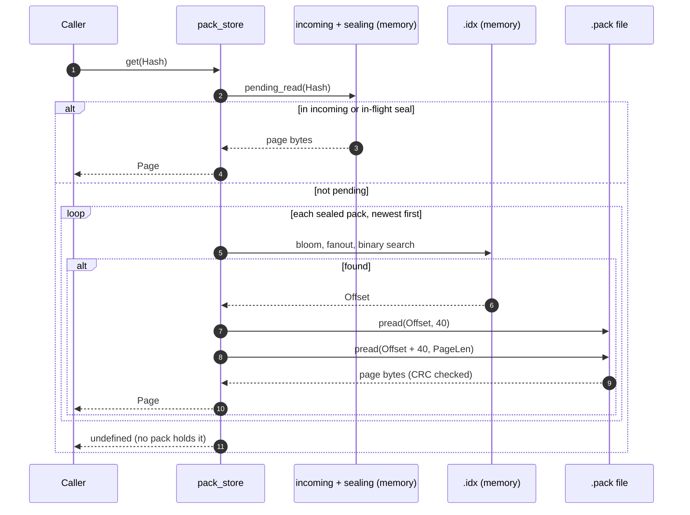
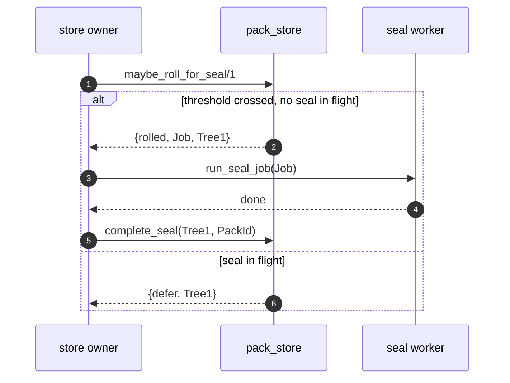
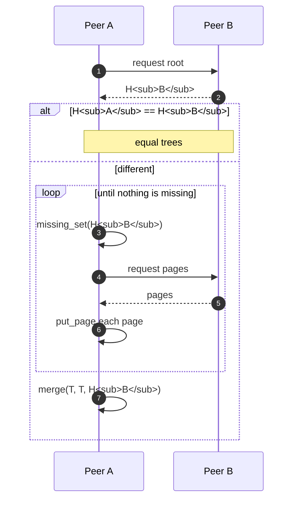

# bondy_mst: the Merkle Search Tree

> Audience: anyone who wants to know what a Merkle Search Tree is, how this
> library stores one, and how peers use it to find what they lack.

`bondy_mst` is the name of the library and of the data structure at its
centre. This chapter explains the structure, the page-store backends, the
durable pack store, and the anti-entropy exchange that peers use to converge.

## What problem does the MST solve?

Two peers each hold a large set of items. Each one wants to learn which items
the other holds and it lacks, without sending the whole set over the network.

A **Merkle Search Tree** makes that a comparison of hashes:

- The hash of each key decides the shape of the tree, so two peers that hold
  the same set build the same tree.
- Each page carries the hashes of its children, so the root hash summarises
  the whole tree.
- To compare two trees, peers compare root hashes. When the hashes are equal,
  the trees are equal. When they differ, a peer requests the pages under the
  other root that it does not hold.

The pages that cross the network are the pages that differ, not the whole
tree.

Equal roots mean equal *trees*. They do not mean equal application data once
a consumer truncates the tree. Two replicas that hold the same data but
truncated at different watermarks carry different trees and different roots.
A consumer that needs a test for data convergence keeps that test over its
own materialised state, not over the MST root.

> The construction is from Auvolat and Taïani, *Merkle Search Trees:
> Efficient State-Based CRDTs in Open Networks*, SRDS 2019. `bondy_mst.erl`
> is ported from the authors' reference Elixir prototype.

## Anatomy of an MST



- **The hash of the key decides the layer.** The layer of a key is the number
  of leading zero 4-bit nibbles in the hash of the key. Leaves are layer `0`.
  Two peers that insert the same key put it in the same layer.
- **A page is a run of keys in one layer.** A page holds its layer, `low` (the
  hash of the subtree before its first key), and a sorted list of entries.
  Each entry is a key, a value, and the hash of the subtree that follows the
  key.
- **Pages are content-addressed.** The hash of a page covers its layer, `low`
  and entries. The store keys each page by that hash. Per-replica metadata on
  a page, such as the time `free/3` marked it, is outside the hash.

The tree does not depend on the order of insertion.
`truncate_matches_delete_and_fresh_test_` in `bondy_mst_truncate_test` builds
trees from shuffled insertions and from ordered insertions of the same keys,
and checks that the roots are equal.

## The store interface

`bondy_mst_store` is the behaviour that every backend implements. Three
backends ship:

| Backend | Durable | Use it for |
|---|---|---|
| `bondy_mst_map_store` | No (a term held by the owner) | Small trees owned by one process. The default. |
| `bondy_mst_ets_store` | No (an ETS table) | Tests and ephemeral trees. |
| `bondy_mst_pack_store` | **Yes** | Durable trees. |

The behaviour works on pages and hashes:

```mermaid
classDiagram
    class bondy_mst_store {
      <<behaviour>>
      +open(HashAlgorithm, Opts) Backend
      +close(Backend) ok
      +get_root(Backend) Hash
      +set_root(Backend, Hash) Backend
      +get(Backend, Hash) Page
      +has(Backend, Hash) bool
      +put(Backend, Page) {Hash, Backend}
      +delete(Backend, Hash) Backend
      +copy(Backend, Store, Hash) Backend
      +free(Backend, Hash, Page) Backend
      +gc(Backend, KeepRoots) {Backend, Metadata}
      +list(Backend) [Page]
      +missing_set(Backend, Root) set(Hash)
      +page_refs(Page) [Hash]
      +destroy(Backend) ok
      +flush(Backend) optional
      +transaction(Backend, Fun) optional
      +capabilities(Backend) optional
      +name(Backend) optional
      +page_state(Backend, Hash) optional
      +maybe_roll_for_seal(Backend) optional
      +complete_seal(Backend, PackId) optional
      +seal_in_flight(Backend) optional
    }
    bondy_mst_store <|-- bondy_mst_map_store
    bondy_mst_store <|-- bondy_mst_ets_store
    bondy_mst_store <|-- bondy_mst_pack_store
```

Every tree operation that rewrites a page calls `free/3` on the old page. The
three backends treat `free/3` differently:

- `bondy_mst_map_store` removes the page at once.
- `bondy_mst_ets_store` marks the page and leaves it in the table.
- `bondy_mst_pack_store` records the hash in its tombstone set.

An older root, a peer root under transfer, or an identical page elsewhere in
the tree can still reference a page that `free/3` marked. The ETS and pack
backends therefore leave reclamation to `gc/2`, which decides by reachability
alone (see [Garbage collection](#garbage-collection)).

`capabilities/1` describes a backend to its consumer. It reports these keys:

- `durable`: the pages survive a restart.
- `async_seal`: the backend supports the asynchronous seal.
- `concurrent_writes`: other processes can write through the same handle.
- `process_bound_reads`: reads work only in the process that opened the
  store.

## The pack store on disk

`bondy_mst_pack_store` stores pages in content-addressed packfiles, in the
manner of the git object database. The store owns the directory given by its
`dir` option:

```
{dir}/
    manifest                     # sealed packs, current root (atomic replace)
    tombstones                   # hashes that free/3 marked
    incoming.pack                # mutable; its index lives in memory
    incoming-sealing-NNNN.pack   # rolled aside during an asynchronous seal
    pack-NNNN.pack               # sealed, immutable (NNNN = zero-padded id)
    pack-NNNN.idx                # index for the sealed pack
```

The `instance_id` option is recorded in the manifest. Opening a directory
whose manifest names another instance fails.

### The pack file


Each record is a 40-byte header followed by the page bytes:

```
Hash (32 B) | PageLen (4 B) | PageCrc32 (4 B) | Page bytes
```

A seal writes the records of a sealed pack in hash order and never changes
them afterwards. `incoming.pack` has the same record format in append order.

### The index

Each sealed pack has a `.idx` file:



The store parses each `.idx` into memory when it opens the pack. A lookup
probes the bloom filter. A negative answer from the bloom filter is final. A
positive answer continues to the fanout table, which bounds a binary search
over the hashes that share the first byte. When a `.idx` is missing or fails
fails to parse, `bondy_mst_pack_sealed_view` rebuilds it from the pack and
emits `[bondy_mst, page_store, idx_rebuild]`.

### The manifest

The manifest names the sealed packs, records whether `incoming.pack` holds
data, and carries the current MST root. `bondy_mst_io:write_file_atomic/2`
replaces it in four steps:



After a crash, the directory holds either the old manifest or the new one.

A root is only as durable as the pages it references. The pack writer
therefore makes `incoming.pack` durable before it writes a manifest that
carries a new root: **pages before the pointer**. A root written first could
survive a crash that loses the pages under it, and the replica would then
advertise a root that it cannot serve. `bondy_mst_pack_root_durability_test`
checks that no page stays unsynced once the root is durable, and that the
root stays readable after a simulated crash.

### Tombstones

The pack store keeps the hashes that `free/3` marked in a `tombstones` file,
written with the same atomic replace. A tombstone does not hide a page:
`get/2` and `has/2` serve every page that is physically present. A tombstone
only removes the page from `list/1`. Garbage collection ignores tombstones and
drops a page only when no kept root reaches it.

## A read inside the pack store



A page in `incoming.pack`, or in a pack that is being sealed, is served from
memory. A page in a sealed pack costs an in-memory index lookup and two
`pread` calls.

## Sealing the incoming pack

`incoming.pack` takes every new page. The store seals it when it reaches
either threshold:

- `auto_seal_records`, default `10_000`;
- `auto_seal_bytes`, default `16_000_000`.

A seal rewrites the pages into a new `pack-NNNN.pack` with its `.idx`, and
the store then starts an empty `incoming.pack`. `infinity` disables a
threshold.

The `seal_mode` option selects where the rewrite runs. The default is `sync`.

- **`sync`**: the `put` that crosses the threshold runs the seal itself.
- **`async`**: `put` never seals. The owner of the store calls
  `bondy_mst:maybe_roll_for_seal/1`, which returns one of three results:
  - `{rolled, Job, Tree}`: the store renamed `incoming.pack` to
    `incoming-sealing-NNNN.pack`, recorded the roll in the manifest, and
    started a new incoming pack. A worker process runs
    `bondy_mst:run_seal_job/1`. The owner then calls
    `bondy_mst:complete_seal/2` with `bondy_mst:seal_job_pack_id(Job)`,
    which adds the pack to the manifest.
  - `{defer, Tree}`: a seal is in flight. One seal at a time is the limit.
  - `{noop, Tree}`: no threshold is crossed.

The store serves the rolled pages from memory until `complete_seal/2` runs.



**Recovery.** When the store opens, it inspects every
`incoming-sealing-NNNN.pack` before it serves reads:

- When the manifest already names pack `NNNN`, the seal committed and the
  store deletes the file.
- Otherwise the store seals the file into `pack-NNNN` and adds the pack to
  the manifest.
- When the file cannot be read, the open fails and the file stays on disk,
  because the manifest root can reference its pages.

The `recovery_*` tests in `bondy_mst_pack_writer_async_seal_test` cover each
case.

`bondy_oplog` opens its pack stores in `async` mode with `auto_seal_bytes`
set to 2 MiB. The `pack_seal_mode` and `pack_auto_seal_bytes` settings of
`bondy_oplog` control both values.

## The root-flush commit barrier

`set_root/2` on the pack store updates the root in memory. The call also
writes the manifest when 32 root changes are unwritten, or when 200 ms have
passed since the last manifest write. The `root_flush_every_records` and
`root_flush_every_ms` options set those limits. Between writes, the root on
disk can lag the root in memory.

`bondy_mst:flush/1` closes that gap. It makes the pending pages durable, then
writes the manifest with the current root, and returns `{ok, Tree}`. On the
in-memory backends it does nothing. `bondy_oplog` calls it at the commit
barrier of each instance, so that the root on disk keeps pace with the WAL
offset it commits. `apps/bondy_db/doc_extras/architecture/01_bondy_oplog.md`
in the Bondy umbrella describes that barrier.

## Anti-entropy

Two peers converge by pulling pages from each other:



`bondy_mst:missing_set/2` walks the pages under the peer root that the local
store holds, and returns the hashes it cannot find. It cannot descend below
an absent page, because the children of that page are unknown until the page
arrives. Each round therefore uncovers the next layer of absent pages, and
the loop ends when the set is empty. Only absent pages cross the network.

`bondy_mst_exchange` runs this exchange inside the library. It holds the peer
root in a merge buffer, requests the absent pages, and merges only when every
page is local, so the tree does not change while pages are in flight. Its
`max_merges` and `max_merges_per_root` options bound the merges in flight. A
request carries the requester's root, so the responder can start an exchange
in the other direction. `bondy_mst_crdt` embeds the exchange and adds gossip
and version history.

`bondy_oplog` runs its own exchange over the same functions:
`bondy_oplog_sync_session` pulls pages and `bondy_oplog_responder` serves
them. `apps/bondy_db/doc_extras/architecture/01_bondy_oplog.md` describes it.

## Deletion and truncation

`bondy_mst:delete/2` removes a key from the tree structurally. It does not
write a tombstone entry. It rewrites the pages on the path to the key, merges
the two subtrees on either side of the removed entry, and calls `free/3` on
each page it replaces.

`bondy_mst:truncate/2` removes every key that is less than or equal to a
watermark. It walks the left edge of the tree once, rewrites the pages there,
and leaves the dropped subtrees unreferenced. `gc/2` reclaims them later.
`truncate_matches_delete_and_fresh_test_` in `bondy_mst_truncate_test` checks
two properties for its inputs:

- the truncated root equals the root after one `delete/2` per removed key;
- the truncated root equals the root of a tree built only from the kept keys.

Two replicas that truncate the same key set at the same watermark therefore
reach the same root.

## Garbage collection


`bondy_mst:gc/2` keeps every page reachable from the current root and from
the roots that the caller passes. The caller has to serialise `gc/2` with
every writer, or pass every root a writer can publish. A root that a writer
publishes after the walk is not in the reachable set.

When a page under the current root is absent, `gc/2` sweeps nothing. The walk
skips absent pages, so a sweep would drop the live pages below the hole.
`gc/2` logs an error, emits `[bondy_mst, gc, aborted]`, and keeps a
classified report that `bondy_mst:gc_aborts/0` returns.
`gc_aborts_on_unservable_root_test` in `bondy_mst_gc_guard_test` covers this
case.

On the pack store, GC writes the reachable pages of all sealed packs into one
new sealed pack, replaces the manifest, and deletes the old packs. Pages in
`incoming.pack` are left for the next seal. With one sealed pack, the rewrite
runs only when GC drops at least one page and the fraction of dropped pages
reaches the `gc_threshold_dead_fraction` option (default `0.0`). With two or
more sealed packs, GC always merges them.

## Things to keep in mind

- **The tree does not depend on insertion order.** A set of keys has one
  tree; `bondy_mst_truncate_test` checks this for its inputs.
- **Pages are content-addressed.** The page hash names the content and the
  subtree below it.
- **Reachability is the only liveness rule.** A tombstone does not hide a
  page and does not make GC drop one.
- **The pack store has one owner.** Its sealed-pack reads use file
  descriptors that belong to the opening process.

## Pointers

- Paper: Auvolat and Taïani, *Merkle Search Trees*, SRDS 2019, Inria
  HAL-02303490.
- The tree: `bondy_mst`, `bondy_mst_page`.
- The behaviour and backends: `bondy_mst_store`, `bondy_mst_map_store`,
  `bondy_mst_ets_store`, `bondy_mst_pack_store`.
- Pack-store internals, each with the on-disk detail in its module doc:
  - `bondy_mst_pack_writer`: incoming pack, seal trigger, async roll;
  - `bondy_mst_pack_seal`: writing a sealed pack;
  - `bondy_mst_pack_reader`, `bondy_mst_pack_sealed_view`: sealed reads;
  - `bondy_mst_pack_index`, `bondy_mst_pack_bloom`: lookups;
  - `bondy_mst_pack_codec`: record format;
  - `bondy_mst_pack_manifest`, `bondy_mst_pack_tombstones`;
  - `bondy_mst_pack_recovery`: crash recovery of `incoming.pack`;
  - `bondy_mst_pack_idx_rebuild`: `.idx` rebuild.
- Anti-entropy: `bondy_mst_exchange`, `bondy_mst_crdt`.
- Consumers in the Bondy umbrella: `bondy_oplog_sync_session`,
  `bondy_oplog_responder`.
