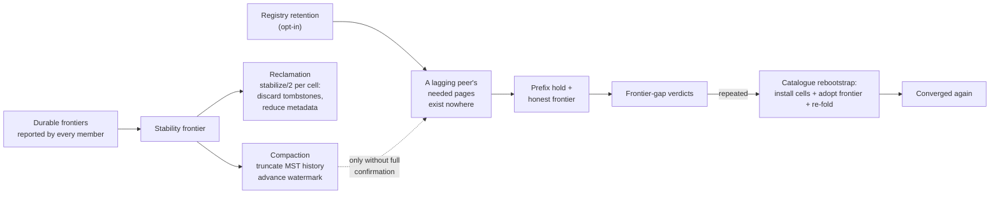
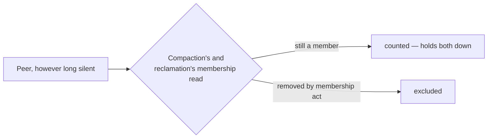

# Storage Runtime View: The Data Lifecycle

How history is bounded. An operation log grows with every write; this view
shows the machinery that decides what may be forgotten, forgets it, and
repairs a node that needed what everyone else forgot.

## Primary presentation

## Element catalog

| Element | Responsibility |
| --- | --- |
| Stability frontier | The license to forget: the largest local key such that every key at or below it is covered by every member's durable frontier, this replica's own included. A member's durable frontier is the applied frontier it last checkpointed and reported in a completed sync round (`bondy_oplog_peer_state`). With clustering enabled every member has to have reported one, and a membership that lists no other node licenses nothing. With clustering disabled (`cluster.enabled = off`) the node licenses itself alone ([clustering](../configuration/clustering.md)). |
| Compaction | Truncates MST history at or below the stability frontier and advances the watermark (`bondy_oplog_compaction`, run in the instance process). It truncates only what the applied frontier records as folded, so it changes no value. When the frontier walk meets a page the tree has lost, the walk returns `unservable` and licenses nothing; a `registry` shard then truncates to the larger of its largest readable key and its watermark, once every witness covers this replica's applied frontier, and emits `[bondy_oplog, instance, mst_rebuilt]`. A `main` shard truncates nothing in that case. |
| Reclamation | The per-cell half: each table's CRDT answers, through `stabilize/2`, what remains of a cell once nothing older can arrive — discard a tombstone, reduce ordering metadata, or keep. The license covers clock-governed reductions only; see [deletion and reclamation](../database/deletion_and_reclamation.md) and [rationale](db_rationale.md) for the proofs of that boundary. |
| Who confirms | On every database, the in-memory `registry` included, every cluster member, reachable or not, until a membership act (a Partisan `leave`) removes it. A down or partitioned member therefore holds compaction and reclamation back, and the writes each side of a partition accepted alone survive it. Meanwhile history grows, on disk for `main` and in memory for `registry`. `db.registry.retention.max_age_ms` and `db.registry.retention.max_events` (both off by default) bound the registry's history, at the cost of sending a lagging peer through rebootstrap. |
| Repair (rebootstrap) | The recovery path for any truncation that outruns a peer: registry retention or the rebuild of a `registry` tree that lost pages. The returning node's holds keep its frontier honest, the deficit produces gap verdicts, and repeated verdicts schedule a catalogue rebootstrap. The rebootstrap installs the peer's *materialised cells* — values survive compaction even though events do not — adopts the frontier the peer reported when every shipped cell landed, and re-folds the events its own tree holds that the frontier does not claim. |
| Bootstrap | The same install path, used at first join: a fresh instance takes a catalogue snapshot instead of paging through history it never had. |

## An episode, end to end

A node goes silent under registry write load, on a cluster with registry
retention enabled. Its peers truncate registry history past the retention
bound, history the silent node never pulled, and keep writing. The node
returns:

1. Its first complete round integrates the survivors' trees. The fold
   holds each truncated origin's later events
   (`bondy_oplog_events_held_total` rises), so no state skips operations.
2. Its frontier, which does not count held events, stays behind, and every
   round ends in a gap verdict.
3. The second verdict schedules a rebootstrap per affected shard. The cells
   install, the frontier is adopted, and the node's own events re-fold over
   the cells. Held events that the adopted frontier claims are skipped.
4. Frontiers equalise and the metrics go quiet.

## Variability guide

Every element above runs on a timer with a budget. The options set how often
a pass runs and how much one pass may do, with the values `bondy.conf` uses
when you set nothing.

### The sweeps

`db.reclaim.interval` (1 minute) spaces the reclamation passes and
`db.reclaim.batch_cells` (500) caps how many cells one pass scans, so a sweep
cannot monopolise an instance. `db.origin_retirement.interval` (10 minutes)
spaces the retirement of departed peers' origins, recorded under
`db.origin_retirement.path`. `db.reclaim` and `db.origin_retirement` turn each
sweep on or off.

Separately, every instance inspects its own heap every `db.gc_interval`
(2 seconds) and fullsweep-hibernates when the heap has grown more than
`db.gc_heap_delta` (16 MB) past its post-collection baseline. That returns
the transient apply and anti-entropy garbage a long-lived process would
otherwise hold until its next major collection.

### Liveness, read two ways

Compaction and reclamation read the membership with no recency filter, on
every database. A silent member holds them down until an explicit membership
act removes it; no timeout changes that. Registry retention is the one bound
on history that does not wait for members.

`db.gc_max_concurrency` (4) caps how many instances either sweep may cycle at
once. Reclamation runs a second instance of the scheduler that drives
compaction (`bondy_oplog_gc_scheduler`), and both read this cap; instances
over it are skipped that tick and retried on the next. Despite the shared
prefix, the cap has nothing to do with the `db.gc_interval` and
`db.gc_heap_delta` heap monitor.

## Rationale

Forgetting is the only irreversible operation here, so it is the only one
gated on confirmation from every member; holding, verdicts and rebootstrap
are reversible pressure toward convergence. Every database lets a silent
member hold forgetting back. In the TLA+ model of confirmed compaction, a
recency filter on the witnesses loses writes under a partition
(`proofs/tla/ConfirmedCompaction_3R_Fresh_Partition.cfg` checks `NoLoss`),
while counting every member is checked against the same invariant
(`proofs/tla/ConfirmedCompaction_3R_Partition.cfg`). The test
`bondy_oplog_compaction_fused_test:fused_compaction_waits_for_every_member/0`
checks that a silent member stops compaction. Registry retention is the
opt-in exception: an operator who would rather bound the registry's memory
forgets past a silent member, and the returning node takes the repair path
above.
