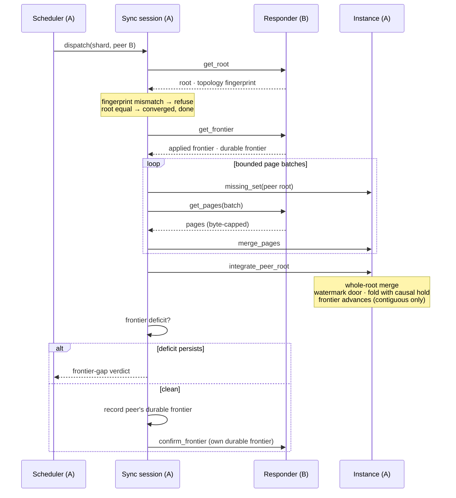

# Storage Runtime View: Replication

How one shard instance reconciles with its replicas: the sync round in
detail, from peer sampling to integration. The garbage-collection side of
the cluster relationship — stability, compaction, repair — is [the data
lifecycle](db_view_lifecycle.md).

## Primary presentation

## Element catalog

| Element | Responsibility |
| --- | --- |
| Scheduler (`bondy_oplog_sync_scheduler`) | Ticks every `db.aae.interval`, samples `db.aae.fanout` peers, and dispatches sessions under `db.aae.max_concurrency`. Adaptive live sync backs converged shards off; shards backing the authentication fence are exempt. It escalates repeated gap verdicts, a peer that can no longer serve needed pages, and a peer whose root stays unservable into rebootstraps. |
| Sync session (`bondy_oplog_sync_session`) | One shard, one peer, one round, pull-only. It checks that the peer's keying-topology fingerprint matches its own before pulling anything. It pins the peer root against its **own** node's page collection for the round: until the final integrate, the pages pulled in earlier batches are unreachable from the local root, and a concurrent compaction cycle could otherwise collect them. It pulls and merges missing pages in batches of `db.aae.max_pages_in_flight ÷ db.aae.max_concurrency` pages, byte-capped below the Partisan frame limit, so peak memory is bounded however divergent the trees are. If the peer compacts mid-session, it chases the refreshed root. Only a round that held the peer's whole tree integrates, judges frontiers, or records the peer's durable frontier. |
| Responder (`bondy_oplog_responder`) | The serving side: answers roots, frontiers, origins, and pages, and stamps root and frontier replies with this node's keying-topology fingerprint. `get_frontier` waits until the local drain has installed what the frontier claims, so a frontier does not claim what the tree cannot ship. `get_root` answers `undefined` only for an empty tree; when its own root references a missing page, it answers an error and the session fails for a retry. |
| Peer state (`bondy_oplog_peer_state`) | Per peer and instance: the durable frontier the peer last reported, and when it last synced. The initiator records the peer's frontier on a completed round, and the peer records the initiator's through `confirm_frontier`. Compaction and reclamation read only these rows, for every member, on every database ([lifecycle](db_view_lifecycle.md)). |
| Integration | Merges the peer tree into the local tree in one step, then passes the **watermark door**: an event at or below the local watermark leaves the tree only once this replica folded it and every member's durable frontier covers it, so a member that lacks it can still pull it here. The new events are then folded in key order with the **causal hold**: a remote origin's events beyond a contiguity gap, and any event whose context observed one, are excluded from the fold and the frontier and re-presented until the gap fills or repair supplies them. An event the frontier already claims is skipped, so a re-presented event changes nothing. On a `registry` shard the fold runs inside the instance; on a `main` shard the instance asks the applier to replay. |

## What a round guarantees — and refuses to claim

A completed round means this node holds every page of the root it completed
against, every event in that tree is folded or deliberately held, and the
frontier comparison that follows is honest, because held events are not
counted. An incomplete round — budget exhausted, peer truncated mid-session,
pages unavailable — records nothing. Every cluster-wide license in the
[lifecycle view](db_view_lifecycle.md) rests on the recorded durable
frontiers, so a round that did not complete is meant to contribute nothing to
them.

## Variability guide

Anti-entropy is background work subordinate to routing, and its options say
how subordinate. Each plate marks them on the geometry they govern, with the
values `bondy.conf` uses when you set nothing.

### The page budget, and what concurrency does to it

`db.aae.max_pages_in_flight` (2048) is the node-wide ceiling on
reconciliation pages held at once, and it is the option that bounds peak
memory. `db.aae.max_concurrency` (3) divides that ceiling instead of adding
to it: each session fetches at most budget ÷ concurrency pages per round.
Raising concurrency therefore buys fairness — more shards make progress at
once, each more slowly — and never more memory. `1` serialises anti-entropy,
which is simplest but lets a busy node starve some shards.

`db.aae.interval` (500 ms) spaces the ticks and `db.aae.fanout` (3) sets how
many peers one tick reaches. When `db.aae.load_adaptive` is on (off by
default), a run queue at or above `db.aae.load_run_queue_threshold` (2.0) per
scheduler makes anti-entropy yield its throttleable dispatches for that tick.
The signal is smoothed, so a momentary burst does not flap the yield.

### Cadence, and the fence that reads freshness

A converged instance widens its live-sync cadence from `db.aae.interval`
toward `db.aae.live_sync.max` (5 seconds), and returns to base when its root
moves again. Setting `db.aae.live_sync` to `off` turns that backoff off.

`db.aae.fence.max_lag` (60 seconds) bounds how stale this node's view of the
security tables may be before it refuses all new authentication, regardless
of method. The fence is a no-op when `db.aae` is off, because local writes
are then synchronous and no cross-node staleness window exists. The sync
session produces the freshness signal, honouring `db.aae.fence.on_isolation`;
authentication only reads it. A node with clustering disabled
(`cluster.enabled = off`) always certifies itself fresh. With clustering
enabled, a node with no reachable peer certifies itself only as the policy
allows: `refuse` (the default) never, `proceed` always, `quorum` while it is
connected to a majority ([clustering](../configuration/clustering.md#running-a-single-node)).

## Rationale

Pull-only rounds over a deterministic tree make the steady state one
root-hash exchange and catch-up proportional to the difference. The page
budget is node-wide so memory does not scale with shard count; the byte cap
stays under the mesh's frame limit so no reply can wedge a channel. The
watermark door and the causal hold follow one rule — *hold, never drop,
never fold out of order* — because each guards a case where a cheap filter
(key below watermark; seq beyond a gap) would silently destroy the events
that matter most: the ones only one side has.
