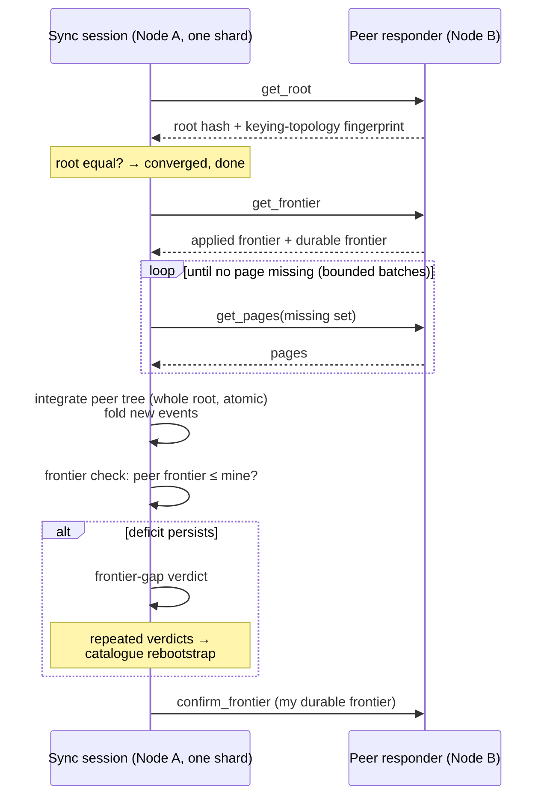
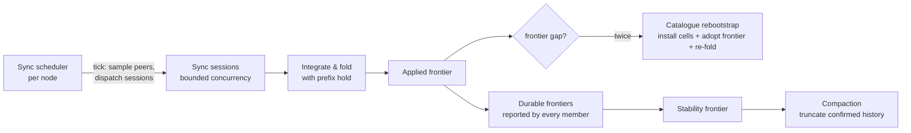

# Runtime View: Convergence and Repair

This view shows how shards on different nodes come to hold the same event
set — and what happens when they cannot. It answers "how does anti-entropy
work?", "how is divergence detected?", and "what repairs a node that fell
too far behind?". It is the cluster-wide continuation of [the state
plane](view_state_plane.md).

Bondy has no consensus round and no causal-broadcast middleware. Replication
is **pull-only anti-entropy**: each node periodically reconciles each shard
with sampled peers, and every mechanism below exists to make that loop safe,
including safe to garbage-collect under.

## Primary presentation

## Element catalog

| Element | Responsibility |
| --- | --- |
| Sync scheduler (`bondy_oplog_sync_scheduler`) | Ticks every `db.aae.interval` (500 ms by default), samples `db.aae.fanout` peers, and dispatches per-shard sync sessions under a node-wide concurrency cap. Converged shards back off (`db.aae.live_sync`); shards backing the authentication fence do not. It escalates repeated failures into a catalogue rebootstrap. |
| Sync session (`bondy_oplog_sync_session`) | One shard, one peer, one round, pull-only. It pulls the peer's root, then missing MST pages in bounded batches (memory is capped node-wide whatever the shard count), and integrates only when it holds the peer's *whole* tree. On completion it records the peer's durable frontier and sends its own to the peer (`confirm_frontier`). |
| Integration & fold | Merges the peer's tree and folds the new events through the same fold module local writes use: inline on a `registry` shard, in the applier on a `main` shard. The fold enforces [per-origin prefix closure](../database/prefix_closure.md): an origin's events beyond a contiguity gap are held, re-presented until the gap fills or repair supplies them, and not counted by the frontier. |
| Applied frontier | Per shard, per origin: the highest folded sequence. It reads as a contiguous prefix because the hold never lets this path fold past a gap. The convergence metrics compare applied frontiers across nodes. |
| Frontier-gap detection | After a complete round, a peer frontier still ahead of the local one, per origin, is a verdict: the peer applied events this node can no longer obtain by page sync. One verdict may be transient; a second within two minutes schedules repair. |
| Catalogue rebootstrap | The repair. The node installs the peer's materialised cells, takes the frontier the peer reported before the transfer when every shipped cell landed (an empty frontier otherwise), then re-folds the events its own tree holds that the frontier does not claim. While it owes that re-fold, the node serves neither a snapshot nor its frontier to peers. The scheduler also schedules it when a peer can no longer serve pages this node needs, and after three consecutive rounds in which a peer that is ahead cannot serve its root. |
| Stability frontier & compaction | The garbage-collection license: the largest local key such that every key at or below it is covered by every member's **durable frontier** — the applied frontier that member last checkpointed and reported. History at or below it may be truncated and tombstones reclaimed. Every cluster member counts, reachable or not, until a membership act removes it. Registry retention (off by default) and the rebuild of a `registry` tree that lost pages truncate without that full confirmation; they are why the frontier-gap and rebootstrap pair exists. |

## The failure that shapes this view

Truncation and lag can interleave. A node falls silent. With registry
retention enabled, its peers truncate registry history past it and keep
writing; without retention, every database waits for the silent node. When
the silent node returns, the history between its position and the truncation
point exists nowhere as pages. Three mechanisms keep this episode from
corrupting state:

1. The **hold** keeps the returning node from folding the survivors'
   *later* events over the missing gap, so no read sees a state that
   skips operations.
2. The **frontier**, unable to advance past the hold, keeps the deficit
   visible to the gap check on every round.
3. The **rebootstrap** repairs from the peer's materialised cells — the
   values survive, even though the events that produced them do not — and
   re-folds the node's own retained events over them.

The visible arc in the metrics: a burst of held events
(`bondy_oplog_events_held_total`) on the returning node, frontier-gap verdicts
(`bondy_oplog_frontier_gap_verdicts_total`), one scheduled rebootstrap per
affected shard (`bondy_oplog_rebootstraps_scheduled_total`), then quiet. The
cluster test
`bondy_oplog_compaction_cluster_SUITE:truncated_prefix_is_held_and_repaired_by_rebootstrap/1`
drives this episode on three nodes and checks that no hole is folded and that
the returning node converges.

## Rationale

Pull-only reconciliation over Merkle trees was chosen over broadcast because
a converged shard exchanges one root hash, catch-up moves only missing pages,
and no delivery middleware adds failure modes of its own. The cost is that
guarantees usually delegated to broadcast — stability for garbage
collection, per-origin order at the fold — have to be rebuilt from what
anti-entropy can confirm. The stability frontier and the prefix hold are
those rebuilds. [Rationale: robustness](architecture_rationale.md) names the
models and proofs that check them.

## Related views

- The shard being synchronised: [the state plane](view_state_plane.md).
- Timers, channels, and the metrics these elements emit: [deployment](view_deployment.md).
- The reclamation license in depth: [deletion and reclamation](../database/deletion_and_reclamation.md).
