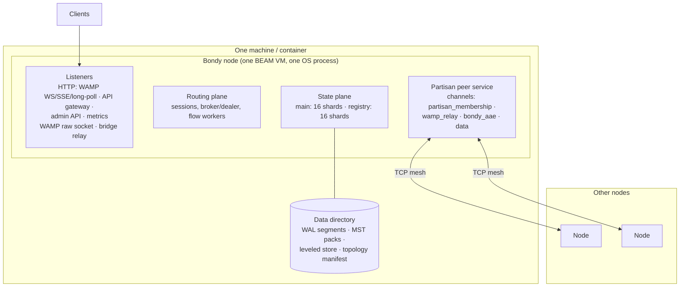

# Allocation View: Deployment

This view maps the runtime elements of the other views onto machines: the
OS process, its sockets, its disk, and the cluster mesh. It answers "what do
I run, what do I open, what do I back up, and what does the cluster look
like on the network?".

## Primary presentation

## Element catalog

| Element | Allocation facts |
| --- | --- |
| The node | One Erlang/OTP release, one OS process. Every node runs the same release with the same responsibilities — there are no roles to assign and no master to elect. Configuration is `bondy.conf`, which the release renders at boot. |
| Listeners | Named listeners (`listeners.$name.*`). Each binds a transport (`tcp`, `tls` or `uds`) and a protocol (`http`, `wamp_rawsocket` or `bridge_relay`). An `http` listener carries a list of services: WAMP over WebSocket, SSE and long-poll, the API gateway, the admin API, health probes, Prometheus metrics, and MCP. The default inventory is an `admin` listener on port 18081, an `api_gateway_http` listener on 18080, and a `wamp_tcp` raw-socket listener on 18082. |
| Partisan mesh | Node-to-node connectivity over TCP connections managed by Partisan, *outside* Erlang distribution, as a full mesh by default. Traffic is separated into named channels, each with its own parallelism and compression: `wamp_relay` carries the WAMP data plane (one connection per flow, pinned by partition key), `bondy_aae` carries anti-entropy sync, `partisan_membership` carries cluster control, and `data` carries the remainder. `cluster.channels.{wamp_relay,control_plane,data,default}.*` tune all but `bondy_aae`, which keeps its built-in setting. Peer discovery (static seeds, DNS) forms the mesh; membership changes propagate through it. |
| Data directory | Everything a durable node owns at rest: for each `main` shard, its WAL segments, its MST pack files and its persisted origin; the `leveled` stores holding the durable projections; and the keying-topology manifest that pins how keys map to shards. This directory is the unit of backup and the thing a re-keyed or re-provisioned node wipes. The `registry` database writes nothing here. |
| Metrics endpoint | Prometheus text format on the `metrics` service (`/metrics`). The convergence view's elements are observable: sync sessions, frontier-gap verdicts, rebootstraps, held events, compaction. |

## Placement and sizing

- **Shards × nodes**: every node hosts every shard of both databases; a
  shard's replicas are its instances on the other nodes. A new node joins
  replication through a catalogue bootstrap of each shard.
- **Cluster size**: replication is full — each node holds the routing view
  and the entire `main` database — so the cluster scales for routing
  throughput and availability, not for data volume.
- **Resources**: explicit caps bound the state plane's memory: anti-entropy
  page budgets are node-wide, and overlay and working-set caps are per
  shard. Durable storage and client sockets both consume file descriptors,
  so size the descriptor limit for both.

## Failure allocation

What fails together, and what a failure costs:

| Failure | Blast radius | Recovery |
| --- | --- | --- |
| One connection process | That client | The client reconnects; `bondy_session_manager` sees the process exit and removes the session's registrations and subscriptions |
| One shard's process | One shard on one node: the instance, WAL writer and applier restart together | `main`: the WAL replays into the projection. `registry`: peers resupply through anti-entropy |
| One node | Its clients reconnect elsewhere; the cluster routes on. While it stays a member, compaction and reclamation wait for it | On return: anti-entropy catch-up, or a catalogue rebootstrap if registry retention truncated history past it ([convergence](view_convergence.md)) |
| Network partition | Each side keeps routing locally; replication, compaction and reclamation pause across the cut | On heal: anti-entropy reconciles. Authentication freshness during the cut follows the fence policy (`db.aae.fence.on_isolation`) |

## Rationale

Uniform nodes are the operational thesis: any node can be drained, killed,
replaced, or added without ceremony, because nothing unique lives on it.
Durable state is on every node, ephemeral state is regenerated, and two
nodes check each other's keying topology before they sync. Partisan instead
of Erlang distribution keeps cluster traffic on channels the operator can
size and observe, and keeps bulk data from queuing behind control messages.

## Related views

- What the shards contain: [the state plane](view_state_plane.md).
- What the mesh carries: [the routing plane](view_routing_plane.md) (relay), [convergence](view_convergence.md) (sync).
- Every option named here: the configuration reference.
