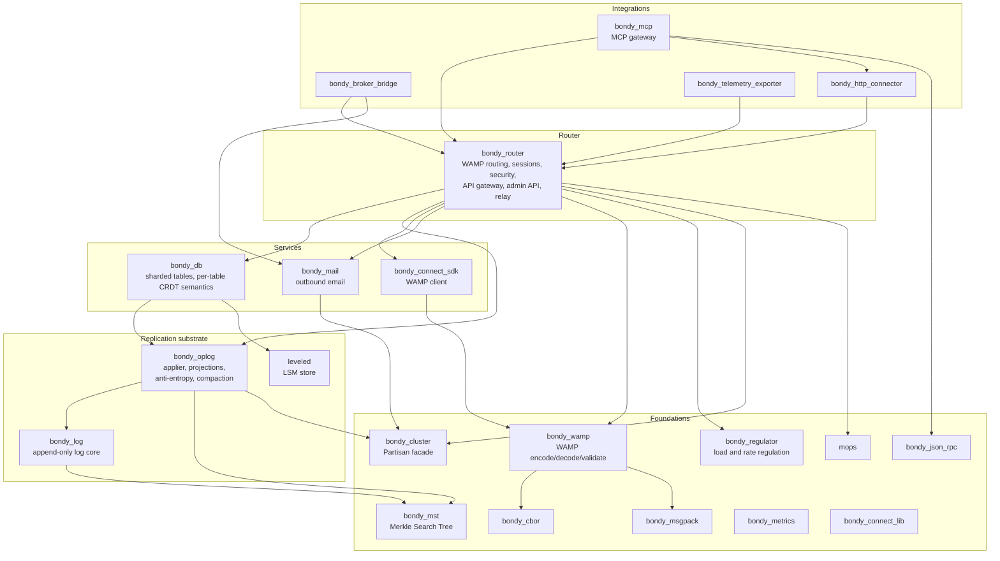

# Module View: Decomposition and Layering

This view shows Bondy's static structure: the OTP applications the system
decomposes into, and the *uses* relation between them. It answers "where does
a given responsibility live?" and "what is this application allowed to depend
on?". It says nothing about runtime — for that, see [the routing
plane](view_routing_plane.md) and [the state plane](view_state_plane.md).

## Primary presentation

An arrow means *uses*: the source calls the target's functions. The diagram
omits `bondy_connect_lib` and `bondy_metrics`, which most applications use,
and a few secondary edges listed in the catalog.

The relation is meant to be acyclic. `scripts/check_layering.escript`, run by
`just xref-layering`, checks two parts of it on the static call graph:

- In the storage stack, each of `bondy_db`, `bondy_oplog` and `bondy_mst`
  calls only the applications below it.
- Only `bondy_cluster` calls the Partisan service modules.

No tool checks the rest of the graph.

## Element catalog

| Application | Responsibility |
| --- | --- |
| `bondy_router` | The WAMP router: sessions, the broker and dealer roles, the Routing Information Base, security (realms, authentication, RBAC), listeners, the HTTP API gateway, the admin API, and node-to-node relay. It opens the storage databases through the catalogue (`bondy_namespace_catalog`). |
| `bondy_wamp` | The WAMP protocol as a library: message records, encodings (JSON, MessagePack, BERT, CBOR, Erlang terms), URI and option validation. Its supervisor starts no children. |
| `bondy_cbor`, `bondy_msgpack` | The CBOR and MessagePack codecs that `bondy_wamp` uses. Each depends only on the standard library. |
| `bondy_json_rpc` | A JSON-RPC 2.0 codec with no transport, used by `bondy_mcp`. |
| `mops` | The expression language of API gateway and broker bridge specifications. |
| `bondy_db` | The storage facade: named tables with per-table CRDT semantics over sharded, replicated instances, and the two databases — durable `main` and ephemeral `registry`. It calls `bondy_mst` only for its file-durability helpers (`bondy_mst_io`). |
| `bondy_oplog` | The replication substrate under every table: the per-shard instance, the applier that folds operations into projections, Merkle-tree indexing of history, anti-entropy, compaction and reclamation. It does not interpret operations: the CRDT modules that give them meaning are callbacks. |
| `bondy_log` | The append-only log core: the segment writer with group-commit fsync, rotation, sparse index, manifest, recovery and scrubber. The oplog's write-ahead log (`bondy_oplog_wal`) is this writer opened with an oplog adapter. |
| `bondy_mst` | The Merkle Search Tree: a page-oriented, content-addressed ordered map whose root hash summarises its contents, used for set reconciliation between peers. |
| `leveled` | The LSM-tree store that holds durable shards' projections. A third-party dependency (`bondy-io/leveled`). |
| `bondy_cluster` | The cluster as every application reaches it, over Partisan: membership, connectivity, and whether clustering is enabled. |
| `bondy_connect_sdk` | A supervised, multi-session WAMP client. It does not depend on `bondy_router`; the router implements its local-transport handler (`bondy_connect_local_handler`) for co-located clients. |
| `bondy_regulator` | Load and memory monitors (`bondy_regulator_load`, `bondy_regulator_memory`) and token-bucket rate limiting, read at session admission and by rate-limit policies. |
| `bondy_mail` | Outbound email: relay configuration, queueing and delivery. With no relay configured its supervisor starts no children and calls answer `{error, not_configured}`. It sits below the router and is told which module resolves a realm's prototype (the `realm_module` environment key) instead of calling up into one. |
| `bondy_metrics` | Wait-free counters, gauges and histograms over `counters` and `atomics`, with a declaration registry for exposition. |
| `bondy_connect_lib` | Types and utilities shared by all layers, including the hybrid logical clock (`bondy_connect_hlc`). |
| `bondy_broker_bridge` | Forwards WAMP events to external systems (Kafka, AWS SNS, SMTP, Mailgun, SendGrid). |
| `bondy_http_connector` | Invokes upstream HTTP services as WAMP callees. |
| `bondy_mcp` | Serves Model Context Protocol endpoints and translates MCP requests into WAMP routing. It also reads `bondy_db` and `bondy_oplog` directly. |
| `bondy_telemetry_exporter` | Exports telemetry to Prometheus and OpenTelemetry. It also reads `bondy_oplog`, `bondy_db` and `bondy_cluster`. |

## Interfaces between layers

Three seams carry most inter-layer traffic:

- **`bondy_router` → `bondy_db`**: named-table operations (`read/3`,
  `apply/4`, `apply_async/4`, `apply_batch/4`, `fold/6`, `range/5`, index
  queries). The router names a table, a realm and a key. The router also calls
  `bondy_oplog` directly for operational reads and subscriptions: applied
  frontiers, instance listings, change feeds (`bondy_oplog_core:subscribe/2`)
  and index-key encoding.
- **`bondy_db` → `bondy_oplog`**: append operations to an instance's log and
  read the instance's projection. `bondy_db` supplies the CRDT modules and the
  leveled projection adapter as options, so `bondy_oplog` drives them at
  runtime without a static call into `bondy_db`.
- **`bondy_oplog` → `bondy_mst`**: insert and look up history by key, diff two
  roots, serve and integrate pages. The tree does not know that it indexes an
  operation log or that peers exist.

## Rationale

The layering exists so that each hard problem has one home that cannot reach
upward for help. The substrate cannot consult WAMP semantics to decide
convergence, so its convergence rules apply to every table. Sharding,
replication and repair live below the facade, so they can change without
touching routing code. A cycle in the uses relation is a defect.

Two consequences help when navigating the code: anything about *what a message
means* lives in `bondy_router`, `bondy_wamp` or an integration, never in the
storage stack; anything about *how state converges* lives in `bondy_oplog` or
below.

## Related views

- Runtime shape of `bondy_router`'s processes: [the routing plane](view_routing_plane.md).
- Runtime shape of `bondy_db` and `bondy_oplog`: [the state plane](view_state_plane.md).
