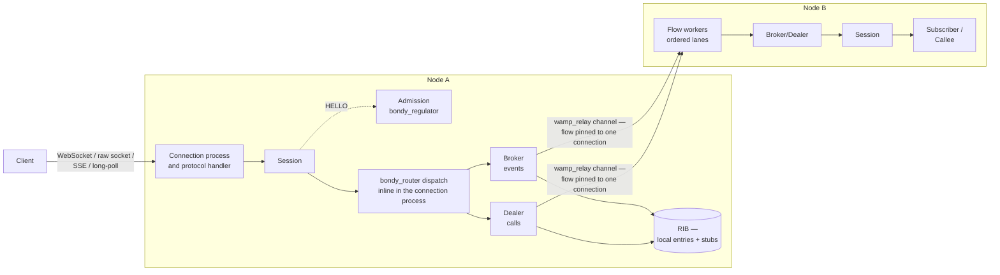
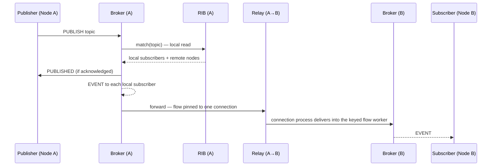

# Runtime View: The Routing Plane

This view shows the components and connectors that move a WAMP message from
a client to its recipients — the data plane. It answers "what happens when a
client publishes, subscribes, calls, or registers?", on one node and across
nodes. Storage internals are a single element here ("the RIB"); their own
structure is [the state plane](view_state_plane.md).

## Primary presentation

## Element catalog

| Element | Responsibility |
| --- | --- |
| Connection process and protocol handler | One process per connection (`bondy_wamp_ws_connection_handler`, `bondy_wamp_tcp_connection_handler`, and the SSE and long-poll handlers). It owns the socket, decodes frames with `bondy_wamp`, and writes replies. The raw-socket handler sends a batch of outgoing messages in one `send` call. A WebSocket connection hibernates when idle, as its configuration allows. |
| Session | The WAMP session state machine (`bondy_wamp_protocol`): establishment (HELLO, CHALLENGE, WELCOME), authentication against the realm's security tables, role negotiation, and teardown. `bondy_session_manager` workers store sessions and monitor each owning connection process, so a crashed connection's session is cleaned up. |
| Admission (`bondy_regulator`) | Read at HELLO, before any realm lookup or authentication. When `bondy_regulator_load` reports the node busy, or `bondy_regulator_memory` reports memory high, the protocol handler refuses the HELLO with an ABORT the client can retry (`load_regulation.hello.enabled`, on by default). A per-source-IP handshake throttle (`bondy_rate_limit`, off by default) follows for admitted HELLOs. |
| `bondy_router` dispatch | Receives every in-session message and forwards it to the role that owns it. Client-submitted messages are handled **synchronously in the connection process that received them**, so a source's messages are routed in submission order and a loaded router slows that connection instead of queueing work. Only CALLs to `wamp.*` and `bondy.*` procedures go to the regulated `router_pool`; when that pool is at capacity, the call runs synchronously instead. |
| Broker | The Publish/Subscribe role (`bondy_broker`): matches a PUBLISH against subscriptions (exact, prefix, wildcard), emits an EVENT per local subscriber, and forwards one copy to each remote node that has a matching subscription. |
| Dealer | The routed-RPC role (`bondy_dealer`): matches a CALL against registrations, applies the invocation policy (single, round-robin, ...), and threads CALL → INVOCATION → YIELD → RESULT, including progressive calls and progressive results. |
| RIB | The Routing Information Base, in two parts. A node's own subscriptions and registrations live in node-local tables (`bondy_registry_store`, with a trie for matching). For each `(realm, match policy, URI)` it serves, the node also writes one summary cell into the replicated `registry` database (`bondy_registry_rib`). Peers turn the cells they receive into **stubs** that name the nodes able to serve a URI. Matching reads only local tables and stubs, so the read path makes no network call. See [Registry routing](../router/registry_routing.md). |
| Flow workers (`bondy_router_worker`) | A pool of ordered lanes on the **receiving** side of the wire. Messages relayed from another node, and bridge-relay ingress, are keyed by the source and destination pair, so a flow lands on one worker and keeps its wire order through local delivery while unrelated flows proceed in parallel. When a worker's share of the pool's capacity is in use, the message is shed and counted (`bondy_wamp_dropped_total{reason="shed"}`). |
| Relay (`bondy_relay`) | Node-to-node WAMP forwarding over the `wamp_relay` Partisan channel. Egress is plain functions in the calling process: the message is addressed to `{via, bondy_router_worker, PartitionKey}`, and the key pins the flow to one channel connection. On the receiving node the channel's connection process resolves the key to the owning worker and delivers into its mailbox; no relay process sits on ingress. |

## Connectors

- **Client ↔ node**: WAMP over WebSocket, raw socket (TCP, TLS or a Unix
  domain socket), Server-Sent Events or HTTP long-poll, with any negotiated
  WAMP serialiser. Co-located clients built on `bondy_connect_sdk` can also use
  an in-VM transport.
- **Within a node**: process messages. Client-submitted work runs in the
  connection process, peer-relayed work in the flow pool's ordered lanes, and
  the owning connection process writes replies.
- **Between nodes**: Partisan channels — TCP connections outside Erlang's
  built-in distribution. Relay traffic has its own channel with configurable
  parallelism (`cluster.channels.wamp_relay.*`), so it does not queue behind
  cluster control messages.

## A publish, end to end

The publisher's acknowledgement does not wait for remote delivery. Three
stages, each already serial, carry the order between a publisher and a
subscriber: the publisher's connection process submits in order, the
partition key pins that publisher's relayed publications to one channel
connection, and the receiving node replays them through one flow worker. For
a PUBLISH the destination is a node rather than a session, so the key is per
publisher. That is enough, because the receiving node creates the EVENTs for
all its local subscribers from the one relayed PUBLISH.

## Rationale

Three decisions shape this plane. *Every node holds the routing view*: local
entries plus a stub for each URI a peer serves. That gives a local read on the
hottest path (every call and publish), at the price of replicating one
summary cell per node and URI — a price the state plane is built to pay.
*Order carried by the pipeline rather than by a serialising process* gives
exactly what WAMP promises (order per pair) and nothing more: the connection
process, the pinned channel connection and the keyed flow worker are each
serial already, so no extra coordination is needed and unrelated traffic runs
in parallel. *Refusal at admission* sheds sessions the node cannot serve at
the cheapest point, which protects sessions already admitted — see [rationale:
robustness](architecture_rationale.md).

## Related views

- Where the RIB's cells live and how they replicate: [the state plane](view_state_plane.md), [convergence and repair](view_convergence.md).
- Sockets, channels, and their configuration: [deployment](view_deployment.md).
