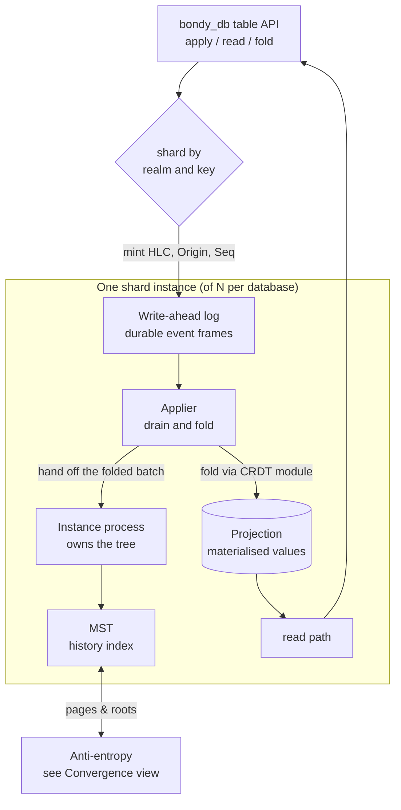

# Runtime View: The State Plane

This view shows how one node stores and serves replicated state: the path a
write takes from a table operation to a durable, readable value, and the
anatomy of a shard. It answers "what happens on `bondy_db:apply/4`?" and
"what am I looking at on disk and in memory?". Cross-node behaviour is [the
next view](view_convergence.md).

## Primary presentation

The diagram shows a `main` shard. A `registry` shard runs the drain, the fold
and the install inside the instance process itself, with no separate applier.

## Element catalog

| Element | Responsibility |
| --- | --- |
| Table API (`bondy_db`) | Names a table, realm, and key; resolves the shard; issues the operation the table's CRDT declares. A batch (`apply_batch/4`) is atomic within one shard. |
| Shard instance (`bondy_oplog_instance`) | The unit of replication and the owner of the MST. It mints and signs event keys `{HLC, Origin, Seq}` — hybrid logical clock, this shard's replica identity, a contiguous sequence number — or lets an eligible caller mint them in its own process. It installs folded batches into the MST and serves the tree to peers. A database is a fixed set of shards (16 by default), each replicating independently with its peers. |
| Write-ahead log | A `bondy_log` segment writer, one process per shard. It appends already-minted events as all-or-nothing frames and knows nothing of the tree. A `main` shard's log fsyncs as `db.wal.fsync_mode` sets; a `registry` shard's log is in memory and never fsyncs. |
| Applier | On a `main` shard, a process of its own (`bondy_oplog_applier`). It drains the log, re-verifies each event's signature, and *folds* it into the projection through the table's CRDT module, then hands the batch to the instance to install. On a `registry` shard the instance does this itself. Events received through anti-entropy reach the same fold module, so local and replicated writes are interpreted by the same code. |
| Projection | The materialised current value per cell; reads return it. `registry` shards keep it in ETS; `main` shards persist it in `leveled`. Reads do not touch the MST or the log. |
| MST | The shard's history, indexed as a Merkle Search Tree ordered by event key. Its root hash summarises the shard's operation set. It serves pages to syncing peers and integrates theirs. |
| CRDT modules | Per-table semantics: registers (last-writer-wins, max, min, multi-value), counters, add-wins and remove-wins sets and maps, grow-only and two-phase sets, flags, and structs. Each declares how concurrent operations resolve and what metadata its cells carry; the substrate stays semantics-free. |

## The two databases

| | `main` | `registry` |
| --- | --- | --- |
| Contents | Realms and realm keys, users, groups, memberships, grants, sources, tickets and OAuth tokens, API gateway specifications, interface metadata, retained messages, bridge-relay and MCP configuration | The RIB summary cells: one per `(realm, match policy, URI, node)` |
| Shard pipeline | Instance, WAL writer, applier, scrubber (`bondy_oplog_instance_sup`) | Instance and in-memory WAL; the instance drains and folds |
| Projection | Durable (`leveled`); MST pages in a pack store on disk | Ephemeral (ETS); MST in memory; refilled from peers after a restart |
| Write profile | Low rate, correctness-critical | High rate, session-lifetime churn |
| Sharding | `db.main.shard_count`, placement by `db.main.partition_strategy` | `db.registry.shard_count` |

The split is deliberate. Session-lifetime state has no business on disk: a
restarted node's old registrations are dead, and it learns the live ones from
its peers. Security state has no business being lost.

## Write and read contracts

The facade offers two acknowledgement points. `apply/4` returns once the
shard has installed that write: folded it into the projection and published
it in the tree. A subsequent `read/3` therefore observes it. `apply_async/4`
returns as soon as the log accepts the write — durably, on `main` shards —
and leaves the fold to happen behind the caller. If the log rejects a write,
its staged effects roll back, and the reserved sequence range returns to the
counter when it is still the topmost reservation. A range that cannot return
is backfilled with no-op `seq_fill` events, so the shard's sequence has no
gap.

A reader on the writing node observes the write when `apply/4` returns; a
reader on another node observes it after replication. Bondy is eventually
consistent across nodes. Authentication, which is sensitive to staleness, is
fenced explicitly (see [rationale](architecture_rationale.md)).

The fold maintains, per shard, an **applied frontier**: for each origin, the
highest sequence folded. It advances only after the projection write returns,
so it does not claim more than the projection holds. It reads as a contiguous
prefix because of what feeds it: locally minted sequences are contiguous, and
the replication fold holds a remote origin's events behind any gap instead of
folding past it ([per-origin prefix closure](../database/prefix_closure.md)).
The convergence view builds on this frontier.

## Rationale

One log, one fold path, and one projection per shard keep the invariants small
enough to state. Every replica folds the same events through the same CRDT
module, so replicas that hold the same event set are meant to hold the same
values, and convergence reduces to *event-set* agreement — which the
[convergence view](view_convergence.md) provides. Materialising a projection,
rather than folding on read, puts the fold's cost at write time and makes the
read path a lookup, which the routing plane's per-message RIB reads need.

## Related views

- How shards on different nodes reach the same event set: [convergence and repair](view_convergence.md).
- What the log, projection, and tree occupy on a machine: [deployment](view_deployment.md).
- How history is discarded: [deletion and reclamation](../database/deletion_and_reclamation.md).
